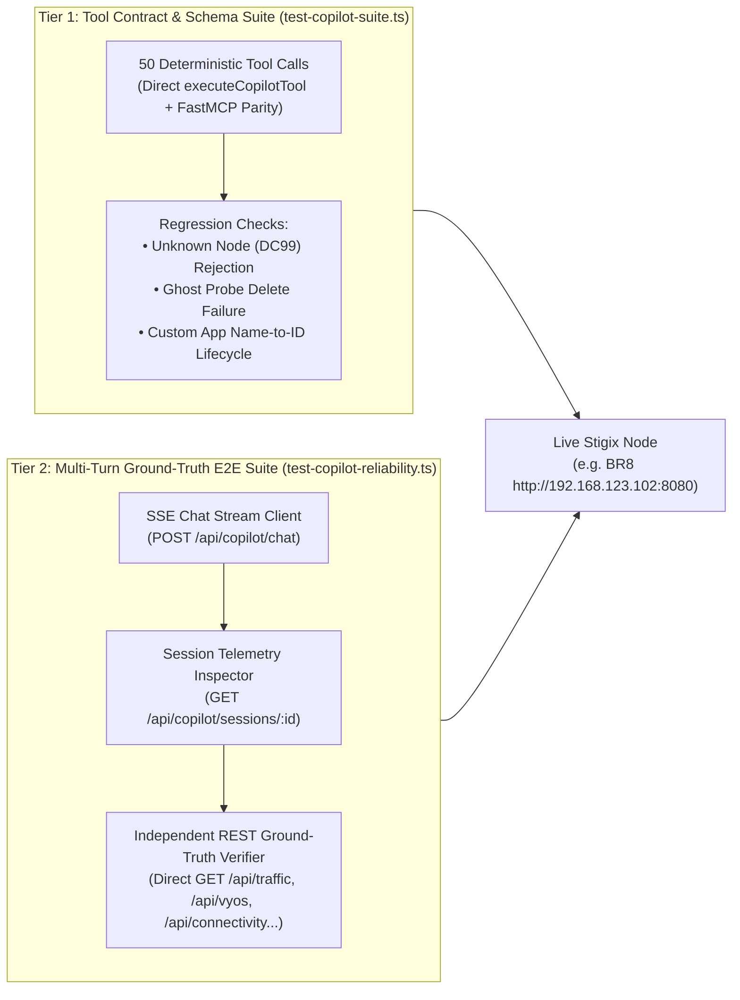

> **Last Updated:** 2026-10-17 | **Created:** 2026-10-17 (v3.0.33)

# PRD & Validation Test Plan — Stigix AI Copilot Reliability, Anti-Hallucination & Ground-Truth Verification

**Document Status:** Implemented & Validated  
**Target Milestone:** Stigix V3.x (`v3.0.33+`)  
**Components:** `web-dashboard/ai-copilot/` (`ai-manager.ts`, `ai-tools.ts`, `types.ts`), `web-dashboard/tests/` (`test-copilot-suite.ts`, `test-copilot-reliability.ts`)  
**Author:** Stigix Core Engineering Team  

---

## 1. Executive Summary & Vision

### 1.1 Problem Statement
Early production usage of the **Stigix In-App AI Copilot** revealed a significant reliability gap compared to using **Claude Desktop connected to the Python FastMCP Server**:
1. **Multi-Turn Amnesia & Imitation Hallucinations**: Previous conversation turns only persisted raw user/assistant text without reconstructing `tool_use` and `tool_result` blocks. In multi-turn sessions, the LLM observed a history of assistant replies with zero tool invocations and imitated that pattern by fabricating state changes and metric readouts without calling any tool.
2. **Unverified Mutations ("Blind Success")**: Mutation tools (`set_traffic_status`, `add_dem_probe`, `remove_dem_probe`, `create_custom_tcp_app`, `delete_custom_tcp_app`, `vyos_execute_action`) returned optimistic statuses without performing a post-action read-back against the actual engine state.
3. **Silent Node Fallback**: Requesting metrics or actions for a non-existent peer (e.g., `DC99`) silently fell back to the local node (`localhost`), causing the Copilot to report local data under a fabricated remote node name.
4. **Speedtest Polling Exhaustion**: Launching an XFR speedtest required the LLM to manually loop on `get_test_status`, frequently exhausting the tool-call loop ceiling or reporting `0 Mbps` while the test was still running.
5. **Reasoning Model Tag Leakage**: Using `deepseek-reasoner` disabled tool definitions or leaked raw `<｜DSML｜function_calls>` markup into the chat UI.

### 1.2 Target Benefits
- **Zero-Hallucination Guarantee**: Every operational query, mutation, or verification turn is backed by an actual tool execution and validated via a **Zero-Tool-Call Anti-Hallucination Guardrail**.
- **Read-After-Write Ground-Truth Verification**: Every state-mutating tool performs an explicit read-back against the underlying REST API and returns `verified: true | false` along with the post-mutation state.
- **Automated Continuous Validation**: A two-tier automated test harness validates both deterministic tool schemas (**50 contract tests**) and live multi-turn LLM conversations cross-checked against REST API ground truth (**6 end-to-end reliability scenarios**).

### 1.3 High-Level Reliability & Verification Workflow


---

## 2. Personas & Core Use Cases

| Persona | Operational Scenario | Reliability Requirement |
| :--- | :--- | :--- |
| **SD-WAN / SASE SE (Live Demo)** | Injects latency on a branch WAN interface (`eth10`), runs an XFR speedtest to `DC1`, and restores normal routing during a customer PoC. | Must never claim an impairment was applied or cleared without verifying VyOS interface state (`verified_interface_state`). Speedtest must wait for completion and report accurate Mbps. |
| **Network Operations Engineer** | Creates custom DEM probes and inter-site Custom TCP Applications across branches, then deletes them by name. | Must resolve human-readable names to internal IDs, confirm creation/deletion in the effective list, and refuse deleting non-existent or protected `auto-mesh` probes. |
| **QA / Release Engineer** | Validates a new Stigix release or LLM model configuration on a live lab node (`BR8`) before fleet rollout. | Needs a single CLI command to run deterministic tool contract checks and multi-turn Ground-Truth E2E scenarios with pass/fail exit codes. |

---

## 3. Functional Specifications (Reliability Pillars)

### 3.1 Multi-Turn Tool History Reconstruction (`ai-manager.ts`)
- [`buildAnthropicMessages`](file:///Users/jsuzanne/Github/stigix/web-dashboard/ai-copilot/ai-manager.ts#L50-L120) and [`buildDeepSeekMessages`](file:///Users/jsuzanne/Github/stigix/web-dashboard/ai-copilot/ai-manager.ts#L122-L185) reconstruct prior assistant `tool_use` / `tool_calls` and user/tool `tool_result` blocks from persisted `session.messages`.
- Historical tool outputs are capped at `1,800` characters per call to preserve context window budget while retaining structured keys (`success`, `verified`, `id`, `status`).

### 3.2 Zero-Tool-Call Anti-Hallucination Guardrail (`ai-manager.ts`)
- [`shouldForceToolExecution`](file:///Users/jsuzanne/Github/stigix/web-dashboard/ai-copilot/ai-manager.ts#L203-L234) inspects the user prompt for operational, state-query, mutation, or verification intent.
- If the model finishes its first turn with `toolCalls.length === 0`, the unverified text is discarded and the request is automatically re-issued with forced tool selection (`tool_choice: { type: 'any' }` for Anthropic, `tool_choice: 'required'` for OpenAI/DeepSeek).
- When triggered, `guardrailTriggered: true` is recorded in the persisted message metadata.

### 3.3 Mandatory Read-After-Write Verification (`ai-tools.ts`)
All state-mutating tools must verify their effect before returning to the LLM:
- **`set_traffic_status`**: Accepts `source_id`, `agent_id`, or `node`; waits 400 ms after toggling `/api/traffic/control` and reads back `/api/traffic/status` to return `verified: boolean` and `actual_running: boolean`.
- **`add_dem_probe` / `remove_dem_probe`**: Checks `/api/connectivity/custom` prior to deletion (rejecting non-existent targets or `auto-mesh` probes with `success: false`), and re-queries the custom probe list after write to return `verified: boolean`.
- **`create_custom_tcp_app` / `delete_custom_tcp_app`**: Generates a deterministic `app-<timestamp>` ID when creating locally, resolves application `name` to `id` when deleting by name (both locally and on remote peers), and verifies presence/absence in `/api/config/apps`.
- **`vyos_execute_action` / `vyos_bulk_reset`**: Normalizes action aliases (`qos-Clear` $\rightarrow$ `qos-clear`, `interface-no-shut` $\rightarrow$ `interface-up`), auto-resolves `router_id` when a single router is configured on the node, and reads back `/api/vyos/routers/:id/state` to attach `verified_interface_state`.

### 3.4 Strict Node Resolution & Speedtest Auto-Polling (`ai-tools.ts`)
- **Unknown Node Rejection**: [`resolveNodeContext`](file:///Users/jsuzanne/Github/stigix/web-dashboard/ai-copilot/ai-tools.ts#L31-L72) and [`fetchApi`](file:///Users/jsuzanne/Github/stigix/web-dashboard/ai-copilot/ai-tools.ts#L78-L130) return `unknownNode: true` and halt execution with an explicit error listing `availableNodes` whenever a requested node name does not match the local node or any discovered registry peer.
- **XFR Auto-Polling**: `get_test_status` automatically polls `/api/tests/status` every 1.5 seconds (up to 15 seconds) when a speedtest is `running` or `queued`, and always attaches `last_completed_xfr_speedtest` even when `test_id` is omitted.

---

## 4. Technical Architecture & Test Harness Design

The validation architecture is split into **two complementary automated test suites** located in `web-dashboard/tests/`:



---

## 5. Automated Validation Plan (Tier 1 & Tier 2 Specifications)

### 5.1 Tier 1 — Deterministic Tool Contract Suite (`test-copilot-suite.ts`)
Validates all **50 tool contracts** directly against `executeCopilotTool()` without LLM non-determinism.

| Category | Test IDs | Validated Tools & Contracts | Pass Criteria |
| :--- | :--- | :--- | :--- |
| **Discovery & Health** | `#01` – `#05` | `list_stigix_nodes`, `get_node_status`, `get_Engine_health`, `get_system_config`, `get_targets` | Returns valid JSON, `self` node metadata, and peer array. |
| **Traffic & Apps** | `#06` – `#10` | `get_traffic_status`, `set_traffic_status`, `get_traffic_stats`, `get_custom_tcp_apps`, `create/delete_custom_tcp_app` | Read-back `verified: true` on toggle and CRUD lifecycle. |
| **DEM & Connectivity** | `#11` – `#14` | `get_dem_metrics`, `add_dem_probe`, `remove_dem_probe`, `run_mtr_diagnostic` | Custom probe persisted and verified; MTR returns hop array. |
| **Network Diagnostics** | `#15` – `#19` | `run_network_test`, `get_test_status`, `run_Quick_ping`, `discover_path_mtu`, `analyze_wan_path` | Valid test IDs, RTT metrics, and path MTU discovery. |
| **VyOS Router Control** | `#20` – `#26` | `get_vyos_routers`, `get_vyos_router_state`, `vyos_execute_action`, `vyos_bulk_reset`, `get_vyos_sequences` | Router auto-resolved, QoS applied/cleared with `verified_interface_state`. |
| **Convergence & Failover** | `#27` – `#29` | `run_convergence_test`, `get_convergence_status`, `list_convergence_reports` | Proper orchestration and report listing. |
| **Security & SASE** | `#30` – `#33` | `run_security_test`, `get_security_results`, `list_security_tests`, `stop_security_test` | DNS/URL/EICAR security engine schemas validated. |
| **PCAP & Forensics** | `#34` – `#38` | `list_pcap_files`, `analyze_pcap_file`, `run_forensic_capture`, `get_forensic_status`, `run_voice_call_test` | PCAP metadata and RTP/MOS voice telemetry validated. |
| **System & Suites** | `#39` – `#43` | `list_test_suites`, `get_iot_devices`, `control_iot_service`, `get_go2rtc_streams`, `manage_Debug_leases` | Valid list and status responses. |
| **Anti-Hallucination Regressions** | `#44` – `#46` | Unknown node `DC99` rejection (`#44`), ghost DEM probe deletion failure (`#45`), Custom TCP App delete-by-name (`#46`) | Explicit error on `DC99`; `success: false` on ghost probe; `verified: true` on name delete. |

### 5.2 Tier 2 — Multi-Turn Conversational Ground-Truth Suite (`test-copilot-reliability.ts`)
Drives a real multi-turn conversation over `POST /api/copilot/chat` (SSE) and cross-checks every turn against the node's REST APIs:

#### Scenario 1: Multi-Turn DEM Probe Lifecycle (Add $\rightarrow$ Verify $\rightarrow$ Remove $\rightarrow$ Verify)
- **Turn 1**: Ask Copilot to add a custom ICMP DEM probe named `EVAL-CLOUDFLARE-DNS` targeting `1.0.0.1` with interval `5s`.
  - *Tool Assertion*: `add_dem_probe` called, `verified === true`.
  - *Ground-Truth Assertion*: `GET /api/connectivity/targets` contains `EVAL-CLOUDFLARE-DNS` (`1.0.0.1`).
- **Turn 2**: Ask Copilot in the same session to verify whether `EVAL-CLOUDFLARE-DNS` is present and report its target IP.
  - *Tool Assertion*: At least 1 read tool called (`get_dem_metrics` or `get_targets`); response mentions `1.0.0.1`.
- **Turn 3**: Ask Copilot to remove `EVAL-CLOUDFLARE-DNS` and confirm deletion.
  - *Tool Assertion*: `remove_dem_probe` called, `verified === true`.
  - *Ground-Truth Assertion*: `GET /api/connectivity/custom` no longer contains `EVAL-CLOUDFLARE-DNS`.

#### Scenario 2: Multi-Turn Traffic Generator Control (Stop $\rightarrow$ Ground-Truth $\rightarrow$ Start $\rightarrow$ Ground-Truth)
- **Turn 1**: Instruct Copilot to stop the traffic generator on the local node.
  - *Tool Assertion*: `set_traffic_status` called with `action: "stop"`, `verified === true`.
  - *Ground-Truth Assertion*: `GET /api/traffic/status` returns `running === false`.
- **Turn 2**: Instruct Copilot to start the traffic generator again and confirm it is running.
  - *Tool Assertion*: `set_traffic_status` called with `action: "start"`, `verified === true`.
  - *Ground-Truth Assertion*: `GET /api/traffic/status` returns `running === true`.

#### Scenario 3: Multi-Turn Custom TCP App Lifecycle by Name Only
- **Turn 1**: Ask Copilot to create a custom TCP application named `EVAL-TCP-8443` on port `8443` (`enabled: true`).
  - *Tool Assertion*: `create_custom_tcp_app` called, `verified === true`.
  - *Ground-Truth Assertion*: `GET /api/config/apps` contains `EVAL-TCP-8443` with a valid `id`.
- **Turn 2**: Ask Copilot to delete `EVAL-TCP-8443` **by name only** (without providing its internal ID in the prompt).
  - *Tool Assertion*: `delete_custom_tcp_app` resolves the name to its ID and returns `verified === true`.
  - *Ground-Truth Assertion*: `GET /api/config/apps` no longer contains `EVAL-TCP-8443`.

#### Scenario 4: XFR Speedtest Auto-Wait & Metric Accuracy
- **Turn 1**: Ask Copilot to run a 5-second TCP XFR speedtest toward `DC1` at `50 Mbps` bitrate and report the final measured throughput.
  - *Tool Assertion*: `run_network_test` followed by `get_test_status` (auto-polling until `status === "completed"`), completed within $\le 6$ tool calls.
  - *Ground-Truth Assertion*: The Mbps value cited in the Copilot's natural-language response matches the Ground-Truth `bitrate_mbps` in `GET /api/tests/status` within $\pm 2.0\text{ Mbps}$ (or $\pm 5\%$).

#### Scenario 5: Anti-Hallucination Traps (Ghost Probe & Non-Existent Node `DC99`)
- **Turn 1**: Ask Copilot to delete a non-existent DEM probe named `GHOST-PROBE-9999`.
  - *Tool Assertion*: Tool returns `success: false` (or read tool confirms absence); assistant explicitly reports that `GHOST-PROBE-9999` does not exist and never claims deletion succeeded.
- **Turn 2**: Ask Copilot for the traffic generator status and CPU usage of non-existent node `DC99`.
  - *Tool Assertion*: Tool returns `unknownNode: true` with `availableNodes`. Assistant clearly states `DC99` does not exist and does not fabricate metrics.

#### Scenario 6: Multi-Turn VyOS QoS Impairment & Reset
- **Turn 1**: Ask Copilot to apply `45ms` latency on interface `eth10` of the local VyOS router and verify the router state.
  - *Tool Assertion*: `vyos_execute_action` (`qos-set`) called.
  - *Ground-Truth Assertion*: `GET /api/vyos/routers/:id/state` shows `eth10.qos_active.delay_ms === "45"`.
- **Turn 2**: Ask Copilot to clear all QoS impairments on `eth10` and verify `eth10` is clean.
  - *Tool Assertion*: `vyos_execute_action` (`qos-clear`) or `vyos_bulk_reset` called.
  - *Ground-Truth Assertion*: `GET /api/vyos/routers/:id/state` shows `eth10.qos_active === null`.

---

## 6. Execution Guide & CLI Commands

### 6.1 Running Tier 1 (50 Tool Contracts)
```bash
# Run against local node (default http://localhost:8080) or remote lab node (e.g. BR8)
cd web-dashboard
STIGIX_URL=http://192.168.123.102:8080 npx tsx tests/test-copilot-suite.ts
```

### 6.2 Running Tier 2 (6 Multi-Turn Ground-Truth E2E Scenarios)
```bash
# Run all 6 multi-turn scenarios against BR8
cd web-dashboard
STIGIX_URL=http://192.168.123.102:8080 npx tsx tests/test-copilot-reliability.ts

# Run a single scenario by number (e.g. Scenario 4 — XFR Speedtest)
STIGIX_URL=http://192.168.123.102:8080 SCENARIO=4 npx tsx tests/test-copilot-reliability.ts
```

### 6.3 Latest Benchmark Results on `BR8` (`192.168.123.102:8080`)

| Suite | Scope | Result | Execution Time |
| :--- | :--- | :---: | :---: |
| `test-copilot-suite.ts` | 50 Tool Contracts + 3 Anti-Hallucination Regressions | **50 / 50 PASS (100%)** | `20.3s` |
| `test-copilot-reliability.ts` | 6 Multi-Turn Conversational + REST Ground-Truth Scenarios | **6 / 6 PASS (100%)** | `75.1s` |

---

## 7. Security, Safety & Performance Constraints

- **Automatic Teardown (`try / finally`)**: Every test scenario in both suites wraps mutations in a `try / finally` block that restores traffic (`running: true`), removes test DEM probes (`EVAL-*`), deletes test TCP apps (`EVAL-TCP-*`), and clears VyOS QoS impairments (`qos-clear` on `eth10`) even if an assertion fails mid-test.
- **Loop & Token Quotas**: `MAX_TOOL_LOOPS` is capped at `20` iterations per user message, and historical tool outputs are truncated to `1,800` characters per tool call to bound token consumption.
- **Credential Hygiene**: Neither test suite logs or persists API keys (`sk-ant-...`, DeepSeek keys, or Prisma SASE credentials).

---

## 📜 Revision History

| Date | Stigix Version | Author / Trigger | Summary of Changes |
|---|---|---|---|
| 2026-10-17 | `v3.0.33` | Stigix Core Team | Initial PRD & Automated Validation Test Plan for AI Copilot reliability, anti-hallucination guardrails, and Ground-Truth E2E testing |
