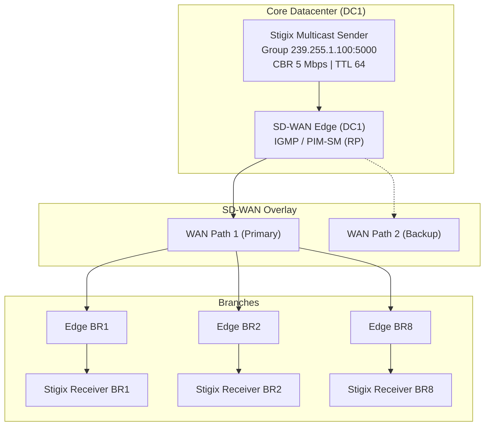
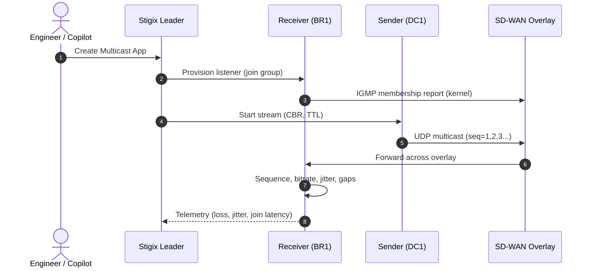
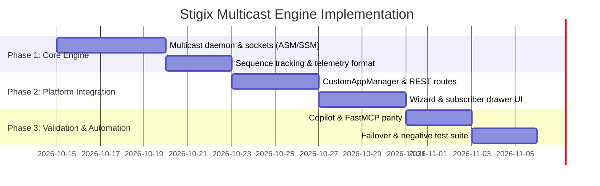

> **Last Updated:** 2026-10-13 | **Created:** 2026-10-13 (v3.0.3) | **Revision:** v2 (technical review)

# PRD — SD-WAN Overlay Multicast Validation Engine

---

## 1. Executive Summary & Vision

### 1.1 The Challenge
Enterprise SD-WAN deployments increasingly transport IP multicast: financial market data, enterprise video / IPTV / CCTV, and industrial / IoT telemetry or bulk imaging (PXE/Ghost).

Validating multicast over SD-WAN is hard:
1. Multicast has no handshake or ACK, so packet loss is invisible to the sender and harmful to consumers.
2. SD-WAN solutions either use **Head-End Replication (HER)** (multicast converted to several unicast overlay copies) or maintain **PIM-SM** trees over the overlay. Each mode has different failure signatures (duplicates, RPF failures, slow convergence).
3. Engineers lack a lightweight, automated tool to measure **join latency**, **loss during underlay failover**, **duplicates**, and **leakage** between segments.

### 1.2 The Solution
The **Stigix Multicast Validation Engine** extends the **Custom Apps** framework with distributed UDP multicast (1-to-N) generation, automated group subscription (ASM and SSM) and real-time telemetry across the SD-WAN fabric.



### 1.3 Scope
**In scope:** IPv4 ASM (239/8) and SSM (232/8), UDP, CBR and burst, IGMPv2/v3, DC-side source and branch-side source (BSS), failover measurement, negative (leakage) tests.

**Out of scope (future):** IPv6 / MLD, MSDP, anycast RP, multicast encryption validation, line-rate stress (> 100 Mbps).

---

## 2. Personas & Core Use Cases

| Persona | Operational Goal | Stigix Value |
|---|---|---|
| **SD-WAN Network Architect** | Certify forwarding mode (HER vs native overlay PIM-SM). | Every subscribed branch receives the stream; duplicates are flagged. |
| **NOC / Operations Engineer** | Measure loss during underlay brownouts and link cuts. | Exact dropped-packet count and convergence time on WAN failure. |
| **Financial / Trading Engineer** | Validate market-feed replication. | Sequence tracking, jitter profile, micro-burst loss. |
| **Security Engineer** | Keep multicast inside its VRF / segment. | Negative test: a non-subscribed or foreign-segment receiver must receive 0 packets. |

---

## 3. Functional Specifications

### 3.1 Multicast Sender Engine
1. **Group addressing:** ASM `239.0.0.0/8` (e.g. `239.255.1.100`); SSM `232.0.0.0/8`.
2. **Transmission parameters:**
   - Destination UDP port (default `5000`–`5008`).
   - Source interface binding via `IP_MULTICAST_IF` (LAN-side interface facing the SD-WAN edge).
   - Bitrate modes: CBR from `64 kbps` to `50 Mbps` (v1 limit, aligned with the UI); Burst mode (e.g. 10 ms bursts every 1 s).
   - IP TTL (default `64`, must be > 1 to cross routed hops).
   - DSCP tagging (`BE`, `CS5`, `EF`, custom).
   - `IP_MULTICAST_LOOP=0` on the sender to avoid local loopback pollution.
3. **Pacing:** use `time.perf_counter()` with catch-up logic; prefer larger datagrams (up to 1316 bytes, 7 x TS packets) above 10 Mbps. `sendmmsg` (or a Node/Go helper) is the fallback if Python cannot hold the target rate within +/- 2 %.
4. **Packet header (packed, network byte order, 24 bytes):**
   ```python
   # struct format "!IQQHH" = 4 + 8 + 8 + 2 + 2 = 24 bytes (no padding)
   # magic        uint32  0x53544758 ("STGX")
   # sequence_id  uint64  monotonically increasing
   # timestamp_ns uint64  sender epoch time (ns)
   # stream_id    uint16  unique multicast app id
   # payload_len  uint16  payload length
   ```
   > A C `struct` declared naturally would be padded to 32 bytes. The wire format is explicitly packed (`__attribute__((packed))` / `struct.pack("!IQQHH")`).

### 3.2 Multicast Receiver Engine
1. **Group membership:**
   - **ASM:** `IP_ADD_MEMBERSHIP` on the selected interface (IGMPv2, or v3 any-source depending on kernel).
   - **SSM:** `IP_ADD_SOURCE_MEMBERSHIP` with an explicit **source IP** (requires IGMPv3; new field `source_ip` in the app definition).
   - `IP_DROP_MEMBERSHIP` (or `IP_DROP_SOURCE_MEMBERSHIP`) when the test stops.
   - IGMP query responses are handled by the Linux kernel, not by the daemon. The engine only **reports** the effective IGMP version (`/proc/sys/net/ipv4/conf/<if>/force_igmp_version`, `/proc/net/igmp`) and may enforce it.
2. **Telemetry:**
   - **Packet loss** from missing `sequence_id` (count and %), plus **reordering** count.
   - **Throughput:** 1 s rolling kbps/Mbps and pps.
   - **Jitter:** RFC 3550 inter-arrival jitter (valid without clock sync).
   - **Join latency (time-to-first-packet):** time between the `IP_ADD_MEMBERSHIP` call and the first data packet. The kernel emits the IGMP report, so this is an end-to-end figure that includes IGMP + PIM propagation.
   - **Duplicates:** repeated `sequence_id` (indicates faulty replication).
   - **One-way delay:** displayed **only** when sender and receiver report synchronized clocks (NTP/PTP offset below a configurable threshold, default 5 ms). Otherwise hidden.
   - **Outage detection:** longest gap without packets (ms), used as the failover convergence time.

### 3.3 Prerequisites & Diagnostics (new)
- **Docker:** the Stigix container must run with `network_mode: host` (bridge networks do not forward IGMP/multicast to the LAN).
- **Interface selection:** explicit interface or IP per node; startup check that the interface is multicast-capable (`MULTICAST` flag).
- **`rp_filter`:** loose mode (`2`) or disabled on the receiver interface when asymmetric paths exist.
- **RPF check:** most common lab failure. If the source subnet is not reachable by unicast through the incoming interface, PIM drops the stream. The UI shows a diagnostic hint when join succeeds but no packet arrives.
- **Self-test:** local sender-to-receiver test on the same segment, to isolate host problems from network problems.

---

## 4. Technical Architecture

### 4.1 Daemon Execution
`engines/multicast_engine.py` runs sender and receiver loops inside the Stigix container (host networking).



### 4.2 Socket Configuration (Linux)
```python
import socket, struct

# Receiver, ASM
sock = socket.socket(socket.AF_INET, socket.SOCK_DGRAM, socket.IPPROTO_UDP)
sock.setsockopt(socket.SOL_SOCKET, socket.SO_REUSEADDR, 1)
sock.bind((group_ip, port))          # bind to the group to filter other multicast traffic
mreq = struct.pack("4s4s", socket.inet_aton(group_ip), socket.inet_aton(interface_ip))
sock.setsockopt(socket.IPPROTO_IP, socket.IP_ADD_MEMBERSHIP, mreq)

# Receiver, SSM (IP_ADD_SOURCE_MEMBERSHIP = 39 on Linux)
mreq_src = struct.pack("4s4s4s", socket.inet_aton(group_ip),
                       socket.inet_aton(interface_ip), socket.inet_aton(source_ip))
sock.setsockopt(socket.IPPROTO_IP, 39, mreq_src)

# Sender
s = socket.socket(socket.AF_INET, socket.SOCK_DGRAM, socket.IPPROTO_UDP)
s.setsockopt(socket.IPPROTO_IP, socket.IP_MULTICAST_TTL, ttl)
s.setsockopt(socket.IPPROTO_IP, socket.IP_MULTICAST_LOOP, 0)
s.setsockopt(socket.IPPROTO_IP, socket.IP_MULTICAST_IF, socket.inet_aton(interface_ip))
s.setsockopt(socket.IPPROTO_IP, socket.IP_TOS, dscp << 2)
```

---

## 5. Platform-Specific Notes

### 5.1 Prisma SD-WAN (ION)
Reference: Prisma SD-WAN Multicast Routing (TechDocs).

| Item | Detail |
|---|---|
| Versions | LAN multicast from 5.6.1; LAN + WAN from 6.0.1; Branch Side Source (BSS) from 6.1.1. |
| Branch site | Supports LAN senders and receivers; receives multicast from the WAN. |
| Datacenter | Sends to branches over the VPN; no LAN receivers on DC. |
| Required settings | Branch ION: *L3 Direct Private WAN Forwarding* and *L3 LAN Forwarding* enabled. LAN interface: Multicast = Yes, IGMP version selected. DC interface: type Port, *Peer with a Network*, Multicast = Yes. |
| RP | Static RP (same RP address on all multicast routers) or dynamically learned RPs. |
| WAN | Multicast WAN configuration profile attached to the branch site; multicast enabled on the DC ION. |
| BSS | Enable *Receive traffic from branch side sources* in the WAN multicast profile; define source + group on the sending site. |
| Test helper | IGMP Static Joins on the branch interface, to separate IGMP failures from transport failures. |

Stigix placement: the DC Stigix node must sit on the segment peered with the ION (*Peer with a Network*), otherwise no PIM adjacency is formed.

### 5.2 VyOS / other overlays
VyOS may be used as underlay/chaos element or as PIM router. Multicast support depends on the lab image; Phase 3 includes a fallback (see roadmap).

---

## 6. Test Scenarios & Acceptance Criteria

| ID | Scenario | Success criteria |
|---|---|---|
| T1 | DC source, 3 branch receivers, 5 Mbps, 10 min | Loss < 0.1 %, 0 duplicates, jitter < 5 ms, join latency reported for each receiver |
| T2 | Branch-side source (BSS), DC and other branches receive | Same as T1; requires Prisma 6.1.1+ |
| T3 | Primary WAN link down during stream | Max gap reported (convergence time); stream resumes without manual action; threshold configurable (default < 10 s) |
| T4 | Receiver joins late (group already active) | Join latency reported; no impact on other receivers |
| T5 | Negative: receiver in another VRF / non-subscribed segment | 0 packets received (leakage = FAIL) |
| T6 | SSM (232/8) with `source_ip` | Receives only from the declared source; a second source is ignored |
| T7 | HER detection | Duplicate count = 0 at receiver; underlay capture shows N unicast copies vs one multicast flow (informational) |

---

## 7. UI/UX Specifications

### 7.1 Custom Apps Wizard Extension
In **Generate > Custom Apps** (`web-dashboard/src/CustomApps.tsx`):
- **Protocol Selector:** `TCP Unicast | UDP Unicast | Multicast Stream`.
- **Multicast fields:** Group IP (default `239.255.1.100`), Port (default `5000`), Mode (ASM / SSM), Source IP (SSM only), Sender node, Receiver nodes (multi-select), Interface per node, Bitrate (`256 kbps` - `50 Mbps`), DSCP (`BE`, `CS5`, `EF`), TTL, Mode (CBR / Burst).
- **Negative test flag:** mark a receiver as "must not receive".

### 7.2 Monitoring Drawer
1. **Source status:** bitrate, packets sent, uptime.
2. **Subscribers table:**

| Receiver | IGMP State / Version | Bitrate | Loss (%) | Dup | Jitter (ms) | Join Latency | Max Gap | Status |
|---|---|---|---|---|---|---|---|---|
| BR1 | Joined (v3) | 4.98 Mbps | 0.00 | 0 | 1.1 | 42 ms | 20 ms | Healthy |
| BR2 | Joined (v3) | 4.97 Mbps | 0.02 | 0 | 1.4 | 38 ms | 24 ms | Healthy |
| BR8 | Joined (v3) | 4.99 Mbps | 0.00 | 0 | 0.9 | 55 ms | 18 ms | Healthy |

3. **Diagnostics banner:** "Joined but no traffic" shows RPF / `rp_filter` / host-networking hints.

---

## 8. AI Copilot & MCP Tooling

| Tool | Parameters | Description |
|---|---|---|
| `create_multicast_app` | `name, group_ip, port, mode, source_ip?, sender_node, receiver_nodes, bitrate_kbps, dscp, ttl` | Deploy a distributed multicast test. |
| `get_multicast_stats` | `app_id` | Loss, bitrate, jitter, duplicates, join latency, max gap per receiver. |
| `stop_multicast_app` | `app_id` | Drop memberships and stop the source. |
| `run_multicast_scenario` | `scenario_id, app_id` | Run T1-T7 and return pass/fail. |

---

## 9. Phased Implementation Roadmap



1. **Phase 1:** `engines/multicast_engine.py`; local self-test; host networking prerequisites; pacing validated at 50 Mbps.
2. **Phase 2:** backend integration (`server.ts`), wizard, drawer, diagnostics banner.
3. **Phase 3:** MCP tools; chaos tests with `vyos_execute_action` (`interface-down`). **Fallback:** if the lab VyOS cannot route multicast, trigger the failover on the SD-WAN edge (link disable) or on the underlay switch.

---

## 10. Risks

| Risk | Mitigation |
|---|---|
| Python cannot sustain target bitrate | Larger datagrams, catch-up pacing, `sendmmsg` / helper |
| Docker bridge blocks multicast | Host networking as documented prerequisite + startup check |
| RPF failures in lab | Diagnostic hints, unicast reachability check |
| Unsynchronized clocks | One-way delay hidden unless offset known |
| Overlay does not support multicast in the lab version | Version check against the platform table (section 5) |

---

## Revision History

| Date | Stigix Version | Author / Trigger | Summary |
|---|---|---|---|
| 2026-10-13 | `v3.0.3` | Stigix Core Team | Initial PRD |
| 2026-10-13 | `v3.0.3` | Technical review | Packed header, SSM, join-latency definition, kernel IGMP behavior, Docker/RPF prerequisites, Prisma section, test scenarios, acceptance criteria, scope, fixed local link |
