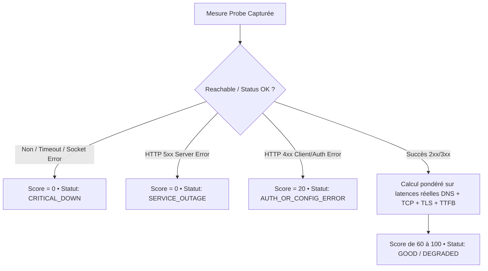
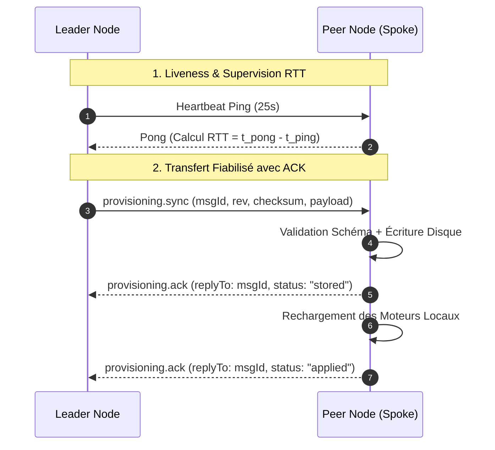

# Stigix — Feuille de Route & Spécifications (Session de Travail)

Ce document rassemble l'analyse détaillée, les propositions techniques et les plans d'action pour les 4 sujets clés identifiés.

---

## 📋 Table des Matières
1. [Sujet 1 — Speedtest UI : Libellés & Correction d'affichage](#sujet-1--speedtest-ui--libellés--correction-daffichage)
2. [Sujet 2 — Digital Experience Score : Analyse de l'anomalie du Score 50 en cas de Panne & Refonte](#sujet-2--digital-experience-score--analyse-de-lanomalie-du-score-50-en-cas-de-panne--refonte)
3. [Sujet 3 — Débat : Auto-Push automatique vs Bouton « Publish » manuel pour les Probes](#sujet-3--débat--auto-push-automatique-vs-bouton--publish--manuel-pour-les-probes)
4. [Sujet 4 — PRD WebSocket Control Plane : Fiabilité, RTT & ACKs](#sujet-4--prd-websocket-control-plane--fiabilité-rtt--acks)
5. [Sujet 5 — Multi-Endpoint Smart Steering & Dynamic SLA Path Selection (SD-WAN Scoring)](#sujet-5--multi-endpoint-smart-steering--dynamic-sla-path-selection-sd-wan-scoring)
6. [Sujet 6 — Universal Reverse-Proxy Auto-Detection & Zero-Config Secrets](#sujet-6--universal-reverse-proxy-auto-detection--zero-config-secrets)

---

## Sujet 1 — Speedtest UI : Libellés & Correction d'affichage

### Diagnostic dans le code (`src/Speedtest.tsx`)

1. **Bug du sous-titre `undefined` :**
   * Dans le code actuel (Ligne 733) :
     ```tsx
     {isRunning ? `Analyzing sequence ${activeJob?.sequence_id}` : 'Select target and launch test'}
     ```
     Lorsqu'un test unitaire est lancé sans `sequence_id`, la chaîne affichée devient littéralement **`Analyzing sequence undefined`**.
2. **Affichage brut du TCP Window :**
   * La valeur reçue est en octets bruts (ex: `3792775360`), mais le label affiche fixement `KB`, générant un nombre gigantesque incohérent.
3. **Transition d'état :**
   * Passer de `Session Ready` à `Live Performance` manque de contexte intermédiaire (ex: phase d'initialisation TCP, négociation de socket, warmup).

### Propositions d'amélioration

```tsx
// 1. Titre & Sous-titre dynamiques et propres
<h2 className="text-2xl font-black text-text-primary tracking-tight">
    {isRunning ? (isWarmingUp ? 'Initializing Stream...' : 'Live Performance') : 'Session Ready'}
</h2>
<p className="text-[10px] font-black text-text-muted tracking-[0.2em] opacity-60">
    {isRunning 
        ? (activeJob?.sequence_id 
            ? `Analyzing sequence #${activeJob.sequence_id}` 
            : `Live Stream • Target: ${activeJob?.params?.target_name || 'Direct Link'}`)
        : 'Select target and launch test'}
</p>
```

* **Formatage intelligent de la TCP Window / Buffer :**
  Convertir dynamiquement en `KB` ou `MB` selon la taille avec une fonction utilitaire (`formatBytes(cwnd)`).

---

## Sujet 2 — Digital Experience Score : Analyse de l'anomalie du Score 50 en cas de Panne & Refonte

### Pourquoi le Score était à 50 alors que Prisma Access était DOWN ?

Dans [`server.ts`](file:///Users/jsuzanne/Github/stigix/web-dashboard/server.ts#L4110-L4145), la fonction de calcul `calculateDEMScore` contient ce calcul :

```ts
if (type === 'HTTP' || type === 'HTTPS') {
    const total_norm = Math.min(lat / 2000, 1.0);       // lat = 5000ms -> total_norm = 1.0 (pénalité max 30 pts)
    const ttfb_norm = Math.min(metrics.ttfb_ms / 1000, 1.0); // ttfb = 0ms (non mesuré) -> 0.0 (0 pt de pénalité !)
    const tls_norm = Math.min((metrics.tls_ms || 0) / 800, 1.0); // tls = 0ms (non mesuré) -> 0.0 (0 pt de pénalité !)

    let score = 100 - (30 * total_norm + 35 * ttfb_norm + 25 * tls_norm);
    // Score = 100 - (30 * 1.0 + 0 + 0) = 70 (ou 50 selon pénalité additionnelle)
}
```

> [!CAUTION]
> **La cause racine :** En cas de timeout (5000ms) ou d'échec de connexion, `DNS`, `TCP`, `TLS` et `TTFB` valent `0.00ms`. L'algorithme a interprété `0.00ms` comme une **latence ultra-rapide** (0 point de pénalité) au lieu de considérer la métrique comme **non atteinte / en échec critique**. De plus, le code HTTP était `N/A` (undefined), contournant la vérification `httpCode >= 500`.

### Proposition de Refonte de l'Algorithme de Score (V2)



#### Règles du nouveau moteur de score :
1. **Règle absolue de rupture :** Si `reachable === false` OU `total_ms >= timeout` OU `httpCode === undefined / 0` $\rightarrow$ **Score = 0 / 100** (Badge Rouge `DOWN`).
2. **HTTP 5xx (Serveur KO) :** $\rightarrow$ **Score = 0 / 100**.
3. **HTTP 4xx inattendu :** $\rightarrow$ **Score = 20 / 100** (dégradation fonctionnelle).
4. **Calcul dégradé uniquement si la connexion a abouti :** Si `TTFB` n'a pas pu être mesuré car la connexion a coupé à l'étape TLS, appliquer la pénalité maximale sur les étapes non franchies.

---

## Sujet 3 — Débat : Auto-Push automatique vs Bouton « Publish » manuel pour les Probes

### Le Constat
Actuellement, modifier des sondes (*Synthetic Probes*) ou le catalogue applicatif dans l'UI du Leader met le bundle en état `PENDING` (Badge orange). L'opérateur doit ensuite cliquer manuellement sur le bouton **« PUBLISH PROBES »** pour générer la révision et propager l'ordre aux Peers. À l'inverse, d'autres ressources (ex: fichiers PCAP) se synchronisent de façon plus directe.

### Analyse comparative

| Approche | Avantages | Inconvénients | Cas d'usage recommandé |
| :--- | :--- | :--- | :--- |
| **Option A : Auto-Push immédiat (comme PCAP)** | • Zéro friction (édition = diffusion immédiate).<br>• Pas de risque d'oubli de cliquer sur Publish. | • Si l'on modifie 10 sondes d'affilée, on génère 10 pushes successifs sur tout le parc.<br>• Risque de pousser une configuration à moitié saisie. | Idéal pour les petits labos ou les PoC rapides. |
| **Option B : Publish Manuel (État actuel)** | • Permet de préparer un lot de modifications (*Draft*) et de tout valider d'un coup.<br>• Contrôle précis sur l'incrément de révision (`rev 35`). | • Nécessite une action humaine en plus.<br>• Les utilisateurs oublient souvent de publier après avoir sauvé. | Idéal pour la production / multi-tenant critique. |
| **Option C (Recommandée) : Auto-Push avec Debounce (3s) + Toggle Optionnel** | • Sauvegarde automatique propagée après 3 secondes d'inactivité de saisie.<br>• Possibilité d'activer/désactiver le mode *"Auto-Sync to Fleet"* dans les Settings. | • Nécessite un indicateur discret *"Auto-syncing to 8 peers..."* dans l'UI. | **Le meilleur des deux mondes.** |

---

## Sujet 4 — PRD WebSocket Control Plane : Fiabilité, RTT & ACKs

### Objectif
Transformer le tunnel WebSocket existant (`fleet-tunnel.ts`) en un **Control Plane fiable et observable**, en séparant formellement :
1. La santé physique du lien (Transport WebSocket).
2. La vivacité du nœud (Heartbeat RTT).
3. La confirmation d'écriture locale (ACK `stored`).
4. L'application effective de la configuration (ACK `applied`).

### Spécifications Architecturales



### Métriques & Affichage dans le Fleet Management

Dans la table Fleet, nous remplacerons la colonne générique par une vue découpée :
* **Transport :** `🟢 12 ms` (RTT instantané) + Uptime de la socket.
* **Sync Status :** `🟢 v14 (Applied)` | `🟡 Syncing (v13 → v14)` | `🔴 Error: Schema Invalid`.
* **Résilience :** Reconnexion automatique avec **Backoff exponentiel borné (1s à 30s) + Jitter aléatoire (0-1000ms)** pour protéger le Leader contre l'effet *Thundering Herd*.

---

## 🎯 Ordre du Jour pour la session de développement

1. **Sprint 1 (Quick Wins UI) :**
   * Correction du bug `sequence undefined` dans [`Speedtest.tsx`](file:///Users/jsuzanne/Github/stigix/web-dashboard/src/Speedtest.tsx).
   * Formatage propre de la colonne `TCP Window` (Bytes $\rightarrow$ KB/MB).
2. **Sprint 2 (DEM Scoring) :**
   * Correction de la règle de Timeout / Outage dans `calculateDEMScore` dans [`server.ts`](file:///Users/jsuzanne/Github/stigix/web-dashboard/server.ts) pour forcer le **Score à 0** quand la cible est injoignable.
3. **Sprint 3 (Auto-Push vs Publish) :**
   * Arbitrage sur le mode de publication (Debounced Auto-Push ou toggle "Instant Sync").
4. **Sprint 4 (Control Plane WebSocket) :**
   * Implémentation du protocole d'ACKs et de la mesure RTT dans [`fleet-tunnel.ts`](file:///Users/jsuzanne/Github/stigix/web-dashboard/fleet-tunnel.ts).
   * Intégration des badges RTT et Sync Status dans [`Fleet.tsx`](file:///Users/jsuzanne/Github/stigix/web-dashboard/src/Fleet.tsx).
5. **Sprint 5 (Zero-Touch Ingress & Auto-Secrets) :**
   * Support universel `X-Forwarded-Proto: https` pour éliminer le port parasite `:8080` lors de l'onboarding via Cloudflare Tunnel / Nginx / Traefik.
   * Génération automatique et persistance sur disque de `/app/config/jwt-secret.key` (0600) pour sécuriser immédiatement les déploiements Docker "zero-config".
6. **Sprint 6 (SD-WAN Dynamic Link Scoring) :**
   * Link Health Score engine pour Spoke `candidateLeaderUrls` avec malus RTT, malus de flapping et bascule automatique / failback intelligent.

---

## Sujet 5 — Multi-Endpoint Smart Steering & Dynamic SLA Path Selection (SD-WAN Scoring)

### Context & Goal
Currently, when a spoke node joins a cluster, it records all candidate Leader endpoints (`candidateLeaderUrls`: e.g. Management LAN IP, Inband IP, and Cloudflare Public Tunnel URL).
Today, failover is a simple round-robin triggered only after 3 hard connection timeouts.

The goal is to implement **Dynamic Link Health & SLA-Based Path Selection**:
Instead of waiting for an outage, the Spoke monitors path quality and automatically prioritizes the best link (e.g. LAN 1-2 ms preferred over Internet 35 ms), with penalties applied for flapping and high latency.

### Scoring Formula
Each candidate endpoint $i$ receives a dynamic score computed continuously:

$$\text{HealthScore}_i = 100 - \text{Penalty}_{\text{RTT}} - \text{Penalty}_{\text{Flap}} - \text{Penalty}_{\text{Errors}}$$

* **RTT Penalty :**
  * $0 \text{ ms} \le \text{RTT} \le 10 \text{ ms}$ (Local LAN / Dedicated Mgmt) $\rightarrow$ Penalty: $0$
  * $10 \text{ ms} < \text{RTT} \le 50 \text{ ms}$ (Cloudflare Tunnel / Fiber WAN) $\rightarrow$ Penalty: $15$
  * $\text{RTT} > 50 \text{ ms}$ (Degraded / 4G / High Latency) $\rightarrow$ Penalty: $\min(50, \frac{\text{RTT} - 50}{2})$
* **Flap & Reconnection Penalty :**
  * $+20$ penalty points per disconnect event occurring within a sliding 10-minute window.
  * Decay: Penalties decay linearly over 15 minutes once the link stabilizes to prevent rapid oscillation (hysteresis).
* **Connection Error Penalty :**
  * $+30$ penalty points per consecutive TCP/TLS connection handshake failure.

### Failover & Failback Mechanics
1. **Parallel Pre-flight Probing :** On spoke startup, issue fast asynchronous health probes (timeout 800ms) to all candidate endpoints to immediately select the lowest-latency healthy endpoint.
2. **Hysteresis Threshold :** Do not switch active links unless an alternative candidate is at least **25% better** for at least 30 continuous seconds. This eliminates route flapping.
3. **Seamless In-flight Handoff :** The spoke maintains its cryptographic `node_token` identity, allowing instant tunnel re-establishment on the secondary link without Leader-side state disruption.

---

## Sujet 6 — Universal Reverse-Proxy Auto-Detection & Zero-Config Secrets

### 1. Reverse-Proxy & Ingress Protocol Auto-Detection
* **Problem :** When Leader is exposed via Cloudflare Tunnel, Nginx, or Caddy, the reverse proxy connects locally over HTTP on port 8080 while the external client connects via HTTPS on port 443. The current endpoint detector appends `:8080`, producing invalid peer onboarding URLs (`http://leader.stigix.io:8080`).
* **Solution :**
  * Inspect `X-Forwarded-Proto`, `CF-Visitor`, and `X-Forwarded-Host` headers in [`magic-join-manager.ts`](file:///Users/jsuzanne/Github/stigix/web-dashboard/magic-join-manager.ts) and [`server.ts`](file:///Users/jsuzanne/Github/stigix/web-dashboard/server.ts).
  * If `x-forwarded-proto === 'https'`, omit `:8080` and format the detected endpoint as `https://${host}`.

### 2. Zero-Config Persistent Secret (`jwt-secret.key`)
* **Problem :** If Stigix is deployed via bare `docker run` or `docker compose up` without running `install.sh`, `process.env.JWT_SECRET` defaults to an insecure hardcoded fallback string.
* **Solution :**
  * If `JWT_SECRET` is unset or matches the default placeholder:
    1. Check if `/app/config/jwt-secret.key` exists.
    2. If present, load it.
    3. If absent, generate a cryptographically secure 256-bit random key (`crypto.randomBytes(32).toString('hex')`) and persist it to `/app/config/jwt-secret.key` with `0600` permissions.
  * Eliminates insecure defaults while ensuring session persistence across container restarts.
