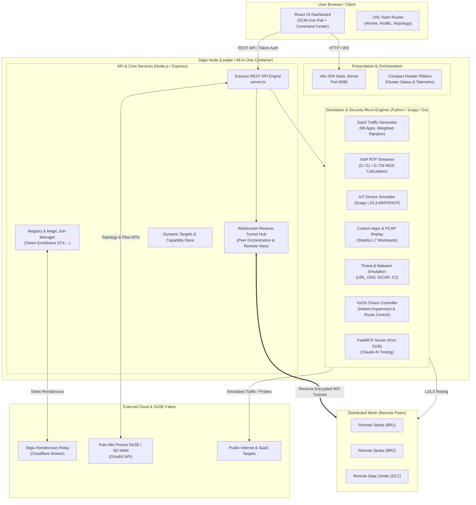

> **Last Updated:** 2026-10-11 | **Created:** 2026-01-27 (v1.1.2-patch.5)

# 🏗️ Stigix Platform Architecture Overview

Stigix is an all-in-one open-source validation platform designed for modern **SASE**, **SD-WAN**, and **Enterprise Network Security** validation. This document outlines the system architecture, component breakdown, and distributed multi-node mesh topology in **Stigix v3**.

---

## 1. High-Level Architecture Diagram

---

## 2. Component Breakdown

### 2.1 Frontend Presentation Shell (Stigix v3)
- **SCM Icon Rail (`NavigationRail.tsx`):** A space-saving vertical icon rail inspired by Palo Alto Strata Cloud Manager. Replaces legacy horizontal bars to preserve scarce vertical screen space on laptops and high-DPI monitors.
- **Flyout Navigation Drawers (`SidebarFlyout.tsx`):** 384px (`w-96`) flyout menus with deep-linked sub-tabs, 2-line descriptions, live engine status pulses, and click-to-pin navigation drawer behavior.
- **Executive Command Center (`HomeOverview.tsx`):** The primary landing view providing single-pane visibility over cluster health, public IP geolocation, and live status across all 5 simulation engines.
- **Compact Single-Line Header (`Header.tsx`):** Consolidates Stigix branding, cluster role indicators (`LEADER` / `PEER` / `STANDALONE`), real-time cluster health, and instant Dark / Light mode toggle.
- **Deep Linking Hash Router (`navigationConfig.ts`):** Every view and settings tab maps directly to a clean URL hash (e.g. `#home`, `#traffic`, `#topology`, `#settings:fleet`), supporting native browser back/forward history.

### 2.2 Backend & Orchestration (`web-dashboard/server.ts`)
- **Express REST API:** Provides endpoints for telemetry, authentication, configuration persistence, and engine lifecycle control.
- **Dynamic Cluster Enrollment (Magic Join):** Generates single-use `STX-...` cryptographic onboarding tokens. Standalone nodes join the mesh with a single curl command or UI token paste without restarting.
- **WebSocket Reverse Tunnel Gateway:** Enables bidirectional communication between the Leader and remote spoke nodes behind firewalls, NAT, or cellular uplinks without opening public inbound ports.
- **Remote View Proxy (`RemoteViewBanner.tsx`):** Proxies live telemetry, charts, and control interfaces from any enrolled remote peer into the central Leader console with an amber contextual banner.

### 2.3 Simulation & Chaos Micro-Engines
- **SaaS Traffic Generator (`traffic-generator.py`):** Generates synthetic HTTP/HTTPS requests across 68 configured enterprise applications (Microsoft 365, Google Workspace, Salesforce, Zoom) with realistic client timing (DNS, TLS, TTFB, RTT).
- **Voice VoIP Simulation (`voice-simulation.py`):** Transmits realistic SIP/RTP audio streams using Scapy to evaluate MOS scores, jitter, and packet drop.
- **Physical IoT Simulation (`iot-simulator.py`):** Simulates real-on-wire IoT devices with dedicated MAC and IP addresses via Scapy Layer-2 ARP and DHCP negotiation.
- **Custom TCP Apps & PCAP Replay (`custom-tcp/`):** Generates custom enterprise TCP streams and stateful L7 packet replays.
- **Security Validation (`security-engine.py`):** Validates NGFW and SASE inspection policies against 70 URL categories, 24 DNS domains, EICAR downloads, and 7 C2 attack scenarios.
- **VyOS Chaos Controller (`vyos-controller.py`):** Injects network chaos (latency, packet loss, bandwidth throttling, port flapping) directly into underlying VyOS edge routers via VyOS API.
- **FastMCP AI Server (`mcp-server/`):** Exposes 79 Model Context Protocol tools over SSE (port 3100) allowing Claude Desktop and autonomous AI agents to orchestrate tests using natural language.

---

## 3. Distributed Mesh Topologies

Stigix supports three operational roles:

| Role | Responsibility | Web UI | WebSocket Gateway | Micro-Engines |
| :--- | :--- | :--- | :--- | :--- |
| **`leader` / `both`** | Central orchestrator, telemetry aggregator, and dashboard host. | ✅ Active (Port 8080) | ✅ Listening (Server) | ✅ Active |
| **`peer` / `spoke`** | Remote branch agent enrolled into a cluster via Magic Join. | 🔒 Contextual / Read-Only | ⚡ Connected (Outbound Client) | ✅ Active |
| **`target`** | Headless probe endpoint (XFR 9000, RTP 6100, Probes 6200, iPerf 5201). | ❌ Disabled | ❌ Disabled | ⚡ Probe Endpoints Only |

---

## 📜 Revision History

| Date | Stigix Version | Author / Trigger | Summary of Changes |
|---|---|---|---|
| 2026-10-11 | `v3.0.0` | Stigix Core Team | Major update for Stigix v3: documented SCM rail frontend shell, Command Center Home overview, Magic Join cluster architecture, and simulation micro-engines |
| 2026-01-27 | `v1.1.2-patch.5` | Stigix Core Team | Initial legacy stub creation |
