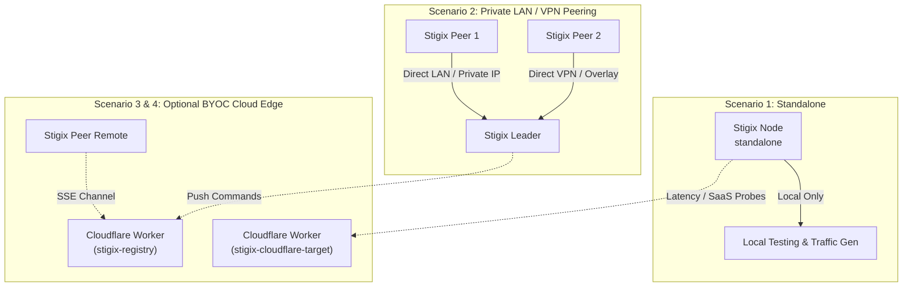

> **Last Updated:** 2026-10-21 | **Created:** 2026-10-21 (v3.0.62)

# Stigix Node Modes, Peering Scenarios & Cloud Edge Architecture

This document details the operational modes of Stigix nodes (`standalone`, `leader`, `peer`), local vs. remote peering scenarios, and the optional Bring-Your-Own-Cloudflare (BYOC) Edge integration.

---

## 🧭 Architectural Principles

1. **Standalone by Default**: Fresh Stigix installations start in **`standalone`** mode. They make **zero outbound network calls** to external registries or Cloudflare workers, execute no polling loops, and consume no third-party API quotas.
2. **Zero-Cloudflare Local Peering**: Clustered topologies across local LANs, private subnets, SD-WAN overlays, or site-to-site VPNs communicate directly peer-to-peer using private IP addresses and invitation tokens, without requiring any external relay.
3. **Optional BYOC Cloud Edge**: Cloudflare Workers are strictly optional and decoupled into two independent worker modules hosted on the user's free or paid Cloudflare account:
   - **Synthetic Probes Target** (`stigix-cloudflare-target`): Global edge responder for latency, jitter, TTFB, and synthetic SaaS benchmarks. Runs as an open stateless benchmark responder (no master key required).
   - **WAN Rendezvous Relay** (`stigix-registry`): NAT-traversal and firewall-punching channel using passive **Server-Sent Events (SSE)** push channels (zero-polling) for connecting distributed sites without public IPs.

---

## 🏗️ Node Operating Modes

| Mode | Role Description | External Cloudflare Calls | Network Listener |
|---|---|---|---|
| **`standalone`** *(Default)* | Single-node operation for local traffic generation, local synthetic probes, and ad-hoc diagnostics. | **0 calls / 100% offline** | Local Web UI / API (`:3000`) |
| **`leader`** | Central controller orchestrating a fleet of peers, collecting aggregated telemetry, and managing test profiles. | **0 calls** *(unless WAN Relay is enabled)* | Local Web UI / API (`:3000`), WebSocket / HTTP Mesh |
| **`peer`** | Managed agent reporting metrics to a designated leader and executing scheduled traffic flows. | **0 calls** *(connects to Leader via private IP or token)* | Local Web UI (`:3000`), outbound connection to Leader |

---

## 📋 Deployment Scenarios



---

### Scenario 1: Single Standalone Node (Default Out-of-the-Box)

**Use Case:** Ad-hoc traffic generation, local speed tests, standalone SD-WAN branch validation, or air-gapped lab testing.

- **Cloudflare Requirement:** None (0%).
- **Configuration (`.env`):**
  ```env
  STIGIX_REGISTRY_ENABLED=false
  STIGIX_REGISTRY_MODE=standalone
  # STIGIX_REGISTRY_URL is commented out
  # STIGIX_TARGET_BASE_URL is commented out
  ```
- **Behavior:**
  - Node operates independently on `http://localhost:3000`.
  - No background heartbeat threads to external services.
  - Verification: `curl http://localhost:3000/api/registry/status` returns `{"mode": "standalone", "enabled": false}`.

---

### Scenario 2: Private Local / Lab Peering (Leader + Peers via LAN / VPN)

**Use Case:** Multi-site lab, data center + branch SD-WAN topologies where all nodes share routeable private IP addresses (e.g. `10.x.x.x`, `192.168.x.x`, or WireGuard/IPsec tunnels).

- **Cloudflare Requirement:** None (0%).
- **Setup Procedure:**
  1. **Configure Leader:**
     - In Dashboard: Navigate to **Settings** or click the node badge in the top navigation bar.
     - Switch node mode to **Leader**.
     - Click **Generate Invite Token** to generate a single-use token (e.g., `STX-a1b2c3d4...`).
     - Note the leader's private IP (e.g., `http://10.0.1.10:3000`).
  2. **Configure Peer(s):**
     - On the peer host, specify the leader's private address:
       ```env
       STIGIX_CONTROLLER_URL=http://10.0.1.10:3000
       STIGIX_REGISTRY_ENABLED=false
       STIGIX_REGISTRY_MODE=peer
       ```
     - Alternatively, in the peer Web UI, open the Node Role modal, select **Peer**, paste the Leader URL (`http://10.0.1.10:3000`) and the invite token.
- **Traffic Flow:** All telemetry, command dispatch, and metrics sync travel over private IP routes directly between Peer and Leader.

---

### Scenario 3: Optional Synthetic Probes Edge Worker (`stigix-cloudflare-target`)

**Use Case:** Measuring WAN performance, round-trip latency, jitter, Time to First Byte (TTFB), and downloading standardized test payloads from Cloudflare's global edge network.

- **Prerequisites:** A free Cloudflare account (includes 100,000 free worker requests/day).
- **Deployment:**
  ```bash
  cd stigix-cloudflare-target
  npm install
  npx wrangler deploy
  ```
  Wrangler returns your worker URL (e.g., `https://stigix-target.<subdomain>.workers.dev`).
- **Authentication & Operation:**
  - **Open Stateless Responder:** No secret or signature required. The worker acts as a dedicated synthetic responder for latency, jitter, throughput and EICAR antivirus probes.
  - Simply paste your deployed worker URL into Stigix Web UI.
- **Dashboard Configuration:**
  - Navigate to **Settings > Cloud Target**.
  - In **Cloud Target Security / Worker**, set **Target Worker Base URL** to your deployed worker URL.
  - Click **Test Target** to verify reachability and measure baseline latency.

---

### Scenario 4: Optional WAN Rendezvous Relay (`stigix-registry`)

**Use Case:** Interconnecting branches or remote workers across the public Internet where nodes reside behind dynamic NAT, CGNAT, or restrictive enterprise firewalls without public IPs or site-to-site VPNs.

- **Architecture:**
  - Nodes establish an outbound HTTP connection to the relay using **Server-Sent Events (SSE)**.
  - **Zero Polling:** The connection stays open passively. When the Leader issues a command, the relay pushes the event down the established stream.
- **Deployment:**
  ```bash
  cd stigix-registry
  npm install
  npx wrangler kv namespace create STIGIX_REGISTRY
  ```
  Copy the returned namespace ID into `stigix-registry/wrangler.toml`:
  ```toml
  [[kv_namespaces]]
  binding = "STIGIX_REGISTRY"
  id = "<your-namespace-id>"
  ```
  Deploy:
  ```bash
  npx wrangler deploy
  ```
  Wrangler outputs your relay URL (e.g., `https://stigix-registry.<subdomain>.workers.dev`).
- **Dashboard Configuration:**
  - Navigate to **Settings > Cloud Edge**.
  - Under **WAN Rendezvous Relay**, enter your worker URL in **Relay Worker URL**.
  - Click **Test Reachability** (the dashboard validates the worker's `/health` endpoint).
  - Click **Save Relay URL**.

#### 🔑 Zero-Touch Remote Onboarding via Join Tokens
A common question is: *If a new peer is deployed as standalone on the Internet without private LAN access, how does it know where the Cloudflare Relay is?*

**Answer: The Join Token (`STX-...`) carries the Relay URL automatically!**

1. When the Leader has a Relay URL configured (via Settings or `.env`), it automatically encodes `relay_url` into the cryptographic payload of the Join Token.
2. The administrator generates the token on the Leader and provides it to the remote Peer (either during installation `install.sh STX-...` or via the **Connect to Fleet** dialog).
3. The remote Peer decodes the token and attempts to probe the Leader's direct LAN endpoints.
4. Because the remote peer is on the public Internet behind NAT, direct LAN probes time out.
5. The Peer detects the timeout and **automatically extracts `relay_url` from the token**.
6. The Peer writes `STIGIX_REGISTRY_URL` and `STIGIX_REGISTRY_ENABLED=true` into its local `.env`, and announces itself to the Cloudflare Relay.
7. The Leader receives the announcement and dials the reverse WebSocket tunnel to the Peer.

> **Result:** The user never needs to manually copy, configure, or type the Cloudflare Relay URL on remote nodes. The Join Token is completely self-contained.

---

### Scenario 5: Full Enterprise Hybrid Deployment

**Use Case:** Large SD-WAN evaluation with a centralized Leader in a Data Center, local branch peers on the corporate LAN, remote home office peers behind NAT via the Rendezvous Relay, and global SaaS benchmarking via the Probes Target.

```
                   ┌──────────────────────────────────────┐
                   │   Cloudflare Edge (User Account)     │
                   │                                      │
                   │  [Probes Target]    [Rendezvous]     │
                   │  stigix-target     stigix-registry   │
                   └──────┬──────────────────────┬────────┘
                          │ (Synthetic Probes)   │ (SSE Push)
                          │                      │
   ┌──────────────────────┼──────────────────────┼────────────────────────┐
   │ Enterprise Network   ▼                      ▼                        │
   │               ┌──────────────┐       ┌──────────────┐                │
   │               │   DC Leader  │◄──────┤ Remote Peer  │                │
   │               │ (10.0.1.10)  │       │ (Home / NAT) │                │
   │               └──────┬───────┘       └──────────────┘                │
   │                      │ Direct LAN                                    │
   │                      ▼ Peering                                       │
   │               ┌──────────────┐                                       │
   │               │ Branch Peer  │                                       │
   │               │ (10.0.2.20)  │                                       │
   │               └──────────────┘                                       │
   └──────────────────────────────────────────────────────────────────────┘
```

---

## 🛠️ Verification & Troubleshooting Checklist

| Check | Command / Action | Expected Result |
|---|---|---|
| **Verify Mode** | `curl -s http://localhost:3000/api/registry/status` | `"mode": "standalone"` (or `"leader"` / `"peer"`) |
| **Verify Outbound Traffic** | `docker compose logs web-dashboard` | No repeated `429 Too Many Requests` or connection errors to external domains |
| **Test Probes Worker** | `POST /api/config/cloud/test` or click **Test Target** | Status code `200` with measured round-trip latency |
| **Test Relay Worker** | `POST /api/registry/test-relay` or click **Test Reachability** | `"status": "ok"`, service: `"stigix-rendezvous-relay"` |
| **Direct Peer Link** | In peer logs: check controller sync | Successful handshake with `STIGIX_CONTROLLER_URL` |

---

## 📜 Revision History

| Date | Stigix Version | Author / Trigger | Summary of Changes |
|---|---|---|---|
| 2026-10-21 | `v3.0.62` | Stigix Core Team | Initial document creation covering Standalone default, Direct LAN Peering, and decoupled BYOC Cloudflare Workers |
