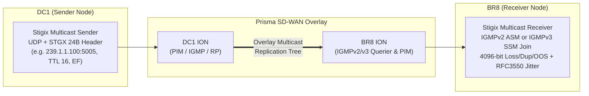

> **Last Updated:** 2026-10-14 | **Created:** 2026-10-14 (v3.0.19)

# SD-WAN Overlay Multicast Validation — Step-by-Step User Guide

This guide walks a new user through validating end-to-end IP Multicast replication across a Prisma SD-WAN overlay using Stigix — specifically using **`DC1`** as the **Multicast Source (Sender)** and **`BR8`** (plus optional additional branches such as `BR1` or `BR2`) as the **Multicast Receiver(s)**.

---

## 🧭 Overview: How Stigix Multicast Validation Works



When you click **Start Stream** on the Stigix Leader dashboard (`DC1`):
1. **Phase 1 — Receiver IGMP Join**: Stigix instructs `BR8` to open a UDP socket on port `5005` and issue an **IGMPv2 Join (`addMembership`)** for ASM or **IGMPv3 Source-Specific Join (`addSourceSpecificMembership`)** for SSM on its LAN interface facing the ION router.
2. **Phase 2 — Sender UDP Stream**: After a `250 ms` stabilization delay, `DC1` starts transmitting paced UDP datagrams containing the 24-byte `STGX` binary telemetry header (`seq`, `tx_ns`, `stream_id`, `flags`) with configured `IP_MULTICAST_TTL` and `DSCP`.
3. **Phase 3 — Live 1-to-N Telemetry & Diagnostics**: The Leader polls all participating nodes every second, computing per-branch bitrate, packet loss, duplicates, out-of-order packets, RFC 3550 jitter, join latency (`T_first_packet - T_igmp_join`), and automatic root-cause diagnostics.

---

## ✅ Prerequisites Before Starting

1. **Docker Host Networking (`network_mode: host`)**:
   - Both `DC1` and `BR8` must run Stigix with `network_mode: host` (the default in Stigix `docker-compose.yml`). Bridge networking blocks native IGMP membership reports from reaching the physical/VLAN LAN segment connected to the Prisma SD-WAN ION.
2. **Fleet Cluster Connectivity**:
   - `DC1` (Leader) and `BR8` (Peer) must be enrolled in the same Stigix cluster and show **Online** in the Fleet banner.
3. **Prisma SD-WAN Multicast Configuration**:
   - Multicast routing (PIM-SM / PIM-SSM and IGMPv2/v3 on the LAN interfaces) must be enabled on the `DC1` and `BR8` ION devices.

---

## 🚀 Step-by-Step Guide: Testing `DC1` (Source) $\rightarrow$ `BR8` (Receiver)

### Step 1 — Open the Multicast Overlay Studio
1. Open the Stigix Web Dashboard on your **Leader node (`DC1`)**.
2. In the left navigation sidebar, click **Custom Apps** (under Traffic Generation / Validation).
3. At the top of the page, use the sub-tab switcher to switch from **`TCP Applications`** to **`Multicast Overlay`**:
   ```text
   [ TCP Applications ]   [ 📡 Multicast Overlay ]
   ```

---

### Step 2 — Create (or Edit) a `DC1 -> BR8` Multicast Profile
1. Click the **`+ New Multicast Stream`** button in the top-right corner of the **Multicast Overlay** view.
2. Fill in the profile parameters in the configuration modal:

| Field | Recommended Value | Why / Notes |
| :--- | :--- | :--- |
| **Application Name** | `DC1-to-BR8 Live Video Feed` | Descriptive label for the stream. |
| **Stream ID** | `mc-dc1-br8` | Unique slug identifier (auto-generated if left blank). |
| **Multicast Mode** | `ASM (Any-Source — IGMPv2/v3)` | Select **ASM** for `239.x.x.x` (`*,G` with RP) or **SSM** for `232.x.x.x` (`S,G` without RP). |
| **Multicast Group IP** | `239.1.1.100` | Must be in `239.0.0.0/8` for ASM (or `232.0.0.0/8` for SSM). Note: `224.0.0.0/24` is rejected because link-local multicast is never routed across SD-WAN. |
| **UDP Port** | `5005` | Any UDP port between `1024` and `65535`. |
| **Sender Node (Source)** | `DC1` (select from dropdown) | The hub/datacenter node that will transmit the UDP multicast stream. |
| **SSM Source IP** *(SSM only)* | *(Leave blank for ASM)* | If testing **SSM (`232.x.x.x`)**, enter `DC1`'s LAN IPv4 address (e.g. `10.200.1.10`). |
| **Receiver Nodes (Branches)** | Check **`BR8`** | Click `BR8` in the Receiver Nodes checklist (you can also check `BR1`, `BR2`, etc. for `1 -> N` replication). |
| **Target Bitrate (kbps)** | `1000` (1 Mbps) | Rate of the synthetic CBR stream (`16` to `50000` kbps). |
| **Payload Size (Bytes)** | `1200` | Safe below typical SD-WAN tunnel MTU (`1400` bytes max) to prevent IP fragmentation. |
| **Multicast TTL** | `16` | **Crucial:** Must be `> 1` (recommended `16` or `32`) so ION routers do not drop packets on hop decrement. |
| **DSCP Marking** | `ef` (`EF - DSCP 46`) | Maps the multicast stream into the SD-WAN Real-Time / Voice-Video QoS queue. |
| **Interface Override** | *(Leave blank)* | Stigix automatically selects the node's private RFC1918 LAN IPv4 interface (ignoring `docker0`, `lo`, and tunnels). |

3. Click **Create Profile**.
4. Verify in the top banner that the provisioning bundle has synchronized to `BR8` (automatic within a few seconds).

---

### Step 3 — Run the Pre-Flight Check (`DC1` & `BR8`)
Before starting traffic, verify that both nodes have valid LAN multicast interfaces and OS permissions:
1. Select your **`DC1-to-BR8 Live Video Feed`** card in the left column.
2. Click the **`Pre-Flight Check`** button in the stream header.
3. In the **Pre-Flight Check Modal**, verify that both **`DC1`** and **`BR8`** display a green **`READY`** badge:
   - **Selected LAN Interface**: Shows the auto-detected LAN IPv4 (e.g. `eth0 — 192.168.x.x`).
   - **UDP Bind & IGMP Membership**: Confirms the kernel allows multicast socket binding.
   - **Kernel IGMP & mroute Table**: Displays active `/proc/net/igmp` memberships and `ip mroute` state.
4. Close the modal once both nodes report **`READY`**.

---

### Step 4 — Start the Multicast Stream & Read the Live Matrix
1. Click the green **`Start Stream`** button.
2. Watch the **1-to-N Replication Overview** and **Branch Receiver Matrix**:
   - **Sender Card (`DC1`)**:
     - Status transitions to **`TRANSMITTING`**.
     - Displays live **TX Bitrate (`~1000 kbps`)**, **Packets/s (`~104 pps`)**, **Total Sent Packets**, **TTL (`16`)**, and **DSCP (`EF`)**.
   - **Receiver Row (`BR8`)**:
     - Status transitions from `JOINED_WAITING` $\rightarrow$ **`RECEIVING`** (green badge) as soon as the first multicast datagram traverses the SD-WAN overlay.
     - **Join Latency (`ms`)**: Shows the exact convergence time in milliseconds between `BR8` issuing its IGMP Join and the first packet arriving from `DC1` across the SD-WAN fabric.
     - **RX Bitrate & Sparkline**: Should closely match `DC1`'s TX bitrate (`~1000 kbps`).
     - **Loss / Dup / Reorder**:
       - `0.00% Loss` confirms clean forwarding.
       - `Dup > 0` indicates duplicate packet delivery (e.g., dual-tunnel replication anomaly).
       - `OOS > 0` indicates packet reordering across paths.
     - **Jitter (RFC 3550)**: Real-time inter-arrival jitter in milliseconds (`< 5 ms` healthy, `< 20 ms` acceptable for video/voice).

---

### Step 5 — Test Advanced SD-WAN Scenarios (`IGMP Leave` & `Late-Join`)
While the stream is actively running from `DC1`, you can validate dynamic IGMP/PIM tree pruning and grafting on `BR8` without stopping the sender:

1. **Test IGMP Prune (`S8`)**:
   - On the **`BR8`** row in the Receiver Matrix, click the **`IGMP Leave`** button.
   - `BR8` immediately sends an IGMP Leave group message to its local ION router.
   - `BR8`'s status badge changes to **`PRUNED`**, and its RX bitrate drops to `0 kbps`.
2. **Test Late-Join (`S4`)**:
   - Wait 5–10 seconds while `DC1` continues transmitting, then click **`IGMP Join`** on the **`BR8`** row.
   - `BR8` re-joins the multicast group mid-stream.
   - Notice two things:
     1. **`Join Latency (ms)`** updates with the fresh graft convergence time.
     2. **`Packet Loss (%)` remains `0.00%`** — Stigix automatically initializes its 4096-bit sequence window on the first packet received after joining (`firstSeq`), avoiding false "phantom loss" for packets sent before `BR8` joined.

---

### Step 6 — Stop the Stream
1. Click the red **`Stop Stream`** button in the stream header.
2. Stigix stops the UDP transmitter on `DC1` and cleanly leaves the IGMP group on `BR8`.

---

## 🛠️ Troubleshooting Common SD-WAN Multicast Issues

Stigix includes an automated **SD-WAN Multicast Diagnostics Banner** above the receiver matrix. Here is how to interpret its findings if `BR8` does not receive traffic:

| Diagnostic Banner / Symptom | Root Cause | How to Fix |
| :--- | :--- | :--- |
| **🚨 TTL Decay Risk (`TTL = 1`)** | The profile's Multicast TTL is set to `1`. The `DC1` ION router decrements TTL to `0` and drops the packet before encapsulating it into the SD-WAN tunnel. | Edit the profile and set **Multicast TTL** to **`16`** or **`32`**. |
| **🚨 Complete Overlay Blackhole (`DC1 TX > 0`, `BR8 RX = 0`, status `JOINED_WAITING`)** | `DC1` is transmitting and `BR8` has sent its IGMP Join, but zero packets cross the SD-WAN fabric. | 1. Verify **IGMPv2/v3** is enabled on the `BR8` ION LAN interface.<br>2. Verify **PIM-SM** (and Rendezvous Point / RP reachability for ASM `239.x.x.x`) or **PIM-SSM** (for `232.x.x.x`) is enabled on both `DC1` and `BR8` IONs.<br>3. Check if a Zone-Based Firewall policy on the ION is dropping UDP port `5005` or destination `239.1.1.100`. |
| **⚠️ Partial Replication Asymmetry** *(when testing `DC1 -> BR1 + BR8`)* | Some branches receive the stream (`RECEIVING`) while `BR8` remains stuck in `JOINED_WAITING`. | `DC1` source and RP are working; the issue is isolated to `BR8`'s local ION LAN IGMP configuration or missing PIM neighbor/tunnel adjacency on `BR8`. |
| **⚠️ Wrong Local Interface Selected** | A node with multiple NICs bound to a management VLAN instead of the SD-WAN LAN VLAN. | Run **Pre-Flight Check** to see all detected interfaces on `DC1` or `BR8`, then set **Interface Override** in the profile to the exact LAN interface name or IP. |

---

## 📜 Revision History

| Date | Stigix Version | Author / Trigger | Summary of Changes |
|---|---|---|---|
| 2026-10-14 | `v3.0.19` | Stigix Core Team | Initial step-by-step user guide for validating SD-WAN Overlay Multicast (`DC1` source to `BR8` receiver) |
