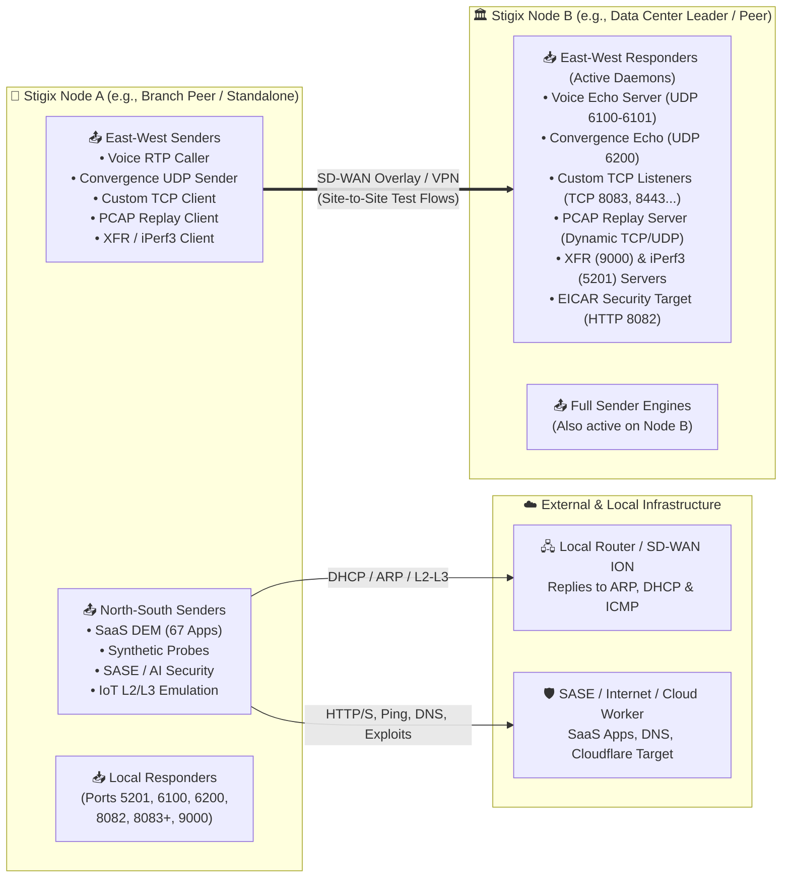
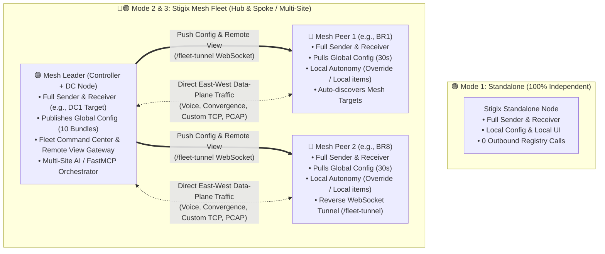

> **Last Updated:** 2026-11-01 | **Created:** 2026-11-01 (v3.1.42)

# 🧭 Stigix Node Modes & Capabilities Matrix (Datasheet)

This reference document provides a clear, at-a-glance comparison of **what a Stigix instance does on the network** (Data-Plane: **Sender** vs. **Receiver**) and **how it operates across deployment topologies** (Control-Plane: **Standalone** vs. **Mesh Peer** vs. **Mesh Leader**).

> 💡 **Interactive Visual Datasheet:** Open [`docs/stigix-modes-datasheet.html`](stigix-modes-datasheet.html) in any browser for the interactive **EN / FR** visual one-pager with dark/light theme toggle and 1-click PDF/Print export.

---

## ⚡ 1. Data-Plane Symmetry: Sender vs. Receiver Roles

Every **Stigix All-in-One** container packs both traffic generators (**Sender / Source**) and active network responders (**Receiver / Target**) out of the box. Regardless of whether a node is `Standalone`, a `Mesh Peer`, or the `Mesh Leader`, its data-plane engines are **100% identical**.

However, network flows fall into two distinct architectural categories:
1. **North-South / Local LAN Flows (`Sender Only`)**: Stigix initiates traffic toward external SaaS clouds, Cloudflare edge workers, SASE security gateways, or the local SD-WAN router/switch.
2. **East-West / Site-to-Site Flows (`Dual Role: Sender + Receiver`)**: One Stigix node (e.g., Branch `BR8`) initiates traffic toward another Stigix node's active responder daemon (e.g., Data Center `DC1`).

### 📊 Complete Engine Matrix: Sender vs. Receiver

| Functional Module | Direction | 📤 **Sender Role** *(Traffic Initiator)* | 📥 **Receiver Role** *(Target / Responder)* | Who Answers on the Wire? |
| :--- | :---: | :--- | :--- | :--- |
| **SaaS Traffic Gen (DEM)** | 🌐 North-South | Generates realistic HTTP/HTTPS traffic across 67 SaaS apps with live `curl` telemetry (`DNS`, `TCP`, `TLS`, `TTFB`). | **None** *(Stigix is pure client)* | 🌍 Real Internet SaaS servers or SASE proxy |
| **Synthetic Probes** | 🌐 North-South *(or IP Ping)* | Executes continuous `HTTP`, `HTTPS`, `ICMP Ping`, `TCP`, `UDP`, and `DNS` probes to benchmark WAN SLA. | **Passive OS IP Stack only** *(No shared probe telemetry daemon)* | ☁️ SaaS endpoints, Stigix Cloudflare Worker, Prisma SD-WAN IPs, or any routable IP |
| **IoT Simulation (`stigix-go`)** | 🔌 Local LAN (L2/L3) | Emulates up to 100 physical IoT personas (MAC spoofing, DHCP requests, ARP announcements, L7 flows, CVEs). | **None** *(Simulated devices only reply to local ARP/Ping)* | 🖧 **Local SD-WAN Router / Switch** answers DHCP & ARP and classifies the IoT devices |
| **SASE Security (URL, DNS, C2, AISA)** | 🛡️ North-South | Fires 70 URL categories, 24 DNS threats, 7 C2 scenarios, and 5 AI Security (AISA) prompts/DLP tests. | **None** *(Outbound security validation)* | 🛡️ Prisma Access / NGFW (blocks/inspects) or Internet / Cloud Worker |
| **East-West Threat (EICAR)** | 🔄 East-West & N-S | Downloads EICAR payloads over HTTP/TCP to verify lateral or outbound Threat Prevention / AV enforcement. | ✅ **EICAR HTTP Server (`TCP 8082`)** + Custom TCP EICAR injection mode | 🎯 Remote Stigix Node (`:8082`) or Cloud Target Worker |
| **Voice Simulation (VoIP RTP)** | 🔄 East-West | Sends G.711 / G.729 RTP audio streams and computes live **MOS**, jitter, packet loss, and RTT. | ✅ **Voice Echo Server (`UDP 6100-6101`)** reflects RTP packets back to caller with site tags | 🎯 Remote Stigix Node (`:6100-6101`) |
| **Convergence Lab (Failover)** | 🔄 East-West | Fires high-precision UDP bursts (up to **1000 PPS**) to measure sub-second SD-WAN tunnel failover & blackout duration. | ✅ **Convergence Echo (`UDP 6200`)** reflects high-frequency UDP sequence probes | 🎯 Remote Stigix Node (`:6200`) |
| **Custom TCP Applications** | 🔄 East-West | Runs stateful outbound client workloads (5 traffic profiles) measuring rolling RTT percentiles ($p50 / p95 / \text{avg}$). | ✅ **TCP App Listeners (`8083, 8443...`)** with 8 server chaos modes (delay, jitter, drops, errors, EICAR) | 🎯 Remote Stigix Node (`:8083+`) |
| **Stateful PCAP Replay** | 🔄 East-West | Replays client-side L7 conversational steps (`⬆️ Client ➔ Server`) from `.pcap` / `.stx-replay` profiles. | ✅ **PCAP Server Listener** binds target sockets and replies with server steps (`⬇️ Server ➔ Client`) | 🎯 Remote Stigix Node (Coordinated by Leader/MCP) |
| **Speedtest (XFR & iPerf3)** | 🔄 East-West | Launches multi-stream TCP/UDP/QUIC bandwidth tests with throughput curves and retransmission metrics. | ✅ **XFR Server (`9000`)** & **iPerf3 Server (`5201`)** active by default | 🎯 Remote Stigix Node (`:9000` / `:5201`) |

---

## 🏗️ 2. Control-Plane Modes: Standalone vs. Mesh Peer vs. Mesh Leader

Every Stigix deployment uses the exact same Docker image (`jlsuzanne/stigix`). You can switch a node's operational mode at any time from the Web UI or via `.env` / CLI without reinstalling.

### 📋 Comprehensive Mode Comparison Table

| Capability / Dimension | 🟢 **Standalone** *(Default)* | 🔵 **Mesh Peer** *(Branch / Spoke)* | 🟣 **Mesh Leader** *(Controller / Hub)* |
| :--- | :--- | :--- | :--- |
| **Primary Use Case** | Single-node lab, local branch validation, SASE/IoT PoC, or air-gapped testing. | Remote branch site (`BR1`, `BR5`, `BR8`) participating in a multi-site SD-WAN / SASE lab. | Central Data Center (`DC1`) or Lab Controller managing a fleet of branch nodes. |
| **Data-Plane Role (Sender & Receiver)** | ✅ **100% Full Engine** (All Senders & Receivers active). | ✅ **100% Full Engine** (Usually initiates branch traffic, can also act as target). | ✅ **100% Full Engine** (Often serves as the primary East-West DC target *and* can initiate traffic). |
| **Local Web UI & Dashboards** | ✅ Full local Web UI (`:8080`). | ✅ Full local Web UI (`:8080`) with local & mesh status badges. | ✅ Full local Web UI + **Fleet Command Center** & **Node Switcher**. |
| **SD-WAN & VyOS Topology View** | ✅ Displays topology & triggers VyOS underlay chaos if API credentials are configured locally. | ✅ Displays full SD-WAN / VyOS topology locally (credentials can be inherited from Leader). | ✅ Displays full topology + central underlay/overlay orchestration across all sites. |
| **Target Discovery (East-West Endpoints)** | 📌 **Manual only** (`Static Targets` configured via IP/JSON or optional Cloud Worker). | ⚡ **Zero-Touch Auto-Discovery**: automatically learns the Leader and all sibling Peers (`⚡ Learned`). | ⚡ **Central Target Registry**: tracks live heartbeats, IPs, and capabilities of all registered nodes. |
| **Configuration Management (10 Bundles)** | 📍 **100% Local**: all apps, probes, and profiles are created and stored locally. | 🌐 **Hybrid (Inherited + Autonomous)**: pulls `🌐 Global` config every 30s, while allowing local customization. | 👑 **Central Author & Publisher**: edits draft configs locally and clicks **`[ Publish ]`** to push revisions to all Peers. |
| **Local Autonomy & Config Overrides** | ✅ Full local control. | ✅ **High Autonomy**: • Start/stop any local traffic generator independently • Customize a global item locally (`✏️ Overridden` — preserved across Leader updates!) • Create branch-only items (`📍 Local`) • Opt-out of sync (`Mesh Provisioning: OFF`) | ✅ Full control over both its own local node execution and published global catalogues. |
| **Prisma SASE Forward-Trust CA Sync** | 🔐 Local 1-click extraction from Prisma SASE API. | 🔐 Automatically inherits the trusted `ca-bundle.pem` published by the Leader. | 🔐 Extracts CAs from Prisma API in 1 click and distributes them across all Mesh Peers. |
| **PCAP Replay Profile Sync** | 📦 Local `.pcap` upload & local replay only. | 📦 Automatically receives `.stx-replay` profiles compiled on the Leader over the mesh tunnel. | 📦 Compiles `.pcap`/`.zip` captures once and auto-syncs `.stx-replay` profiles to all Peers. |
| **Onboarding & Fleet Enrollment** | — *(No mesh connection)* | ✨ Joins in 30s via 1-line `Magic Join` command (`STX-JOIN-v1` token) or Web UI modal. | 🔑 Generates cryptographically signed `STX-JOIN-v1` onboarding tokens & commands. |
| **Remote Management (NAT Traversal)** | — *(Direct local access only)* | 🔌 Maintains an outbound multiplexed WebSocket tunnel (`/fleet-tunnel`) to the Leader (**0 inbound firewall ports needed**). | 🕹️ **Remote View Gateway**: inspect and control any Peer's UI/API in 1 click directly from the Leader browser. |
| **AI Copilot & FastMCP Orchestration** | 🤖 Controls the local node only. | 🤖 Can be controlled locally or remotely via the Leader's MCP gateway. | 🤖 **Fleet-Wide AI Orchestrator**: coordinates multi-node actions (e.g., *"Bind PCAP server on DC1, replay client from BR8, and inject 100ms latency on VyOS"*). |

---

## 🔍 3. Understanding Peer Autonomy & Configuration Badges

A frequent question from users is: *"If a node joins a Mesh as a Peer, is it locked down by the Leader?"*  
**No.** Stigix uses a **Non-Destructive Pull Model** (30-second sync cycle) across 10 configuration bundles (`Applications`, `Probes`, `Convergence`, `Prisma SASE`, `CA Certificates`, `Security`, `Voice`, `IoT`, `Custom TCP`, `PCAP Profiles`):

| UI Badge on a Peer | Behavior & Autonomy Rule |
| :--- | :--- |
| **`🌐 Global`** | Item published by the Leader and unmodified on the Peer. Automatically updated when the Leader publishes a new revision. |
| **`✏️ Overridden`** | Global item that a branch operator customized locally (e.g., changing a probe target IP or timeout for that specific branch). **Local overrides are never overwritten** when the Leader publishes new global revisions. |
| **`📍 Local`** | Item created directly on the Peer for site-specific testing. Invisible to other peers and untouched by Leader syncs. |
| **`⚠️ Orphaned`** | A global item that was deleted on the Leader, but had local overrides (`✏️ Overridden`) on this Peer. Stigix preserves it locally so active branch tests are never silently broken. |

---

## 📜 Revision History

| Date | Stigix Version | Author / Trigger | Summary of Changes |
|---|---|---|---|
| 2026-11-01 | `v3.1.42` | Stigix Core Team | Initial creation of the Node Modes & Capabilities Matrix (Sender/Receiver symmetry & Standalone/Peer/Leader comparison). |
