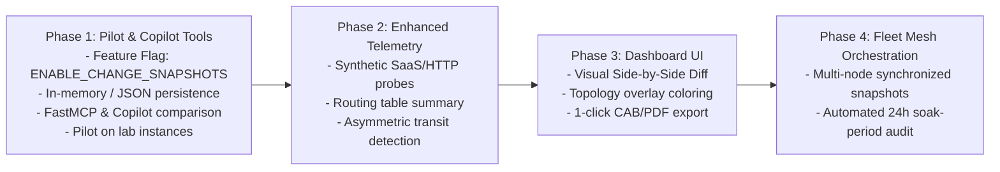

> **Last Updated:** 2026-10-18 | **Created:** 2026-10-18 (v3.0.39)
> **Status:** Draft (Evolutionary Architecture) | **Target:** v3.1.x / Pilot on v3

# PRD: Stigix ChangeGuard — State Snapshot, Before/After Delta Engine & AI Impact Assessment

| Metadata | Details |
|---|---|
| **Feature Name** | ChangeGuard (Before/After Snapshot & Delta Engine) |
| **Component** | Backend (`web-dashboard/server.ts`), FastMCP (`mcp-server/src/server.py`), AI Copilot (`ai-tools.ts`), Web Dashboard (`Observe` / `Maintenance`) |
| **Feature Flag** | `ENABLE_CHANGE_SNAPSHOTS` (default: `false`) |
| **Status** | In Pilot / Experimental Design |
| **Target Version** | v3.0.40 (Pilot / MCP) ➔ v3.1.0 (Full UI) |

---

## 1. Executive Summary & Problem Statement

### 1.1 The Pain Point: Network Maintenance Blind Spots
During network maintenance windows (site migration, SD-WAN router swap, ISP fiber cutover, configuration push), network engineers (NetOps) face a critical decision point—usually around 02:00 AM:
> *"Did this change break anything subtle? Is reachability 100% restored across the entire mesh? Do we validate the change or trigger a rollback?"*

Historically, engineers manually copy-paste terminal command outputs (`ping`, `traceroute`, `show ip route`, `show interfaces`) before and after the maintenance window. Subtleties like a 300% increase in jitter, a missing backup subnet route, or asymmetric routing across peers are frequently overlooked until end users start complaining the following morning.

### 1.2 The Solution
**Stigix ChangeGuard** provides an automated, lightweight **State Snapshot & Delta Engine** designed to capture pre-change baseline states, compare them against post-change or current states, and leverage AI Copilot (Claude / DeepSeek) to deliver actionable Go/No-Go recommendations, regression warnings, and CAB-ready closure reports.

---

## 2. Core Principles & Architecture Strategy

1. **Lightweight & Non-Disruptive:**
   A snapshot is simply a freeze-frame of data Stigix *already gathers in memory* (Topology, WireGuard peer states, DEM reachability matrix, synthetic probes). Creation time must be `< 50ms` with zero CPU overhead.
2. **Minimal Storage Footprint:**
   Each snapshot is a compact JSON payload (~10 KB to 40 KB). 100 snapshots consume under 4 MB. Snapshots are stored in local storage (`data/snapshots/*.json` or local SQLite) with automated retention policies.
3. **Evolutionary Pilot (Feature-Flagged):**
   The feature is isolated behind `ENABLE_CHANGE_SNAPSHOTS=false`. It begins as a headless Copilot / MCP tool for lab validation (BR1, DC1, BR8), and graduates to the web dashboard once the AI diff analysis is refined.
4. **AI-Assisted Interpretation over Raw Diffs:**
   Rather than overwhelming the operator with raw JSON or hundreds of line-by-line diffs, the LLM performs contextual analysis:
   - Go / No-Go verdict with confidence scoring.
   - Identified regressions (red) and performance gains (green).
   - Root-cause hypotheses and CLI remediation hints.

---

## 3. Evolutionary Roadmap



---

## 4. Phase 1: Pilot Specification (Immediate Implementation)

### 4.1 Data Schema: `StigixSnapshot`
A snapshot captures the local state and peer DEM interactions:

```json
{
  "id": "snap-20261018-123000-br1",
  "name": "pre-fiber-migration",
  "description": "Baseline before Orange fiber cutover on BR1",
  "timestamp": "2026-10-18T10:30:00.000Z",
  "node": {
    "nodeId": "BR1",
    "role": "peer",
    "version": "3.0.39",
    "wanIp": "198.51.100.22"
  },
  "tunnels": [
    {
      "peerId": "DC1",
      "status": "UP",
      "endpoint": "203.0.113.10:51820",
      "latestHandshake": 1729247380,
      "transferRxBytes": 104857600,
      "transferTxBytes": 52428800
    }
  ],
  "demMatrix": [
    {
      "targetPeer": "DC1",
      "latencyAvgMs": 24.2,
      "latencyMinMs": 22.1,
      "latencyP95Ms": 26.8,
      "jitterMs": 1.4,
      "packetLossPercent": 0.0,
      "mosScore": 4.38
    },
    {
      "targetPeer": "BR2",
      "latencyAvgMs": 35.0,
      "jitterMs": 2.1,
      "packetLossPercent": 0.0,
      "mosScore": 4.32
    }
  ],
  "metadata": {
    "createdBy": "copilot",
    "tags": ["migration", "wan"]
  }
}
```

### 4.2 Storage & File Management
- **Directory:** `data/snapshots/`
- **File Naming:** `{snapshot_id}.json`
- **Retention Rule:** Keep last 50 snapshots or delete snapshots older than 30 days.

### 4.3 REST API Endpoints (Guarded by `ENABLE_CHANGE_SNAPSHOTS`)

| Method | Endpoint | Description |
|---|---|---|
| `POST` | `/api/snapshots` | Capture and save a new snapshot (`{ name, description, tags }`). |
| `GET` | `/api/snapshots` | List all available snapshots (id, name, timestamp, node). |
| `GET` | `/api/snapshots/:id` | Fetch the full snapshot payload by ID or name. |
| `DELETE` | `/api/snapshots/:id` | Remove a stored snapshot. |
| `POST` | `/api/snapshots/diff` | Calculate deterministic delta between `baselineId` and `targetId` (or `"current"`). |

### 4.4 Deterministic Delta Engine Output (`/api/snapshots/diff`)
Before submitting to the LLM, the backend calculates deterministic numerical and state deltas:

```json
{
  "baseline": { "id": "snap-1", "name": "pre-fiber-migration", "timestamp": "..." },
  "target": { "id": "current", "timestamp": "..." },
  "summary": {
    "tunnelCount": { "before": 4, "after": 4, "delta": 0 },
    "tunnelsDegraded": [],
    "tunnelsRecovered": []
  },
  "demDeltas": [
    {
      "peer": "DC1",
      "latency": { "before": 24.2, "after": 11.5, "delta": -12.7, "percentChange": -52.4 },
      "packetLoss": { "before": 0.0, "after": 0.0, "delta": 0.0 },
      "jitter": { "before": 1.4, "after": 1.1, "delta": -0.3 },
      "mos": { "before": 4.38, "after": 4.41, "delta": 0.03 }
    },
    {
      "peer": "BR2",
      "latency": { "before": 35.0, "after": 36.2, "delta": 1.2, "percentChange": 3.4 },
      "packetLoss": { "before": 0.0, "after": 1.5, "delta": 1.5 },
      "jitter": { "before": 2.1, "after": 18.4, "delta": 16.3 }
    }
  ]
}
```

### 4.5 FastMCP & Copilot Tools Integration

Two new tools exposed to Claude & DeepSeek via FastMCP / Copilot (`ai-tools.ts` and `mcp-server/src/server.py`):

1. **`take_snapshot(name: str, description: str = "") -> dict`**
   - Calls the local snapshot collector.
   - Returns confirmation with key baseline stats (e.g., *"Snapshot `pre-migration` created: 4/4 tunnels UP, average RTT 24ms"*).

2. **`compare_snapshots(baseline: str, target: str = "current") -> dict`**
   - Retrieves the two snapshots (or captures `"current"`).
   - Generates the deterministic mathematical delta.
   - Instructs the LLM to format the response into:
     - **Verdict:** `GO` / `WARNING` / `NO-GO (ROLLBACK)`.
     - **Key Gains:** Latency reductions, jitter stability.
     - **Regressions:** Packet loss, missing tunnels, high jitter spikes.
     - **Recommendation:** Diagnostic command or confirmation to close change ticket.

---

## 5. Phase 2 & 3: Future Evolutionary Stages

### Phase 2: Synthetic Probes & Routing Expansion
- Include HTTP/DNS synthetic test results (e.g. latency to Office 365, internal DNS resolution time).
- Capture kernel route table summary (number of active routes, next-hops) to catch routing leaks or missing subnets.

### Phase 3: Dashboard UI & Change Advisory Board (CAB) Reports
- Dedicated **"ChangeGuard"** panel in the Stigix Web Dashboard.
- Visual side-by-side comparison table with color-coded badges (`🟢 Improved`, `🔴 Regressed`, `⚪ Unchanged`).
- One-click **"Export CAB Closure Report"** in Markdown or PDF with AI executive summary.

### Phase 4: Fleet Mesh Orchestration
- Leader node triggers synchronized snapshots across all peers simultaneously before major core updates.
- 24-hour post-maintenance "Soak Period" delta: compares baseline against normal peak operating hours next day.

---

## 6. Success Metrics for the Pilot

| Metric | Target |
|---|---|
| **Snapshot Capture Latency** | < 50ms per node |
| **Snapshot File Size** | < 50 KB JSON |
| **Diff Generation Time** | < 10ms |
| **Copilot Accuracy** | Correctly identifies simulated network regression (e.g. 5% packet loss or +50ms latency) 100% of the time |
| **Regression Risk on Stigix Core** | 0% (guarded by `ENABLE_CHANGE_SNAPSHOTS=false` default) |

---

## 7. Revision History

| Date | Version | Author | Description |
|---|---|---|---|
| 2026-10-18 | v1.0.0 | Stigix Core Team | Initial evolutionary PRD for ChangeGuard & Pilot specification. |
