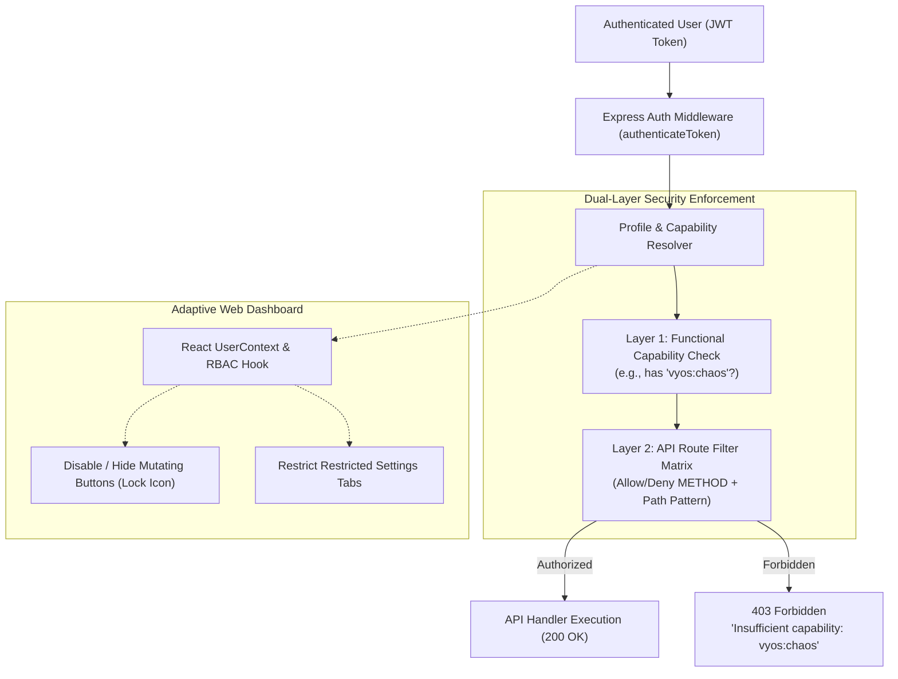
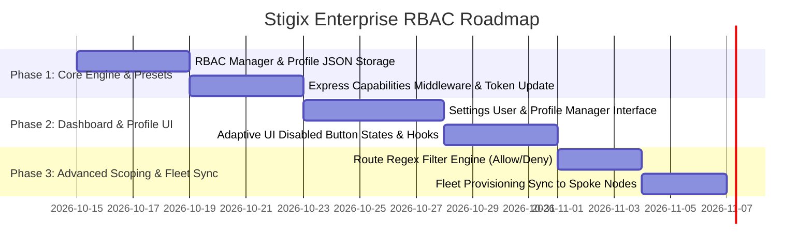

> **Last Updated:** 2026-10-13 | **Created:** 2026-10-13 (v3.0.3)

# PRD — Enterprise Role-Based Access Control (RBAC) & Profile System

---

## 1. Executive Summary & Vision

### 1.1 The Challenge
Stigix currently features a basic authentication mechanism where users are stored in `config/users.json` with a binary role (`admin` vs. `user`). This creates major operational limitations in enterprise environments:
- **Demonstration & Customer Showcases:** Operators cannot create a safe, Read-Only demo user without risking an accidental click on "Stop Traffic", "VyOS Interface Shut", or probe deletion.
- **Auditing & Compliance:** Security teams require access to audit security logs and run automated compliance scans without having the ability to alter cluster settings or underlay routing.
- **Operations vs. Administration Separation:** Daily SD-WAN test engineers need the freedom to launch speedtests, simulate voice calls, and inject VyOS impairments without having permission to edit cluster tokens, cloud API keys, or user accounts.

### 1.2 The Solution
The **Stigix Enterprise RBAC System** introduces a hybrid **Capability-Based Permission Matrix with Custom API Route Scoping**:
1. **Granular Permissions (Capabilities):** Intuitive feature-level permissions (e.g., `traffic:run`, `vyos:chaos`, `dem:edit`, `system:read`).
2. **Clonable Profile Presets:** Built-in enterprise presets (`Super Admin`, `SD-WAN Test Operator`, `Demo / Read-Only Observer`, `Security Auditor`) that can be used directly or cloned into custom tenant profiles.
3. **Advanced API URL Route Scoping (Allow/Deny Filters):** For advanced needs, profiles can specify exact HTTP Method + Path rules (e.g., `ALLOW GET /api/*`, `DENY POST /api/vyos/*`) ensuring defense-in-depth at the API gateway layer.
4. **Adaptive UI Synchronization:** The frontend automatically hides or disables action buttons with informative tooltips based on the active user profile.



---

## 2. Personas & Core Use Cases

| Persona | Operational Scenario | Assigned Profile | Key Permissions |
|---|---|---|---|
| **Platform Administrator** | Manages licenses, cluster enrollment, fleet tokens, user accounts, and AI Copilot BYOK keys. | `Super Admin` | Full Read-Write across all subsystems (`*`). |
| **SD-WAN QA / Lab Engineer** | Runs traffic simulations, launches speedtests, injects VyOS delay/loss, and creates custom apps. Cannot alter cluster tokens or manage users. | `Test Operator` | Full execution rights on tests and impairments; Read-Only on system configuration. |
| **Executive / Customer Demo** | Walks through live dashboards, inspects charts, views topology, and observes DEM metrics during customer presentations. Zero mutation allowed. | `Read-Only Viewer` | Pure Read-Only across all API endpoints (`GET /api/*`). All action buttons locked. |
| **SASE Security Auditor** | Validates URL filtering, executes EICAR and threat tests, inspects flow logs, and generates reports. | `Security Auditor` | Full Read-Write on `/api/security/*` and `/api/prisma/*`; Read-Only on network tests. |

---

## 3. Architecture & Functional Specifications

### 3.1 Permission Hierarchy & Capabilities

Permissions follow a clean `domain:action` taxonomy:

| Domain | Capability ID | Description | Allowed Endpoints (Representative) |
|---|---|---|---|
| **Traffic** | `traffic:read`<br/>`traffic:execute` | View traffic metrics.<br/>Start, stop, and change traffic generation intensity. | `GET /api/traffic/status`<br/>`POST /api/traffic/start`, `POST /api/traffic/stop` |
| **Tests** | `tests:read`<br/>`tests:execute` | View test history and active jobs.<br/>Launch XFR speedtests, convergence, and voice calls. | `GET /api/tests/*`<br/>`POST /api/tests/xfr`, `POST /api/voice/start` |
| **VyOS** | `vyos:read`<br/>`vyos:chaos` | View router status, interfaces, and history.<br/>Inject QoS latency/loss, shut/no-shut interfaces, and run chaos scenarios. | `GET /api/vyos/*`<br/>`POST /api/vyos/direct-action`, `POST /api/vyos/bulk-reset` |
| **DEM** | `dem:read`<br/>`dem:manage` | View synthetic probe scores and latency charts.<br/>Create, edit, enable/disable, and delete DEM probes. | `GET /api/connectivity/*`<br/>`POST /api/connectivity/custom`, `DELETE /api/connectivity/custom/:id` |
| **Security** | `security:read`<br/>`security:execute` | View security verdicts, EICAR stats, and Prisma flows.<br/>Run URL batches, DNS batches, and EICAR threat simulations. | `GET /api/security/*`, `POST /api/prisma/flows`<br/>`POST /api/security/url-batch`, `POST /api/security/threat-test` |
| **Apps** | `apps:read`<br/>`apps:manage` | View custom TCP/UDP apps and active flows.<br/>Create, edit, import, and delete East-West custom apps. | `GET /api/custom-tcp/apps`<br/>`POST /api/custom-tcp/apps`, `DELETE /api/custom-tcp/apps/:id` |
| **Capture** | `capture:read`<br/>`capture:execute` | Download existing PCAP captures.<br/>Start live packet sniffing (BPF filter) or run PCAP replay. | `GET /api/pcap/*`<br/>`POST /api/pcap/start`, `POST /api/pcap/replay` |
| **Copilot** | `copilot:use`<br/>`copilot:admin` | Chat with AI Copilot.<br/>Configure BYOK API keys, change model provider, and edit system guidelines. | `POST /api/copilot/chat`<br/>`POST /api/copilot/config` |
| **System** | `system:read`<br/>`system:admin` | View health matrix, license info, and system status.<br/>Cluster enrollment, site renaming, factory reset, user management. | `GET /api/system/*`, `GET /api/registry/*`<br/>`POST /api/admin/*`, `POST /api/auth/users/*` |

---

### 3.2 Built-in Profile Presets

Stigix provides 4 immutable out-of-the-box presets, plus support for unlimited user-defined custom profiles:

```json
{
  "presets": [
    {
      "id": "profile-super-admin",
      "name": "Super Administrator",
      "description": "Full unconstrained administrative access across all platform subsystems.",
      "is_preset": true,
      "capabilities": ["*"],
      "route_rules": []
    },
    {
      "id": "profile-operator",
      "name": "SD-WAN Test Operator",
      "description": "Can execute traffic generation, WAN impairments, voice, and speedtests. Configuration and user administration are restricted.",
      "is_preset": true,
      "capabilities": [
        "traffic:read", "traffic:execute",
        "tests:read", "tests:execute",
        "vyos:read", "vyos:chaos",
        "dem:read",
        "apps:read", "apps:manage",
        "capture:read", "capture:execute",
        "copilot:use",
        "system:read"
      ],
      "route_rules": [
        { "effect": "DENY", "method": "*", "path": "/api/auth/users*" },
        { "effect": "DENY", "method": "*", "path": "/api/registry/cluster*" },
        { "effect": "DENY", "method": "POST", "path": "/api/copilot/config" }
      ]
    },
    {
      "id": "profile-readonly",
      "name": "Demo / Read-Only Observer",
      "description": "Safe preview profile for demonstrations and dashboards. Completely prevents any network modification or test execution.",
      "is_preset": true,
      "capabilities": [
        "traffic:read", "tests:read", "vyos:read",
        "dem:read", "security:read", "apps:read",
        "capture:read", "copilot:use", "system:read"
      ],
      "route_rules": [
        { "effect": "ALLOW", "method": "GET", "path": "/api/*" },
        { "effect": "ALLOW", "method": "POST", "path": "/api/copilot/chat" },
        { "effect": "DENY", "method": "POST", "path": "/api/*" },
        { "effect": "DENY", "method": "DELETE", "path": "/api/*" },
        { "effect": "DENY", "method": "PUT", "path": "/api/*" }
      ]
    },
    {
      "id": "profile-security-auditor",
      "name": "Security & Compliance Auditor",
      "description": "Specialized profile for SecOps. Full control over security probes and Prisma flow inspection; Read-Only on underlay networks.",
      "is_preset": true,
      "capabilities": [
        "security:read", "security:execute",
        "traffic:read", "dem:read", "system:read",
        "capture:read"
      ],
      "route_rules": [
        { "effect": "ALLOW", "method": "*", "path": "/api/security/*" },
        { "effect": "ALLOW", "method": "*", "path": "/api/prisma/*" },
        { "effect": "DENY", "method": "POST", "path": "/api/vyos/*" },
        { "effect": "DENY", "method": "POST", "path": "/api/tests/*" }
      ]
    }
  ]
}
```

---

### 3.3 Custom Profile Cloning & Route Filtering
Administrators can:
1. **Clone** any existing preset (e.g., clone `SD-WAN Test Operator` as `Junior Field Tester`).
2. **Toggle individual capabilities** via an intuitive matrix of checkboxes.
3. **Add custom Route Filter Rules** (Advanced Tab):
   - **Effect:** `ALLOW` or `DENY`.
   - **HTTP Method:** `*`, `GET`, `POST`, `PUT`, `DELETE`.
   - **Path Pattern:** Glob expression (e.g. `/api/vyos/direct-action`, `/api/speedtest/*`).
   - **Evaluation Order:** Deny rules take precedence over Allow rules (Standard Principle of Least Privilege).

---

## 4. Technical Specifications & Data Models

### 4.1 Storage Model (`config/rbac-profiles.json`)
A new persistent file in the `config/` directory stores profile definitions:

```json
{
  "profiles": [
    {
      "id": "prof-custom-partner",
      "name": "Partner Validation Tech",
      "description": "Custom profile for third-party lab validation",
      "is_preset": false,
      "cloned_from": "profile-operator",
      "created_at": 1791878000000,
      "capabilities": ["tests:execute", "dem:read", "traffic:read"],
      "route_rules": [
        { "effect": "ALLOW", "method": "POST", "path": "/api/tests/xfr" }
      ]
    }
  ]
}
```

### 4.2 Updated User Model (`config/users.json`)
The existing user schema expands backwards-compatibly:

```json
[
  {
    "id": "usr-admin-01",
    "username": "admin",
    "passwordHash": "$2a$10$...",
    "profile_id": "profile-super-admin",
    "created_at": 1791870000000,
    "last_login": 1791878200000,
    "role": "admin" // Kept for v2 backwards-compatibility
  },
  {
    "id": "usr-demo-02",
    "username": "demo",
    "passwordHash": "$2a$10$...",
    "profile_id": "profile-readonly",
    "created_at": 1791871000000,
    "last_login": 1791877000000,
    "role": "user"
  }
]
```

### 4.3 JWT Token & Middleware Enforcement

1. **JWT Payload:**
   On login (`/api/auth/login`), the generated JWT includes the user's active capabilities:
   ```json
   {
     "username": "demo",
     "profile_id": "profile-readonly",
     "capabilities": ["traffic:read", "tests:read", "vyos:read", ...],
     "exp": 1791964600
   }
   ```

2. **Express Middleware Guard (`rbacGuard`):**
   ```ts
   // Example Route Annotation
   app.post('/api/vyos/direct-action', authenticateToken, requireCapability('vyos:chaos'), handleDirectVyosAction);
   app.post('/api/traffic/start', authenticateToken, requireCapability('traffic:execute'), handleTrafficStart);
   ```

3. **Fallback Route Rule Interceptor:**
   Before reaching the route handler, a global RBAC validator inspects custom `route_rules` for the user's profile:
   ```ts
   function enforceRouteRules(req: Request, res: Response, next: NextFunction) {
       const userProfile = rbacManager.getProfile(req.user.profile_id);
       if (!userProfile) return next();
       
       const matchedRule = rbacManager.matchRule(userProfile.route_rules, req.method, req.path);
       if (matchedRule?.effect === 'DENY') {
           return res.status(403).json({
               success: false,
               error: 'Access Denied',
               message: `Your profile (${userProfile.name}) does not permit ${req.method} on ${req.path}.`
           });
       }
       next();
   }
   ```

---

## 5. UI/UX Specifications (Web Dashboard)

### 5.1 Settings ➔ User Management & Profiles Tab
The User Management tab in **Settings** ([`Settings.tsx`](file:///Users/jsuzanne/Github/stigix/web-dashboard/src/Settings.tsx)) is restructured into two sub-views:
1. **Users View:**
   - Table of users showing: Avatar, Username, Assigned Profile (badge), Created Date, Last Active, and Actions (Edit Profile, Change Password, Delete).
   - "Add User" modal featuring a dropdown to select the assigned Profile.
2. **Access Profiles View:**
   - Cards displaying the 4 Presets (with "Preset" lock badge) and custom profiles.
   - **"Clone Profile"** button on every card.
   - Profile Editor Modal:
     - Profile Name & Description.
     - Interactive Grid of Capabilities with "Select All" / "Deselect All" per domain.
     - Advanced Tab: Table of Route Filter Rules (`ALLOW` / `DENY`, Method, Path pattern).

### 5.2 Adaptive UI & Action Button States
When an operator with a restricted profile (e.g. `Read-Only Observer`) logs into Stigix:
1. **Mutating Buttons (Start Traffic, Run Speedtest, Inject QoS, Delete Probe):**
   - Rendered in a disabled state with a sleek lock icon (`<Lock size={12} />`).
   - Hover tooltip displays:  
     `🔒 Action restricted by profile: "Demo / Read-Only Observer" (Requires capability: traffic:execute)`
2. **Protected Settings Sub-Tabs (Cluster & Mesh, User Management, BYOK Copilot Keys):**
   - Hidden or replaced with an access-denied state explaining required permissions.

---

## 6. Security, Compliance & Safety Constraints

1. **Immutable Super Admin Guard:**
   - The default `admin` user cannot be deleted or assigned a profile other than `Super Administrator`.
   - The `Super Administrator` preset cannot be modified or deleted.
2. **Local Peer & Spoke Replication:**
   - In Fleet / Cluster mode, user profiles defined on the Leader (DC1) automatically sync to spoke nodes via the `provisioningManager` to ensure unified access control across all fabric instances.
3. **Session Revocation:**
   - If an administrator changes a user's profile or revokes permissions, active JWT sessions are invalidated on next verification via a user `token_version` check.

---

## 7. Phased Implementation Roadmap



---

## 📜 Revision History

| Date | Stigix Version | Author / Trigger | Summary of Changes |
|---|---|---|---|
| 2026-10-13 | `v3.0.3` | Stigix Core Team | Initial PRD creation for Enterprise RBAC & Profile System |
