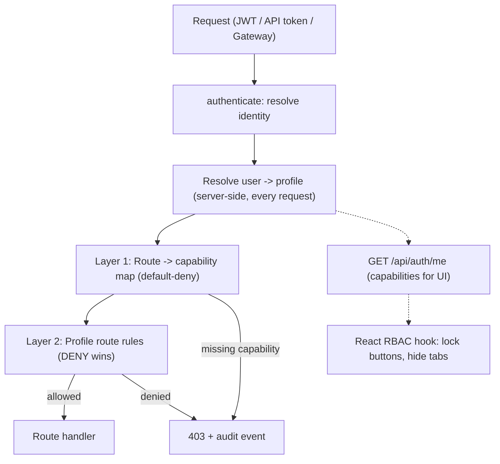

> **Last Updated:** 2026-10-16 | **Created:** 2026-10-13 (v3.0.3)

# PRD — Enterprise Role-Based Access Control (RBAC) & Profile System

**Status:** Draft v4 (zero-regression & multi-node fleet hardened) | **Owner:** Stigix Core Team | **Target:** v3.1.x

---

## 1. Executive Summary & Vision

### 1.1 Current State (as implemented today)
Verified in `web-dashboard/server.ts`, `api-studio-routes.ts`, and `ai-copilot/`:

| Aspect | Today |
|---|---|
| Users | `config/users.json` = `[{ username, passwordHash }]`. **There is no `role` field.** |
| "Admin" | Hard-coded: `username === 'admin'`. Only used to guard `POST /api/auth/users` (create user). There is no list/edit/delete user API. |
| Token | JWT `{ username }`, 24 h, signed with `JWT_SECRET` (falls back to a hard-coded default if unset). No revocation. |
| Authorization | **None beyond authentication.** Any authenticated user can call any of the ~242 routes in `server.ts` (plus routes in `custom-tcp-apps/`, `pcap-routes.ts`, `packet-capture-routes.ts`, `api-studio-routes.ts`, and `ai-copilot/api-routes.ts`). |
| Public routes | 14 routes in `server.ts` have no `authenticateToken` (login, health, status, version, features, join flows, internal log event, etc.). Socket.IO (`join-device-logs`) also lacks authentication middleware. |
| Fleet identity | Requests dispatched by the reverse tunnel (loopback + `x-gateway-source`) and requests proxied by the leader (JWT `{ username: 'stigix-gateway', role: 'admin' }`, 30 s) are **always admin**, and the end user's identity is lost. |
| Other clients | SSE streams accept `?token=`; Copilot tools (`ai-tools.ts`), MCP server and CLI all call the same API or invoke in-memory managers (`ToolExecutionContext`) directly with a shared global context. |
| API Playground | `POST /api/playground/execute` (`api-studio-routes.ts`) can inject server-held Prisma SASE OAuth tokens (`autoAuth: 'sase'`) or VyOS API keys (`autoAuth: 'vyos'`) on behalf of any authenticated caller, and `GET /api/api-studio/stream` broadcasts all global API traffic in real time. |
| Brute-force protection | None (no rate limiter dependency). |

Consequence: every non-`admin` account is effectively an administrator, and a "demo" account is impossible without risking a click on "Stop Traffic", a VyOS interface shutdown, a probe deletion, or privilege escalation through API Playground / AI Copilot.

### 1.2 The Solution
A hybrid **Capability + Route-Rule** model with clonable profiles:
1. **Capabilities** (`domain:action`, e.g. `traffic:execute`) drive clean UI checkboxes, UI locking and coarse enforcement.
2. **Profiles** bundle capabilities. Four immutable presets plus unlimited clones.
3. **Route rules** (optional, advanced): `ALLOW`/`DENY` on method + path glob for defense in depth and special cases.
4. **Identity propagation** so that Copilot (including in-memory tool calls), MCP, CLI, API Playground, Socket.IO, the fleet gateway and automation tokens are all subject to the same checks.
5. **Audit trail** of every denied and every mutating action.

### 1.3 Goals and Non-Goals

| Goals | Non-Goals (v1) |
|---|---|
| Default-deny authorization on all `/api/*` routes | SSO / OIDC / LDAP (design must not prevent it later) |
| 4 presets + clone/edit custom profiles | Per-object (row-level) permissions, e.g. "only probe X" |
| Read-only demo that cannot leak secrets | Multi-tenancy inside one node |
| Same enforcement for UI, Copilot, MCP, CLI, fleet gateway | MFA |
| Audit log + safe, reversible rollout (audit-only mode) | Time-boxed / scheduled access |



---

## 2. Personas & Presets

| Persona | Scenario | Preset |
|---|---|---|
| **Platform Administrator** | Cluster, users, keys, fleet, licenses | `Super Administrator` |
| **SD-WAN QA / Lab Engineer** | Runs traffic, speedtests, voice, chaos, custom apps; cannot manage users, keys, fleet | `SD-WAN Test Operator` |
| **Executive / Customer Demo** | Dashboards, charts, topology; zero mutation, zero secrets | `Demo / Read-Only Observer` |
| **SASE Security Auditor** | Security tests, Prisma flows, reports | `Security & Compliance Auditor` |
| **Automation / Integration** | MCP server, CLI, CI | Dedicated **API token** bound to any profile (see 4.5) |

---

## 3. Functional Specifications

### 3.1 Capability Taxonomy

Naming is strictly `domain:action` with actions limited to `read`, `execute` (start/stop/run something transient), `manage` (create/edit/delete persistent config) and `admin`.

| Domain | `read` | `execute` | `manage` / `admin` |
|---|---|---|---|
| **traffic** | status, stats, interface info | start/stop generator, change intensity | edit application list (`manage`) |
| **tests** | XFR history, test results, voice/convergence status | launch XFR, iperf client, convergence, voice calls | edit voice/SIP config, clear histories (`manage`) |
| **targets** | XFR quick/merged targets, Cloud Target status | trigger Cloud Target scenarios | create/edit/delete targets and scenarios (`manage`) |
| **vyos** | router state, history, sequences | direct actions, run sequences (chaos) | routers, sequences, config import/reset (`manage`) |
| **dem** | probe results, stats | run probe now | create/edit/delete probes (`manage`) |
| **iot** | device list, status, real-time logs (`Socket.IO`) | start/stop IoT daemon or device simulation | create/edit/delete IoT devices (`manage`) |
| **security** | verdicts, stats | URL/DNS batches, EICAR, threat tests | edit security config, upload EDL (`manage`) |
| **prisma** | flows, SD-WAN topology data | — | credentials/config (`admin`) |
| **apps** | custom TCP apps and flows | start/stop apps | create/edit/import/delete (`manage`) |
| **multicast** | streams and stats | start/stop, scenarios | create/edit/delete (`manage`) — see `PRD_MULTICAST_SDWAN_OVERLAY.md` |
| **capture** | list captures and PCAP profiles | start capture, run PCAP replay | upload/edit/delete captures & PCAP profiles (`manage`) |
| **capture:download** | download raw PCAP/payload data (**sensitive**) | | |
| **copilot** | public config (`GET /api/copilot/config`), own sessions | `use` (chat — tools gated by caller's capabilities) | BYOK keys, provider, guidelines, all sessions (`admin`) |
| **system** | health, version, status, standard logs | — | settings, site rename, PKI/CA certificates, API Studio / Playground, backups (`admin`) |
| **fleet** | peer list, registry status, topology | — | enrollment, Magic Join, tokens, provisioning, remote access config (`admin`) |
| **users** | — | — | users, profiles, API tokens (`admin`) |
| **secrets** | `secrets:read` — any endpoint that returns credentials, keys, tokens, raw API inspector payloads or full config exports (**sensitive**) | | |

Hierarchy: `manage` implies `execute` and `read`; `execute` implies `read`; `admin` implies all actions in its domain (`copilot:use` is mapped to `copilot:execute` internally). `*` = everything.

### 3.2 Sensitive reads are not "read-only"
A `GET` is not necessarily safe. Endpoints such as cloud/Prisma config, VyOS config export, BYOK keys, fleet/join tokens, CA private material, raw API Studio inspector buffers (`/api/api-studio/stream`, `/api/api-studio/recent`), PCAP downloads or full backups return secrets or cross-user sensitive data. They are classified `secrets:read` / `capture:download` / `system:admin` and are **excluded from the Demo preset**, even though they are `GET`. Where the UI needs part of such a payload (e.g., `GET /api/copilot/config` or Prisma connection status), the server returns a **redacted/masked** version for callers lacking `secrets:read`.

### 3.3 Built-in Presets (immutable, clonable)

| Preset | Capabilities | Route rules |
|---|---|---|
| `Super Administrator` (`profile-super-admin`) | `*` | none |
| `SD-WAN Test Operator` (`profile-operator`) | all `read` (except `secrets:read`); `traffic:execute`; `tests:execute`; `targets:manage`; `vyos:execute`; `dem:manage`; `iot:manage`; `apps:manage`; `multicast:manage`; `capture:execute`; `copilot:use`; `security:read` | `DENY * /api/auth/users*`, `DENY POST\|PUT\|DELETE /api/fleet/*`, `DENY POST\|PUT\|DELETE /api/copilot/config` |
| `Demo / Read-Only Observer` (`profile-readonly`) | all `read` **except** `secrets:read` and `capture:download`; `copilot:use` (read-only tools only, see 3.6) | `DENY POST /api/*`, `DENY PUT /api/*`, `DENY DELETE /api/*`, `DENY PATCH /api/*`, `ALLOW POST /api/copilot/chat`, `ALLOW POST /api/copilot/sessions`, `ALLOW POST /api/auth/stream-ticket` |
| `Security & Compliance Auditor` (`profile-security-auditor`) | all `read` (except `secrets:read`); `security:manage`; `prisma:read`; `capture:read`; `copilot:use` | `DENY POST\|PUT\|DELETE /api/vyos/*`, `DENY POST /api/tests/*` |

Precise capability lists live in `web-dashboard/rbac/presets.ts` (single source of truth, unit-tested). Note that in `SD-WAN Test Operator`, `GET /api/fleet/*` and `GET /api/copilot/config` remain allowed so the operator can view fleet peers and load the Copilot UI. In `Demo / Read-Only Observer`, `DENY POST /api/*` intentionally blocks `POST /api/auth/change-password` so a visitor on a shared demo account cannot hijack the password and lock out other demo users (while `ALLOW DELETE /api/copilot/sessions/:id` is permitted for the user's own sessions).

### 3.4 Route Rules: semantics (normative)
Evaluation is defined as:

1. Candidate rules are those whose method (`*`, single method, or pipe-separated `POST|PUT|DELETE`) and path glob match the request.
2. **Most specific path wins** (longest literal prefix; exact > glob). At equal specificity, **`DENY` wins**.
3. If no rule matches, the decision is left to Layer 1 (capabilities). Route rules can therefore only **narrow** (`DENY`) or explicitly **grant a single route inside an already-allowed capability** (e.g. `ALLOW POST /api/copilot/chat` when `POST /api/*` is denied by a broader rule and the profile holds `copilot:use`). An `ALLOW` rule can never grant a route whose capability the profile lacks, except where `grant_override: true` is set by a Super Administrator (audited).
4. Matching is done on the **normalized** `req.originalUrl` path: query string stripped, `//` and trailing `/` collapsed, `.`/`..` resolved, case-sensitive, and URL-decoded once. Express mount points (`app.use('/api/x', ...)`) therefore cannot cause bypasses.

### 3.5 Route -> Capability Map & Zero-Regression Single-Gate Architecture (default-deny)
With ~242 routes spread across `server.ts`, `custom-tcp-apps/api-routes.ts`, `pcap-routes.ts`, `packet-capture-routes.ts`, `api-studio-routes.ts` (mounted on `/api/api-studio`, `/api/logs`, and `/api/playground`), and `ai-copilot/api-routes.ts`, annotating handlers one by one is error-prone. Instead:

- **Single global mount:** All scattered `app.use('/api/...', authenticateToken)` and per-route `authenticateToken` middlewares are consolidated into a single `app.use('/api', authenticateToken, rbacGate)` registered **before** all `/api/*` route and sub-router definitions.
- **Fail-safe Super Admin pass-through (Zero-Regression guarantee):** If the caller resolves to `profile-super-admin` (or `RBAC_MODE === 'off'`), `rbacGate` immediately short-circuits (`return next()`) in $O(1)$. This guarantees that `admin` users, `stigix-cli.py`, `mcp-server`, and internal orchestrators (`aiCopilotSystemToken`, `stigix-multicast-orchestrator`) can **never** be broken even if a newly added internal route is missing from `route-map.ts`.
- **Central table & route tiers:** `web-dashboard/rbac/route-map.ts` classifies every `METHOD + normalized full path pattern` into one of four explicit tiers:
  1. **`PUBLIC` (unauthenticated pre-login, Docker healthcheck & peer discovery):** `POST /api/auth/login`, `GET /api/health`, `GET /api/version`, `GET /api/features`, `GET /api/config/ui`, `GET /api/icons`, `GET /api/status`, `GET /api/stats`, `GET /api/system/tunnel-status` (used by `install.sh` to verify tunnel establishment), and `GET /api/connectivity/iperf/server` (probed directly by remote Stigix peers to check if `iperf3 -s` is running).
  2. **`MACHINE_AUTH` (unauthenticated user JWT, authenticated via peer key / HMAC / loopback):**
     - `/api/registry/register`, `/api/registry/instances`, `/api/registry/targets`, `/api/registry/provisioning/*` (`local-registry-server.ts` — Spoke heartbeats and bundle pulls every 30 s).
     - `POST /api/fleet/join-redeem` (`server.ts` — Spoke onboarding, authenticated by `STX-...` HMAC signature in `magicJoinManager.redeemToken()`).
     - `POST /api/registry/join-with-token` (`server.ts` — allowed from loopback `127.0.0.1`/`::1` when the node is not yet enrolled so `install.sh` Zero-Touch onboarding works untouched; otherwise requires `authenticateToken` + `fleet:admin` to prevent remote unauthenticated cluster takeover).
     - `POST /api/internal/log-event` and `POST /api/api-studio/internal/log-event` (Python micro-engine telemetry ingestion — restricted strictly to loopback IP `127.0.0.1` / `::1` / `::ffff:127.0.0.1` so existing Python scripts require zero changes while blocking external spoofing).
  3. **`AUTHENTICATED` (any logged-in user, subject to Layer 2 route rules):** `GET /api/auth/me`, `POST /api/auth/stream-ticket`, and `POST /api/auth/change-password`.
  4. **Capability-mapped routes:** All remaining `/api/*` routes mapped to a specific `domain:action` capability.
- **Gateway BFF Reverse Proxy unwrapping (`/api/gateway/:peerId/*`):** When a request targets `/api/gateway/:peerId/<innerPath>` (`server.ts` L15171), `rbacGate` on the Leader first requires `fleet:read`, then strips `/api/gateway/:peerId` and evaluates `(req.method, /<innerPath>)` against `route-map.ts` and the caller's `route_rules` before forwarding. A non-admin user can therefore switch context to a remote Spoke in the UI (`GET` telemetry) without being able to proxy unauthorized mutations (`POST /api/gateway/br1/api/vyos/...`).
- **Coverage test (CI):** Boots the Express app / router stack, enumerates every registered `(method, fullPath)` across `app` and all mounted sub-routers, and fails if any route is missing from `route-map.ts`.
- Mutating methods on unmapped routes always require `system:admin` as a safe fallback in `audit` mode.

### 3.6 Copilot, API Playground, Socket.IO, MCP, CLI and Fleet: identity propagation
These channels are the highest-risk bypasses because they act on behalf of a user or hold server credentials:

| Channel | Requirement |
|---|---|
| **AI Copilot (`ai-manager.ts` & `ai-tools.ts`)** | 1. **Per-request context:** `streamChat()` receives `req.user` (and resolved capabilities) and creates a request-scoped `ToolExecutionContext` carrying the caller's token/identity instead of using a shared global context.<br>2. **Direct-execution tool gate:** Many tools in `ai-tools.ts` call in-memory managers directly when `nodeCtx.isLocal` is true (`ctx.saveCustomProbes`, `ctx.vyosManager`, `ctx.tcpAppManager`, `ctx.xfrManager`, `ctx.runCommand`) without making an HTTP call. `executeCopilotTool()` **must** check a mandatory `TOOL_CAPABILITY_MAP` (mapping all ~50 tools to their required capability) **before** invoking any handler, in addition to forwarding the user's JWT on `fetchApi()` calls.<br>3. **Session isolation:** Copilot sessions (`ai-sessions.json`) store `owner: username`. Non-admin users can only list, view, chat in, or delete their own sessions (`copilot:admin` can view/clear all). |
| **API Studio & Playground (`api-studio-routes.ts`)** | 1. **`POST /api/playground/execute`:** Currently injects server-held Prisma SASE OAuth tokens (`autoAuth: 'sase'`), VyOS API keys (`autoAuth: 'vyos'`), or local JWTs (`autoAuth: 'stigix'`). Under RBAC: requires `system:admin` by default (or `prisma:admin` for `autoAuth: 'sase'`, `vyos:manage` for `autoAuth: 'vyos'`). Arbitrary external/loopback URL proxying without matching admin capability is denied to prevent SSRF and credential abuse.<br>2. **Live Inspector (`/api-studio/stream`, `/recent`, `/clear`):** Captures all inbound/outbound payloads across all users. Restricted to `system:admin` (or `secrets:read` for read-only inspection).<br>3. **`POST /internal/log-event`:** Restricted to loopback IP (`127.0.0.1` / `::1`) so external callers cannot spoof inspector logs without breaking local Python scripts. |
| **Socket.IO (`server.ts`)** | `io.use()` handshake middleware verifies the user's JWT or stream ticket and attaches `socket.data.user`. Subscribing to `join-device-logs` requires `iot:read`. |
| **MCP server / CLI** | Authenticate with an **API token** (4.5) bound to a profile, e.g. a read-only token for dashboards or an operator token for test automation. |
| **Unified Fleet Proxy (`mintPeerProxyToken`)** | Today, Leader $\rightarrow$ Spoke proxy calls (`/api/gateway/:peerId/*` at `server.ts` L15238, `ai-tools.ts` L1189, multicast `nodeForwarder` at `server.ts` L15522) hard-code `{ username: 'stigix-gateway', role: 'admin' }`, while Spoke $\rightarrow$ Leader matrix proxy calls (`/api/fleet/matrix/*` at `server.ts` L14199, L14222, L14257, L14318) hard-code `{ username: 'system-proxy' }` signed with a mismatched fallback `'stigix-secret-key-12345'`.<br>All inter-node user proxy calls are unified into a single helper `mintPeerProxyToken(req.user, peerId)` signed with `SECRET_KEY` (30 s TTL) carrying `{ sub, username, role: 'admin', profile_id, capabilities: string[], route_rules, is_peer_proxy: true, peer }`.<br>• **Zero-Regression rolling upgrades:** Retaining `role: 'admin'` and `username` in the JWT payload ensures older Spokes/Leaders not yet upgraded during a rolling `stigix-fleet-upgrade` continue to accept the token, while upgraded nodes inspect `is_peer_proxy: true` and enforce `profile_id` + `capabilities` + `route_rules` without race conditions.<br>• **Legacy peer compatibility:** If an upgraded node receives a proxy token from a non-upgraded peer lacking `profile_id` (`username` in `['stigix-gateway', 'system-proxy', 'stigix-multicast-orchestrator']`), it gracefully defaults to `profile-super-admin` while `RBAC_MODE !== 'enforce'`. |
| **Loopback tunnel dispatch** | Requests dispatched locally by `fleet-tunnel.ts` include an in-memory per-process header (`x-stigix-internal-secret`) in addition to `x-gateway-source`, while preserving seamless fallback if the header is already accompanied by a valid `mintPeerProxyToken` `Authorization` bearer token. |

---

## 4. Technical Specifications

### 4.1 Storage (`config/rbac-profiles.json`)
```json
{
  "version": 1,
  "profiles": [
    {
      "id": "prof-custom-partner",
      "name": "Partner Validation Tech",
      "description": "Custom profile for third-party lab validation",
      "is_preset": false,
      "cloned_from": "profile-operator",
      "created_at": 1791878000000,
      "updated_at": 1791878000000,
      "capabilities": ["tests:execute", "dem:read", "traffic:read"],
      "route_rules": [
        { "effect": "DENY", "method": "POST", "path": "/api/tests/xfr/*" }
      ]
    }
  ]
}
```
Presets are defined in code and are **not** stored, so upgrades can add capabilities to presets safely. The file stores custom profiles only. Writes are atomic (temp file + rename) and backed up.

### 4.2 Users (`config/users.json`) and migration
Target schema (backwards compatible reader):
```json
[{ "username": "admin", "passwordHash": "$2a$...", "profile_id": "profile-super-admin",
   "token_version": 1, "created_at": 1791870000000, "last_login": 1791878200000, "disabled": false }]
```
The legacy `role` field never existed on disk and is **not** introduced; the legacy "admin" check becomes `profile_id === 'profile-super-admin'`.

**Migration (first start on v3.1):**
- `admin` -> `Super Administrator`.
- Every other existing user currently has near-admin power. To avoid breaking anyone, they are mapped to a preset **`Legacy User`** (all capabilities except `users:admin`, `fleet:admin`, `secrets:read`, `copilot:admin`, matching today's practical limits as closely as possible). A banner invites the admin to reassign them. `Legacy User` is hidden for new assignments.
- A backup `users.json.pre-rbac` is written before migration.
- Last Super Administrator can never be deleted, disabled or downgraded.

### 4.3 Authentication and enforcement
1. **Login & instant server-side resolution:** `/api/auth/login` issues a JWT `{ sub, username, profile_id, token_version }` (`username` kept alongside `sub` for 100% backward compatibility with existing handlers reading `req.user.username`). **Capabilities are not embedded** in user session JWTs: for every non-proxy request (`!is_peer_proxy`), `authenticateToken` looks up the user in the in-memory `users.json` cache ($O(1)$) and resolves their current `profile_id` and capabilities from the profile store. Deleting/disabling a user or changing their profile therefore takes effect **immediately (0 ms)** on the very next request without waiting for the 8 h JWT expiry.
2. **Revocation:** a request is rejected (`401`) if the user no longer exists in `users.json`, is `disabled: true`, or if `token_version` in the JWT differs from the user's current value. Changing a password or forcing session logout bumps `token_version`.
3. **Single middleware** `rbacGate` registered once after `authenticateToken` for the whole `/api` prefix (see 3.5), then Layer 2 route rules. Per-route `requireCapability()` remains available for sensitive handlers that need a second check (e.g. dynamic `autoAuth` mode in `/api/playground/execute`).
4. **SSE `?token=` query tokens:** `POST /api/auth/stream-ticket` provides short-lived stream tickets (see 4.6) via `?ticket=`. To avoid breaking any existing SSE `EventSource` client or external script, legacy `?token=<jwt>` remains supported in `authenticateToken` and goes through the exact same `rbacGate` capability check.
5. **Non-breaking `JWT_SECRET` across Fleet clusters:**
   - Fix the 4 Spoke $\rightarrow$ Leader matrix proxy calls in `server.ts` (L14199, L14222, L14257, L14318) that erroneously used `'stigix-secret-key-12345'` so they use the unified `SECRET_KEY`.
   - **Cluster continuity guarantee:** Replacing `SECRET_KEY` with an independent random `config/.jwt_secret` on each node would break existing multi-node Fleet tunnels (`fleet-tunnel.ts`) and inter-node JWT verification on clusters where `JWT_SECRET` was not explicitly set in `.env`. Therefore: (a) if a node is enrolled in a Fleet (`REGISTRY_MODE=leader|peer` or `cluster-enrollment.json`), the Leader's `SECRET_KEY` remains the shared cluster key (distributed via Magic Join `join-redeem` and `fleet-tunnel` handshake); (b) during verification, `jwt.verify` accepts both the active `SECRET_KEY` and the legacy fallback key during the migration window so rolling upgrades across `DC1`/`BR*` **never drop active tunnels or proxy calls**.
6. **Login hardening:** rate limiting and temporary cooldown keyed by the **`(IP, username)` tuple** (e.g. 5 failures from the same IP for the same username -> 5 min cooldown) plus a higher per-IP ceiling, with constant-time failure responses. Keying by `(IP, username)` rather than `username` alone prevents an unauthenticated attacker or misconfigured script from locking out the `admin` account for legitimate administrators on other IPs.

### 4.4 API

| Method | Path | Capability | Purpose |
|---|---|---|---|
| `GET` | `/api/auth/me` | `AUTHENTICATED` | Username, profile, **resolved capabilities**, rules summary — consumed by the UI hook (backward-compatible response shape) |
| `POST` | `/api/auth/change-password` | `AUTHENTICATED` | Self-service password change (blocked on `Demo` preset via `DENY POST /api/*` to protect shared demo accounts) |
| `POST` | `/api/auth/stream-ticket` | `AUTHENTICATED` | Issue short-lived (30 s) single-use `?ticket=` for SSE / Socket.IO |
| `GET/POST/PUT/DELETE` | `/api/auth/users[/:username]` | `users:admin` | List, create, change profile, reset password, disable, delete |
| `GET/POST/PUT/DELETE` | `/api/rbac/profiles[/:id]` | `users:admin` | List, create, edit, delete custom profiles |
| `POST` | `/api/rbac/profiles/:id/clone` | `users:admin` | Clone preset or custom profile |
| `GET` | `/api/rbac/capabilities` | `users:admin` | Taxonomy for the editor |
| `POST` | `/api/rbac/simulate` | `users:admin` | "Can profile X do `METHOD /path` (or Copilot tool Y)?" — dry-run for the editor |
| `GET/POST/DELETE` | `/api/auth/tokens[/:id]` | `users:admin` (or own tokens) | API tokens |
| `GET` | `/api/audit` | `system:admin` | Audit log query/export |

Existing `POST /api/auth/users` stays (adds optional `profile_id`, default `profile-operator`).

### 4.5 API tokens (service accounts)
For MCP, CLI and CI: opaque tokens (`stx_...`, shown once, stored hashed with SHA-256 / bcrypt), bound to a profile and owner, with optional expiry and last-used tracking, revocable. They replace sharing a human password. Token requests go through the same `rbacGate`.

### 4.6 Stream tickets
`POST /api/auth/stream-ticket` returns a single-use ticket (TTL 30 s) bound to the user and the stream path, accepted via `?ticket=` on SSE/EventSource endpoints (`/api/tests/xfr/:id/stream`, `/api/api-studio/stream`, etc.) and Socket.IO handshakes.

### 4.7 Audit log & `api-logger.ts` URL sanitization
- **Audit log:** Append-only JSONL in `config/audit/`, rotated by size, containing: timestamp, user/token, profile, source (`ui` / `copilot` / `mcp` / `playground` / `gateway` + peer), method, normalized path (or Copilot tool name), decision (`allow`/`deny`), capability, status code, and a redacted body summary for mutations. All `deny` decisions and all non-GET allowed actions (plus Copilot tool executions) are logged. Surfaced in Settings -> Access -> Audit and exportable. Secrets are never logged.
- **`api-logger.ts` query-string & key redaction:** `sanitizeData()` in `web-dashboard/api-logger.ts` is extended with `sanitizeUrlQuery(url)` to redact `([?&](?:token|ticket|key|secret|password)=)[^&\s"']+` in both `entry.url` and `generateCurlSnippet()`, and `SENSITIVE_KEYS` is expanded with `ticket`, `deepseekApiKey`, `masterKey`, and `stx_`.

### 4.8 Fleet / cluster behavior
- **Profiles are synchronized** from the leader to spokes as a new `ProvisioningManager` bundle type (`rbac-profiles`), following the existing pattern used for `applications`, `connectivity-probes`, `cloud-config`, `ca-certificates` and `pcap-profiles`.
- **User accounts and password hashes are not synchronized** (explicitly not a goal; each node owns its local users). Remote access through the leader uses the identity propagation in 3.6.
- A spoke that has not received the bundle yet uses the built-in presets or the signed `capabilities` array from the leader's short-lived proxy JWT, never "allow all".

---

## 5. UI/UX Specification (Web Dashboard)

### 5.1 Settings -> Access (restructure of the Users tab in `Settings.tsx`)
1. **Users:** table (username, profile badge, created, last login, status) with *Add*, *Change profile*, *Reset password*, *Disable*, *Delete*. Banner for users still on `Legacy User`.
2. **Profiles:** cards for presets (lock badge) and custom profiles; *Clone*, *Edit*, *Delete* (blocked if assigned to a user or active API token).
   - Editor: name/description; capability grid grouped by domain with select-all per domain; **Advanced** tab for route rules with the **"Test a request"** simulator (uses `/api/rbac/simulate`) and a visible diff of what the clone changed versus its source.
3. **API tokens** and **Audit log** tabs.

### 5.2 Adaptive UI
A single `useRbac()` hook (data from `/api/auth/me`) exposes `can('traffic:execute')`. Mutating controls use a shared `<RbacButton capability="...">`:
- Disabled with a lock icon and tooltip: *"Requires `traffic:execute` - not allowed by profile Demo / Read-Only Observer"*.
- Sensitive tabs (Fleet, Access, Copilot keys, API Studio Playground) are hidden or locked when the user lacks the capability and show an access-denied state on direct navigation.
- Persistent profile badge in the header.
- **The UI is a convenience only.** Every rule is enforced on the server; 403 responses are handled globally with a toast.

---

## 6. Security Requirements
1. Default-deny with CI coverage test (3.5); no route or Copilot tool can be added unmapped, while `profile-super-admin` retains a fail-safe pass-through.
2. Last Super Administrator protection; presets cannot be edited or deleted.
3. Privilege-escalation guard: a user with `users:admin` cannot grant capabilities they do not hold unless they are a Super Administrator; only Super Administrators can set `grant_override`.
4. Secrets redaction for callers without `secrets:read` (3.2), query-string token/ticket redaction in `api-logger.ts` (4.7), and strict gating of `/api/playground/execute` (`autoAuth`) so non-admins cannot use server-stored SASE/VyOS credentials (3.6).
5. Identity propagation and per-tool capability checks for Copilot (including local in-memory tool calls), session isolation per user, MCP, CLI, Socket.IO, unified `mintPeerProxyToken` across Leader $\leftrightarrow$ Spoke calls, and inner-path unwrapping on `/api/gateway/:peerId/*` (3.5, 3.6).
6. Immediate (0 ms) server-side profile/user resolution from `users.json` cache + revocation through `token_version`; shared `Demo` account password lock; login rate limiting keyed by `(IP, username)`.
7. All denies, mutations, and Copilot tool calls audited.
8. Rollout safety: environment/config switch `RBAC_MODE = off | audit | enforce`. **`audit`** (default for the first release) evaluates every request, logs would-be denies, never blocks. `enforce` becomes default one release later.

---

## 7. Success Metrics & Acceptance Criteria
- 100% of registered `/api/*` routes (across `server.ts` and all sub-routers) and 100% of `COPILOT_TOOLS` are classified in `route-map.ts` / `TOOL_CAPABILITY_MAP` (`PUBLIC`, `MACHINE_AUTH`, `AUTHENTICATED`, or capability-mapped; CI coverage test green).
- **Zero-regression verification:** Docker healthchecks (`/api/health`), `install.sh` Zero-Touch Magic Join (`/api/fleet/join-redeem`, loopback `/api/registry/join-with-token`, `/api/system/tunnel-status`), Spoke registry/provisioning sync (`/api/registry/*`), remote peer iperf discovery (`/api/connectivity/iperf/server`), Python log ingestion (loopback `/api/internal/log-event`), and rolling Fleet upgrades (`DC1` $\leftrightarrow$ `BR*`) all succeed with zero errors.
- With the Demo preset: every non-GET request (except `/api/copilot/chat`, `/api/copilot/sessions`, `/api/auth/stream-ticket`, and own-session `DELETE /api/copilot/sessions/:id`), `POST /api/auth/change-password`, every `secrets:read` / `capture:download` / `/api/playground/execute` endpoint, and any mutating `/api/gateway/:peerId/*` call returns 403.
- Copilot as Demo user cannot start traffic, run VyOS actions, or add/edit/delete DEM probes (even when `nodeCtx.isLocal` is true), and cannot see or delete an Admin's Copilot sessions.
- API Playground with `autoAuth: 'sase'` or `'vyos'` returns 403 for non-admin users.
- Remote View through the leader (`/api/gateway/:peerId/*`) and Spoke $\rightarrow$ Leader matrix proxy calls (`/api/fleet/matrix/*`) no longer grant admin to a non-admin user, including when using a newly created custom profile before bundle sync completes.
- Migration: all pre-existing users can still log in and keep their effective access (`Legacy User`); `users.json.pre-rbac` exists.
- Profile edit or user disable takes effect on the user's next request (0 ms) without re-login.
- Latency overhead of the gate < 1 ms p95 (in-memory resolution).
- Existing automated suites (Copilot, MCP, custom-tcp) pass with an admin token.

## 8. Risks & Open Questions

| Risk / Question | Mitigation / Status |
|---|---|
| Large route surface (~242 + multi-mounted sub-routers) makes the map incomplete | Single `app.use('/api', ...)` gate; fail-safe pass-through for `profile-super-admin`; CI coverage test enumerating all mounted routers; `audit` mode first release; fallback `system:admin` for unmapped mutations |
| Breaking Fleet tunnels or Spoke proxy calls during upgrade | Keep cluster `SECRET_KEY` consistent across enrolled nodes, fix `'stigix-secret-key-12345'` in `/api/fleet/matrix/*`, include backward-compatible `role: 'admin'` + `username` alongside `is_peer_proxy: true` in `mintPeerProxyToken`, and accept legacy fallback secret during the migration window |
| Breaking `/api/gateway/:peerId/*` (Remote View) or allowing privilege escalation through it | Unwrap `/api/gateway/:peerId/<innerPath>` in `rbacGate` on the Leader to check the inner path's capability + rules before forwarding with `mintPeerProxyToken` |
| Breaking `install.sh`, Local Registry, or Python log ingestion | Classify `/api/registry/*`, `/api/fleet/join-redeem`, loopback `/api/registry/join-with-token`, and loopback `/api/internal/log-event` under `MACHINE_AUTH`; keep `/api/connectivity/iperf/server`, `/api/system/tunnel-status`, and `/api/icons` in `PUBLIC` |
| Shared `Demo` user changing password and locking out other demo visitors | Block `POST /api/auth/change-password` on the `Demo` preset via `DENY POST /api/*` |
| In-memory Copilot tools bypassing HTTP middleware | Mandatory `TOOL_CAPABILITY_MAP` check inside `executeCopilotTool()` + request-scoped `ToolExecutionContext` |
| API Playground SSRF / credential leakage via `autoAuth` | Require `system:admin` (or `prisma:admin` / `vyos:manage`) on `/api/playground/execute` and `/api/api-studio/*` |
| Admin lockout via brute-force or misconfigured script | Key rate limiter by `(IP, username)` tuple rather than global `username` |
| Existing scripts/CLI/MCP use a human login | Provide API tokens; document migration; keep password login working |
| Some GETs mix public and secret fields | Redaction layer + `sanitizeUrlQuery()` in `api-logger.ts` + review list in the route map |
| Offline spokes with stale profiles | Use signed `capabilities` from leader proxy JWT or fall back to built-in presets (never allow-all); resync on reconnect |
| Dockerfile sync for new `rbac/` and `audit/` files and dependency | Run `stigix-docker-audit` checklist |
| Future SSO | `profile_id` mapping from IdP groups is compatible; out of scope |

## 9. Phased Roadmap (effort-based)

| Phase | Scope | Est. effort |
|---|---|---|
| **1 – Foundations** | `rbac/` module (taxonomy, presets, store), user schema + migration, non-breaking `SECRET_KEY` / `.jwt_secret` handling, `/api/auth/me`, single `rbacGate` in `audit` mode with Super Admin fail-safe, audit log & `api-logger.ts` URL query sanitization | 4-5 days |
| **2 – Route & Tool maps** | Consolidate `authenticateToken`, build `route-map.ts` (`PUBLIC`, `MACHINE_AUTH`, `AUTHENTICATED`, capability tiers + `/api/gateway/:peerId/*` unwrapping) + `TOOL_CAPABILITY_MAP` (`ai-tools.ts`), CI coverage tests, Demo-matrix test, redaction of sensitive GETs & API Studio gating | 4-5 days |
| **3 – Identity propagation** | Request-scoped Copilot context & session isolation, unified `mintPeerProxyToken` (Leader $\leftrightarrow$ Spoke & `/api/fleet/matrix/*` fix), Socket.IO auth, API tokens, stream tickets, `(IP, username)` login rate limiting | 4-5 days |
| **4 – UI** | Access tab (users, profiles, simulator, tokens, audit), `useRbac`, `RbacButton`, adaptive locking | 5 days |
| **5 – Fleet & rollout** | `rbac-profiles` bundle sync, `enforce` mode, docs, FAQ, MCP/CLI updates | 3 days |

Total about 20-23 days for full scope. A useful MVP (Demo vs Admin vs Operator with default-deny, Copilot tool gating, `audit`/`enforce` switch and the UI lock) is achievable in about 8-10 days (phases 1, 2 and the minimum of 4).

---

## 📜 Revision History

| Date | Stigix Version | Author / Trigger | Summary of Changes |
|---|---|---|---|
| 2026-10-16 | `v3.0.32` | Stigix Core Team | Zero-regression & multi-node fleet review (Draft v4): added fail-safe `profile-super-admin` pass-through, explicit `PUBLIC` / `MACHINE_AUTH` / `AUTHENTICATED` route tiers (preserving `install.sh`, `/api/registry/*`, peer iperf probes, and loopback Python log ingestion), inner-path RBAC unwrapping for `/api/gateway/:peerId/*`, unified `mintPeerProxyToken` across Leader $\leftrightarrow$ Spoke (fixing `/api/fleet/matrix/*` secret mismatch and preserving rolling-upgrade compatibility), non-breaking cluster `JWT_SECRET` continuity, shared `Demo` password lock (`POST /api/auth/change-password`), immediate 0 ms user/profile lookup from `users.json` cache, and URL query-string token/ticket redaction in `api-logger.ts` |
| 2026-10-16 | `v3.0.32` | Stigix Core Team | Security & architecture review v3: added `iot` and `targets` domains, gated API Studio / Playground (`autoAuth` SSRF/credential injection & live stream), added mandatory `TOOL_CAPABILITY_MAP` for in-memory Copilot tools and per-user Copilot session isolation, consolidated Express auth into a single `/api` middleware, fixed preset route rules for `SD-WAN Test Operator` and `Demo`, embedded `capabilities` in short-lived leader->spoke JWTs to avoid sync race conditions, added Socket.IO handshake auth, and keyed login rate-limiting by `(IP, username)` to prevent admin DoS |
| 2026-10-13 | `v3.0.3` | Stigix Core Team | Revision against the actual code: corrected current-state description (no `role` field, `username === 'admin'`, implicit admin for gateway), defined rule semantics, default-deny route map with CI coverage test, sensitive-read concept, Copilot/MCP/tunnel identity propagation, API tokens, stream tickets, audit log, migration (`Legacy User`), `RBAC_MODE` rollout, server-side capability resolution and revocation, fleet bundle sync, acceptance criteria, risks, realistic estimates |
| 2026-10-13 | `v3.0.3` | Stigix Core Team | Initial PRD creation for Enterprise RBAC & Profile System |
