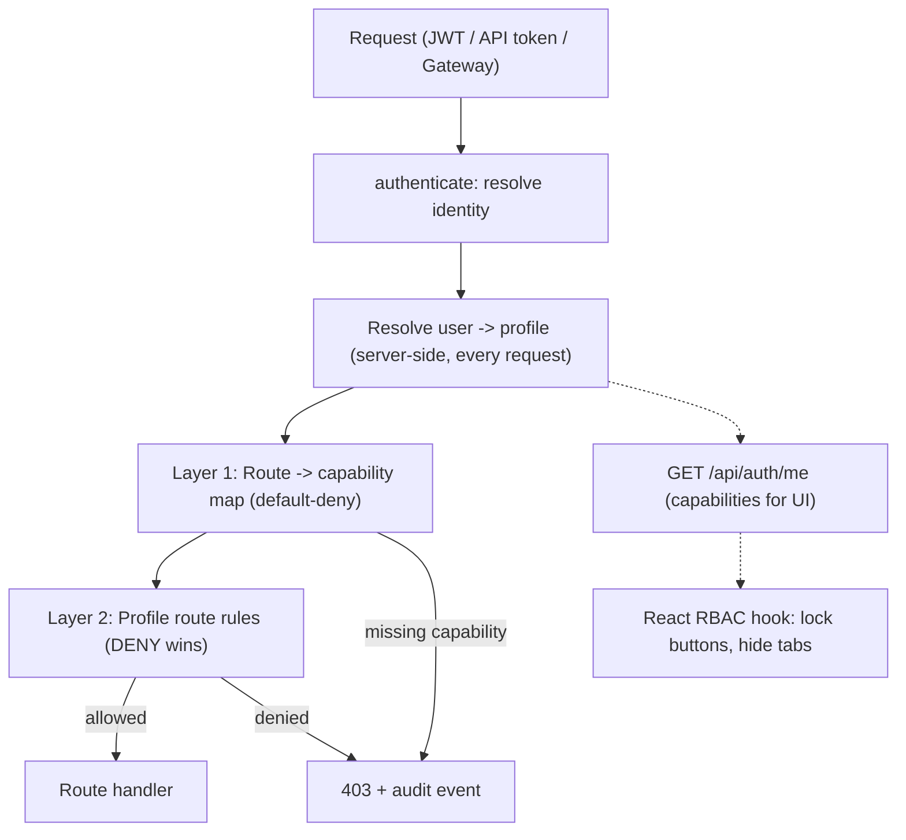

> **Last Updated:** 2026-10-13 | **Created:** 2026-10-13 (v3.0.3)

# PRD — Enterprise Role-Based Access Control (RBAC) & Profile System

**Status:** Draft v2 (revised against the current code base) | **Owner:** Stigix Core Team | **Target:** v3.1.x

---

## 1. Executive Summary & Vision

### 1.1 Current State (as implemented today)
Verified in `web-dashboard/server.ts`:

| Aspect | Today |
|---|---|
| Users | `config/users.json` = `[{ username, passwordHash }]`. **There is no `role` field.** |
| "Admin" | Hard-coded: `username === 'admin'`. Only used to guard `POST /api/auth/users` (create user). There is no list/edit/delete user API. |
| Token | JWT `{ username }`, 24 h, signed with `JWT_SECRET` (falls back to a hard-coded default if unset). No revocation. |
| Authorization | **None beyond authentication.** Any authenticated user can call any of the ~242 routes in `server.ts` (plus routes in `custom-tcp-apps/` and `pcap-routes.ts`). |
| Public routes | 14 routes in `server.ts` have no `authenticateToken` (login, health, status, version, features, join flows, internal log event, etc.). |
| Fleet identity | Requests dispatched by the reverse tunnel (loopback + `x-gateway-source`) and requests proxied by the leader (JWT `{ username: 'stigix-gateway', role: 'admin' }`, 30 s) are **always admin**, and the end user's identity is lost. |
| Other clients | SSE streams accept `?token=`; Copilot tools, MCP server and CLI all call the same API as an authenticated user. |
| Brute-force protection | None (no rate limiter dependency). |

Consequence: every non-`admin` account is effectively an administrator, and a "demo" account is impossible without risking a click on "Stop Traffic", a VyOS interface shutdown, or a probe deletion.

### 1.2 The Solution
A hybrid **Capability + Route-Rule** model with clonable profiles:
1. **Capabilities** (`domain:action`, e.g. `traffic:execute`) drive clean UI checkboxes, UI locking and coarse enforcement.
2. **Profiles** bundle capabilities. Four immutable presets plus unlimited clones.
3. **Route rules** (optional, advanced): `ALLOW`/`DENY` on method + path glob for defense in depth and special cases.
4. **Identity propagation** so that Copilot, MCP, CLI, the fleet gateway and automation tokens are all subject to the same checks.
5. **Audit trail** of every denied and every mutating action.

### 1.3 Goals and Non-Goals

| Goals | Non-Goals (v1) |
|---|---|
| Default-deny authorization on all `/api/*` routes | SSO / OIDC / LDAP (design must not prevent it later) |
| 4 presets + clone/edit custom profiles | Per-object (row-level) permissions, e.g. "only probe X" |
| Read-only demo that cannot leak secrets | Multi-tenancy inside one node |
| Same enforcement for UI, Copilot, MCP, CLI, fleet gateway | MFA |
| Audit log + safe, reversible rollout (audit-only mode) | Time-boxed / scheduled access |



---

## 2. Personas & Presets

| Persona | Scenario | Preset |
|---|---|---|
| **Platform Administrator** | Cluster, users, keys, fleet, licenses | `Super Administrator` |
| **SD-WAN QA / Lab Engineer** | Runs traffic, speedtests, voice, chaos, custom apps; cannot manage users, keys, fleet | `SD-WAN Test Operator` |
| **Executive / Customer Demo** | Dashboards, charts, topology; zero mutation, zero secrets | `Demo / Read-Only Observer` |
| **SASE Security Auditor** | Security tests, Prisma flows, reports | `Security & Compliance Auditor` |
| **Automation / Integration** | MCP server, CLI, CI | Dedicated **API token** bound to any profile (see 4.5) |

---

## 3. Functional Specifications

### 3.1 Capability Taxonomy

Naming is strictly `domain:action` with actions limited to `read`, `execute` (start/stop/run something transient), `manage` (create/edit/delete persistent config) and `admin`.

| Domain | `read` | `execute` | `manage` / `admin` |
|---|---|---|---|
| **traffic** | status, stats | start/stop generator, change intensity | edit application list (`manage`) |
| **tests** | XFR history, test results | launch XFR, iperf client, convergence, voice | — |
| **vyos** | router state, history, sequences | direct actions, run sequences (chaos) | routers, sequences, config import/reset (`manage`) |
| **dem** | probe results | run probe now | create/edit/delete probes (`manage`) |
| **security** | verdicts, stats | URL/DNS batches, EICAR, threat tests | edit security config (`manage`) |
| **prisma** | flows, SD-WAN topology data | — | credentials/config (`admin`) |
| **apps** | custom apps and flows | start/stop apps | create/edit/import/delete (`manage`) |
| **multicast** | streams and stats | start/stop, scenarios | create/edit/delete (`manage`) — see `PRD_MULTICAST_SDWAN_OVERLAY.md` |
| **capture** | list captures | start capture, run PCAP replay | delete captures (`manage`) |
| **capture:download** | download PCAP/payload data (**sensitive**) | | |
| **copilot** | — | `use` (chat) | BYOK keys, provider, guidelines (`admin`) |
| **system** | health, version, status, logs | — | settings, site rename, license, backups (`admin`) |
| **fleet** | peer list and status | — | enrollment, tokens, provisioning, remote access (`admin`) |
| **users** | — | — | users, profiles, API tokens (`admin`) |
| **secrets** | `secrets:read` — any endpoint that returns credentials, keys, tokens or full config exports (**sensitive**) | | |

Hierarchy: `manage` implies `execute` and `read`; `execute` implies `read`; `admin` implies all actions in its domain. `*` = everything.

### 3.2 Sensitive reads are not "read-only"
A `GET` is not necessarily safe. Endpoints such as cloud/Prisma config, VyOS config export, BYOK keys, fleet/join tokens, PCAP downloads or full backups return secrets or sensitive data. They are classified `secrets:read` / `capture:download` and are **excluded from the Demo preset**, even though they are `GET`. Where the UI needs part of such a payload, the server returns a **redacted** version for callers lacking `secrets:read`.

### 3.3 Built-in Presets (immutable, clonable)

| Preset | Capabilities | Route rules |
|---|---|---|
| `Super Administrator` (`profile-super-admin`) | `*` | none |
| `SD-WAN Test Operator` (`profile-operator`) | all `read`; `traffic:execute`; `tests:execute`; `vyos:execute`; `dem:manage`; `apps:manage`; `multicast:manage`; `capture:execute`; `copilot:use`; `security:read` | `DENY * /api/auth/users*`, `DENY * /api/fleet/*`, `DENY * /api/copilot/config` |
| `Demo / Read-Only Observer` (`profile-readonly`) | all `read` **except** `secrets:read` and `capture:download`; `copilot:use` (restricted, see 3.5) | none (capability gating is sufficient; `DENY` for non-GET as a safety net) |
| `Security & Compliance Auditor` (`profile-security-auditor`) | all `read`; `security:manage`; `prisma:read`; `capture:read` | `DENY * /api/vyos/*` for non-GET, `DENY POST /api/tests/*` |

Precise capability lists live in `web-dashboard/rbac/presets.ts` (single source of truth, unit-tested).

### 3.4 Route Rules: semantics (normative)
The previous draft allowed contradictory rules (e.g. `ALLOW POST /api/copilot/chat` vs `DENY POST /api/*`). Evaluation is now defined as:

1. Candidate rules are those whose method and path glob match the request.
2. **Most specific path wins** (longest literal prefix; exact > glob). At equal specificity, **`DENY` wins**.
3. If no rule matches, the decision is left to Layer 1 (capabilities). Route rules can therefore only **narrow** (DENY) or explicitly **grant a single route inside an already-allowed domain**; an `ALLOW` rule can never grant a route whose capability the profile lacks, except where `grant_override: true` is set by a Super Administrator (audited).
4. Matching is done on the **normalized** `req.originalUrl` path: query string stripped, `//` and trailing `/` collapsed, `.`/`..` resolved, case-sensitive, and URL-decoded once. Express mount points (`app.use('/api/x', ...)`) therefore cannot cause bypasses.

### 3.5 Route -> Capability Map (default-deny)
With ~242 routes spread across `server.ts`, `custom-tcp-apps/api-routes.ts`, `pcap-routes.ts` and others, annotating handlers one by one is error-prone. Instead:

- A central table `web-dashboard/rbac/route-map.ts` maps `METHOD + path pattern` to the required capability.
- Any `/api/*` route **not in the table** is denied unless it is in an explicit `PUBLIC` list (the 14 current public routes, individually reviewed).
- **Coverage test (CI):** boots the app, enumerates registered routes, and fails if one is neither mapped nor `PUBLIC`. New endpoints therefore cannot ship unprotected.
- Mutating methods on unmapped routes always require `system:admin` as a safe fallback in `audit` mode.

### 3.6 Copilot, MCP, CLI and fleet: identity propagation
These are the highest-risk bypasses because they act on behalf of a user:

| Channel | Requirement |
|---|---|
| **AI Copilot** | Tools in `ai-tools.ts` call the local API; each call must carry the **chatting user's** identity. A Demo user asking "stop all traffic" must get a 403 from the tool, surfaced to the model. `copilot:use` never implies tool execution rights. |
| **MCP server / CLI** | Authenticate with an **API token** (4.5) bound to a profile, e.g. a read-only token for dashboards. |
| **Reverse tunnel / leader proxy (Remote View)** | Today always `admin`. Must instead forward the end user's identity: the leader signs a short-lived JWT containing `{ sub, profile_id, capabilities_hash, peer }`; the peer resolves the profile **locally** if known, otherwise uses the signed claims. The hard-coded `role: 'admin'` is removed (kept only for `stigix-leader` service calls such as provisioning, scoped to `fleet:*`). |
| **Loopback shortcut** | `x-gateway-source` on loopback must additionally verify a per-process secret header, not just the source IP, so a local process cannot impersonate the gateway. |

---

## 4. Technical Specifications

### 4.1 Storage (`config/rbac-profiles.json`)
```json
{
  "version": 1,
  "profiles": [
    {
      "id": "prof-custom-partner",
      "name": "Partner Validation Tech",
      "description": "Custom profile for third-party lab validation",
      "is_preset": false,
      "cloned_from": "profile-operator",
      "created_at": 1791878000000,
      "updated_at": 1791878000000,
      "capabilities": ["tests:execute", "dem:read", "traffic:read"],
      "route_rules": [
        { "effect": "DENY", "method": "POST", "path": "/api/tests/xfr/*" }
      ]
    }
  ]
}
```
Presets are defined in code and are **not** stored, so upgrades can add capabilities to presets safely. The file stores custom profiles only. Writes are atomic (temp file + rename) and backed up.

### 4.2 Users (`config/users.json`) and migration
Target schema (backwards compatible reader):
```json
[{ "username": "admin", "passwordHash": "$2a$...", "profile_id": "profile-super-admin",
   "token_version": 1, "created_at": 1791870000000, "last_login": 1791878200000, "disabled": false }]
```
The legacy `role` field never existed on disk and is **not** introduced; the legacy "admin" check becomes `profile_id === 'profile-super-admin'`.

**Migration (first start on v3.1):**
- `admin` -> `Super Administrator`.
- Every other existing user currently has near-admin power. To avoid breaking anyone, they are mapped to a preset **`Legacy User`** (all capabilities except `users:admin`, `fleet:admin`, `secrets:read`, `copilot:admin`, matching today's practical limits as closely as possible). A banner invites the admin to reassign them. `Legacy User` is hidden for new assignments.
- A backup `users.json.pre-rbac` is written before migration.
- Last Super Administrator can never be deleted, disabled or downgraded.

### 4.3 Authentication and enforcement
1. **Login** (`/api/auth/login`) issues a JWT `{ sub, profile_id, token_version }` only. **Capabilities are not embedded**: they are resolved from the profile store on every request (cheap, in-memory cache invalidated on profile save). This gives instant effect of profile edits and avoids stale/oversized tokens.
2. **Revocation:** a request is rejected if `token_version` in the JWT differs from the user's current value. Changing a profile, password or disabling a user bumps `token_version`.
3. **Single middleware** `rbacGate` registered once after `authenticateToken` for the whole `/api` prefix (see 3.5), then Layer 2 route rules. Per-route `requireCapability()` remains available for sensitive handlers that need a second check.
4. **SSE `?token=` query tokens** must be short-lived stream tickets (see 4.6) rather than the full session JWT, so a leaked URL does not grant a 24 h session.
5. **`JWT_SECRET`:** startup fails (or generates and persists a random secret) if the hard-coded default would be used, once RBAC enforcement is enabled.
6. **Login hardening:** rate limiting and temporary lockout per username/IP (e.g. 5 failures -> 5 min), constant-time failure message. (Adds a dependency such as `express-rate-limit`; Docker audit applies.)

### 4.4 API

| Method | Path | Capability | Purpose |
|---|---|---|---|
| `GET` | `/api/auth/me` | any authenticated | Username, profile, **resolved capabilities**, rules summary — consumed by the UI hook |
| `GET/POST/PUT/DELETE` | `/api/auth/users[/:username]` | `users:admin` | List, create, change profile, reset password, disable, delete |
| `GET/POST/PUT/DELETE` | `/api/rbac/profiles[/:id]` | `users:admin` | List, create, edit, delete custom profiles |
| `POST` | `/api/rbac/profiles/:id/clone` | `users:admin` | Clone preset or custom profile |
| `GET` | `/api/rbac/capabilities` | `users:admin` | Taxonomy for the editor |
| `POST` | `/api/rbac/simulate` | `users:admin` | "Can profile X do `METHOD /path`?" — dry-run for the editor |
| `GET/POST/DELETE` | `/api/auth/tokens[/:id]` | `users:admin` (or own tokens) | API tokens |
| `GET` | `/api/audit` | `system:admin` | Audit log query/export |

Existing `POST /api/auth/users` stays (adds optional `profile_id`, default `Test Operator`).

### 4.5 API tokens (service accounts)
For MCP, CLI and CI: opaque tokens (`stx_...`, shown once, stored hashed), bound to a profile, with optional expiry and last-used tracking, revocable. They replace sharing a human password. Token requests go through the same `rbacGate`.

### 4.6 Stream tickets
`POST /api/auth/stream-ticket` returns a single-use ticket (TTL 30 s) bound to the user and the stream path, accepted via `?ticket=` on SSE/EventSource endpoints only.

### 4.7 Audit log
Append-only JSONL in `config/audit/`, rotated by size, containing: timestamp, user/token, profile, source (UI/Copilot/MCP/gateway + peer), method, normalized path, decision (`allow`/`deny`), capability, status code, and a redacted body summary for mutations. All `deny` decisions and all non-GET allowed actions are logged. Surfaced in Settings -> Access -> Audit and exportable. Secrets are never logged.

### 4.8 Fleet / cluster behavior
- **Profiles are synchronized** from the leader to spokes as a new `ProvisioningManager` bundle type (`rbac-profiles`), following the existing pattern used for `applications`, `connectivity-probes`, `cloud-config`, `ca-certificates` and `pcap-profiles`.
- **User accounts and password hashes are not synchronized** (explicitly not a goal; each node owns its local users). Remote access through the leader uses the identity propagation in 3.6.
- A spoke that has not received the bundle yet uses the built-in presets, never "allow all".

---

## 5. UI/UX Specification (Web Dashboard)

### 5.1 Settings -> Access (restructure of the Users tab in `Settings.tsx`)
1. **Users:** table (username, profile badge, created, last login, status) with *Add*, *Change profile*, *Reset password*, *Disable*, *Delete*. Banner for users still on `Legacy User`.
2. **Profiles:** cards for presets (lock badge) and custom profiles; *Clone*, *Edit*, *Delete* (blocked if assigned to a user).
   - Editor: name/description; capability grid grouped by domain with select-all per domain; **Advanced** tab for route rules with the **"Test a request"** simulator (uses `/api/rbac/simulate`) and a visible diff of what the clone changed versus its source.
3. **API tokens** and **Audit log** tabs.

### 5.2 Adaptive UI
A single `useRbac()` hook (data from `/api/auth/me`) exposes `can('traffic:execute')`. Mutating controls use a shared `<RbacButton capability="...">`:
- Disabled with a lock icon and tooltip: *"Requires `traffic:execute` - not allowed by profile Demo / Read-Only Observer"*.
- Sensitive tabs (Fleet, Access, Copilot keys) are hidden when the user lacks the capability and show an access-denied state on direct navigation.
- Persistent profile badge in the header.
- **The UI is a convenience only.** Every rule is enforced on the server; 403 responses are handled globally with a toast.

---

## 6. Security Requirements
1. Default-deny with CI coverage test (3.5); no route can be added unmapped.
2. Last Super Administrator protection; presets cannot be edited or deleted.
3. Privilege-escalation guard: a user with `users:admin` cannot grant capabilities they do not hold unless they are a Super Administrator; only Super Administrators can set `grant_override`.
4. Secrets redaction for callers without `secrets:read` (3.2).
5. Identity propagation for Copilot, MCP, CLI, tunnel and leader proxy (3.6).
6. Revocation through `token_version`; short-lived stream tickets; login rate limiting.
7. All denies and mutations audited.
8. Rollout safety: environment/config switch `RBAC_MODE = off | audit | enforce`. **`audit`** (default for the first release) evaluates every request, logs would-be denies, never blocks. `enforce` becomes default one release later.

---

## 7. Success Metrics & Acceptance Criteria
- 100% of registered `/api/*` routes are mapped or explicitly `PUBLIC` (CI coverage test green).
- With the Demo preset: every non-GET request and every `secrets:read` / `capture:download` endpoint returns 403 (automated matrix test over the whole route map).
- Copilot as Demo user cannot start traffic, run VyOS actions or edit probes via tools.
- Remote View through the leader no longer grants admin to a non-admin user.
- Migration: all pre-existing users can still log in and keep their effective access (`Legacy User`); `users.json.pre-rbac` exists.
- Profile edit takes effect on the user's next request without re-login.
- Latency overhead of the gate < 1 ms p95 (in-memory resolution).
- Existing automated suites (Copilot, MCP, custom-tcp) pass with an admin token.

## 8. Risks & Open Questions

| Risk / Question | Mitigation / Status |
|---|---|
| Large route surface (~242 + sub-routers) makes the map incomplete | Coverage test; `audit` mode first release; fallback `system:admin` for unmapped mutations |
| Existing scripts/CLI/MCP use a human login | Provide API tokens; document migration; keep password login working |
| Breaking Remote View when removing the implicit admin | Phase the identity propagation behind `RBAC_MODE`, test with leader -> spoke scenarios |
| Some GETs mix public and secret fields | Redaction layer + review list in the route map |
| Public routes policy | **Decided:** `/api/stats`, `/api/status`, `/api/health`, `/api/version`, `/api/features`, `/api/config/ui` (GET) and the login/join flows stay `PUBLIC` (non-sensitive, needed pre-login or for health checks). `/api/connectivity/iperf/server` and `/api/internal/log-event` are restricted to loopback/peer-authenticated callers. Each `PUBLIC` entry is reviewed and listed explicitly in `route-map.ts` |
| Offline spokes with stale profiles | Use presets (never allow-all); resync on reconnect |
| Dockerfile sync for new `rbac/` and `audit/` files and dependency | Run `stigix-docker-audit` checklist |
| Future SSO | `profile_id` mapping from IdP groups is compatible; out of scope |

## 9. Phased Roadmap (effort-based)

| Phase | Scope | Est. effort |
|---|---|---|
| **1 – Foundations** | `rbac/` module (taxonomy, presets, store), user schema + migration, `/api/auth/me`, `rbacGate` in `audit` mode, audit log | 4-5 days |
| **2 – Route map** | Build `route-map.ts` for all routers, coverage test, Demo-matrix test, redaction of sensitive GETs | 4-5 days |
| **3 – Identity propagation** | Copilot tools, tunnel/leader proxy, loopback secret, API tokens, stream tickets, login rate limiting | 4 days |
| **4 – UI** | Access tab (users, profiles, simulator, tokens, audit), `useRbac`, `RbacButton`, adaptive locking | 5 days |
| **5 – Fleet & rollout** | `rbac-profiles` bundle sync, `enforce` mode, docs, FAQ, MCP/CLI updates | 3 days |

Total about 20-22 days for full scope. A useful MVP (Demo vs Admin vs Operator with default-deny, `audit`/`enforce` switch and the UI lock) is achievable in about 8-10 days (phases 1, 2 and the minimum of 4).

---

## 📜 Revision History

| Date | Stigix Version | Author / Trigger | Summary of Changes |
|---|---|---|---|
| 2026-10-13 | `v3.0.3` | Stigix Core Team | Initial PRD creation for Enterprise RBAC & Profile System |
| 2026-10-13 | `v3.0.3` | Stigix Core Team | Revision against the actual code: corrected current-state description (no `role` field, `username === 'admin'`, implicit admin for gateway), defined rule semantics, default-deny route map with CI coverage test, sensitive-read concept, Copilot/MCP/tunnel identity propagation, API tokens, stream tickets, audit log, migration (`Legacy User`), `RBAC_MODE` rollout, server-side capability resolution and revocation, fleet bundle sync, acceptance criteria, risks, realistic estimates |
