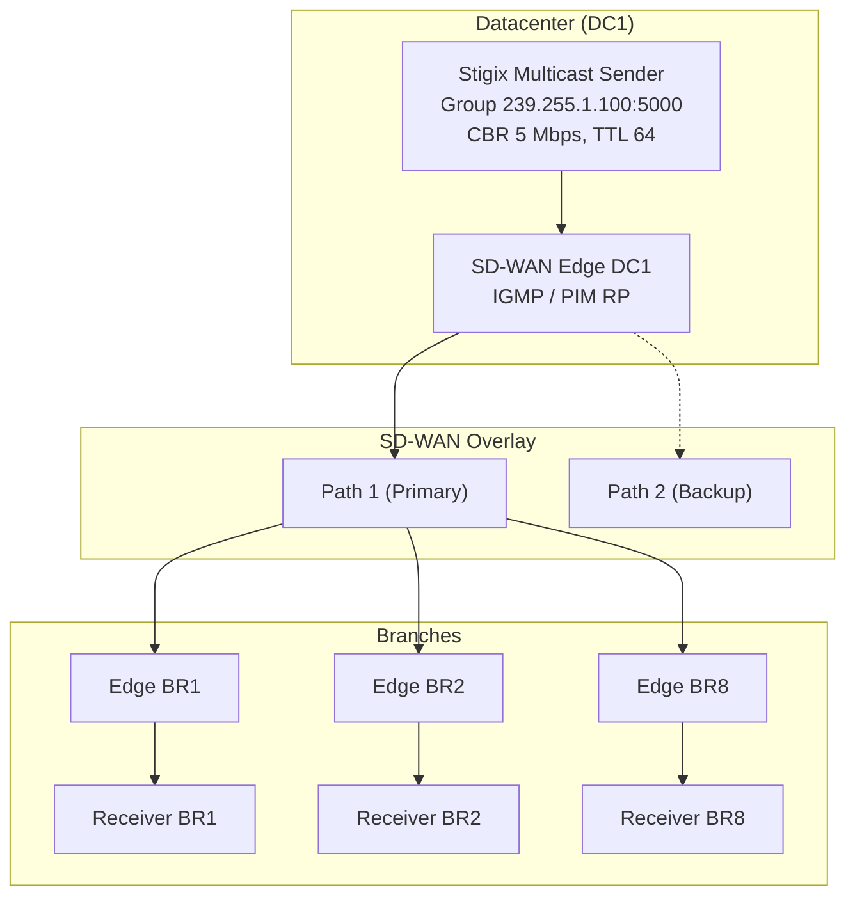
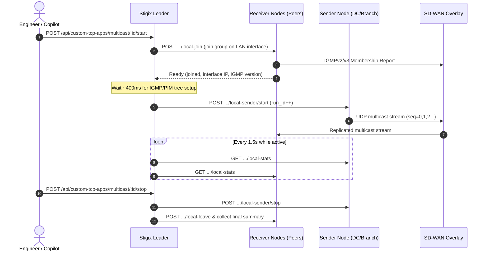

> **Last Updated:** 2026-10-15 | **Created:** 2026-10-13 (v3.0.3)

# PRD — SD-WAN Overlay Multicast Validation Engine

**Status:** Approved v4 (Architecture Finalized) | **Owner:** Stigix Core Team | **Target:** v3.0.x / v3.1.x

**Reference platform:** Palo Alto Networks **Prisma SD-WAN** (first validated target). **Design principle:** the engine is *vendor-neutral* — it only speaks standard IGMP/UDP multicast from the edge of the LAN, so it works with any SD-WAN solution that transports multicast. Vendor-specific knowledge is limited to documentation (Appendix A) and optional pre-flight hints.

---

## 1. Executive Summary & Vision

### 1.1 The Challenge
Enterprise SD-WAN deployments increasingly transport IP multicast: financial market data, corporate video/IPTV/CCTV, and industrial/IoT telemetry or bulk imaging.

Validating multicast over an SD-WAN overlay is hard:
1. Multicast is UDP-only, with no handshake or ACK. Loss is silent for the application.
2. The overlay must either do **Head-End Replication (HER)** (multicast converted into N unicast tunnels) or run **PIM-SM / PIM-SSM** across the overlay. The two behave very differently on failover.
3. Engineers lack a lightweight tool to measure **join latency**, **loss/duplication per receiver**, and **convergence time on WAN failure**.

### 1.2 The Solution
Extend the existing **Custom Apps** subsystem (`web-dashboard/custom-tcp-apps/`) with a native TypeScript/Node.js **Multicast Overlay** engine (`dgram` UDP sockets): a distributed 1-to-N UDP multicast sender plus receivers that join the group, track sequence numbers, and report telemetry to the Leader dashboard.

### 1.3 Goals and Non-Goals

| Goals | Non-Goals (v1) |
|---|---|
| IPv4 ASM (`239/8`) and SSM (`232/8`) streams | IPv6 / MLD, MSDP, anycast RP |
| Per-receiver loss, duplicates, reordering, jitter, throughput, join latency | Configuring the SD-WAN fabric (PIM, IGMP proxy, RP) — the network is assumed pre-configured |
| Convergence-time measurement during underlay chaos | Real video/audio codecs or decoding; multicast encryption validation |
| DC-side source **and branch-side source (BSS)** streams | Multicast routing daemon inside Stigix (no PIM speaker) |
| Copilot/MCP/CLI parity | Line-rate stress (> 50 Mbps) |
| Run inside existing container (host networking) | Bridge-mode Docker support |



---

## 2. Personas & Use Cases

| Persona | Goal | Value |
|---|---|---|
| **SD-WAN Architect** | Certify HER vs. native PIM behavior | Confirm every subscribed branch receives the stream with zero duplicates |
| **NOC Engineer** | Measure impact of a link cut | Exact lost-packet count and **stream interruption time** |
| **Trading / Financial Engineer** | Validate low-jitter feed replication | Sequence tracking, jitter and micro-burst loss |
| **Security Engineer** | Verify segmentation | Prove a non-member node (or other VRF) receives **nothing** (negative test) |

Core test scenarios:
- **S1 – Baseline:** DC source, all receivers joined, 5 Mbps for 10 min: loss < 0.1%, 0 duplicates, jitter < 5 ms, join latency reported per receiver.
- **S2 – Branch-side source (BSS):** a branch node is the sender; other branches receive (note: on Prisma SD-WAN, DC IONs do not support LAN IGMP receivers natively, so receivers in S2 are other branch sites unless external PIM peering is used at the DC; Prisma ION 6.1.1+ required, see Appendix A).
- **S3 – Failover:** primary WAN link down during the stream; report max gap per receiver; stream must resume without manual action (default threshold < 10 s, configurable).
- **S4 – Late join:** a receiver joins an already active group; join latency reported, loss baseline initialized from `first_received_seq` upon join, no impact on other receivers.
- **S5 – Leak test:** receiver on an unauthorized segment/VRF must see 0 packets (`EXPECT_NONE`; any valid packet = FAIL).
- **S6 – SSM:** `232/8` with `source_ip`; only the declared source is received, a second source is ignored.
- **S7 – HER detection (informational):** duplicates = 0 at the receiver; an underlay capture shows N unicast copies vs. one multicast flow.
- **S8 – Leave:** after stop, traffic stops reaching the branch (prune check).

---

## 3. Functional Specifications

### 3.1 Sender (`MulticastSenderRuntime`)
1. **Addressing:** ASM `239.0.0.0/8` (administratively scoped) and SSM `232.0.0.0/8`. Reject other ranges in validation, and reject reserved `224.0.0.0/24` (link-local).
2. **Parameters:** UDP port (default `5000`), egress interface IP (`socket.setMulticastInterface(interfaceIp)`, auto-detected from the node's LAN private IP facing the SD-WAN edge with optional manual override), TTL (default `64` via `socket.setMulticastTTL(ttl)`), DSCP (`BE`, `CS5`, `EF`, custom), payload size (default `1316` bytes = 7 TS packets; range 64–1400 to avoid fragmentation).
   - **Pacing:** High-resolution monotonic timer (`process.hrtime.bigint()`) with token-bucket catch-up logic in Node.js `dgram` using a pre-allocated `Buffer`.
3. **Rate modes:**
   - **CBR:** 64 kbps – 50 Mbps (v1 cap, see 4.3).
   - **Burst:** N packets every T ms (e.g., 50 pkts every 100 ms).
4. **`socket.setMulticastLoopback(false)` (`IP_MULTICAST_LOOP = 0`)** so a co-located receiver does not see its own traffic and skew tests (unless explicitly running a local loopback self-test).
5. **Packet header** (network byte order, packed, 24 bytes — big-endian `Buffer` layout matching `!IQQHH`), followed by deterministic payload padding:

   | Offset | Size | Field | Notes |
   |---|---|---|---|
   | 0 | 4 | `magic` | `0x53544758` ("STGX") — non-matching packets are counted as `foreign` and ignored |
   | 4 | 8 | `sequence_id` | `uint64` (`writeBigUInt64BE`), per-stream, starts at 0 on each run |
   | 12 | 8 | `timestamp_ns` | `uint64` (`writeBigUInt64BE`), sender wall clock in ns; used for **jitter only**, never one-way delay unless clock sync is verified |
   | 20 | 2 | `stream_id` | `uint16` (`writeUInt16BE`), deterministic numeric hash of app ID |
   | 22 | 2 | `run_id` | `uint16` (`writeUInt16BE`), increments on sender restart so receivers can detect a reset instead of reporting huge loss |

6. **Phase 5 Enhancement — Optional L7 RTP v2 / MPEG-TS Framing (`payloadFormat: "raw-stgx" | "rtp-mpegts" | "rtp-g711"`):**
   - To ensure **Palo Alto NGFW L7 App-ID**, **Prisma SD-WAN Flow Browser**, and **Wireshark** natively classify and dissect Stigix multicast streams as standard enterprise media (`rtp`, `mpeg-ts`) during customer demonstrations without losing sequence/jitter telemetry:
     - When `payloadFormat: "rtp-mpegts"` is selected (default for IPTV / Video presets on UDP `5004` with `1316`-byte payload):
       - Bytes `0..11`: Valid **12-byte RFC 3550 RTP v2 header** (`0x80` Version 2, Payload Type `0x21` = `33` `MP2T`, 16-bit RTP sequence number, 32-bit 90kHz RTP timestamp, 32-bit SSRC derived from `stream_id`).
       - Bytes `12..1315`: Seven 188-byte **MPEG-2 Transport Stream (MPEG-TS)** frames, each starting with the mandatory `0x47` MPEG-TS sync byte (`offset 12, 200, 388, 576, 764, 952, 1140`), with the 24-byte `STGX` telemetry header embedded inside the first MPEG-TS adaptation/payload field (`offset 16..39`).
     - The Stigix Receiver auto-detects `STGX` at either `offset 0` (`raw-stgx`) or `offset 16` (`rtp-mpegts` / `rtp-g711`), maintaining 100% backward compatibility while passing strict L7 Deep Packet Inspection.

### 3.2 Receiver (`MulticastReceiverRuntime`)
1. **Membership (Node.js `dgram`):**
   - ASM: `socket.addMembership(groupAddress, multicastInterfaceIp)`.
   - SSM: `socket.addSourceSpecificMembership(sourceIp, groupAddress, multicastInterfaceIp)` (requires IGMPv3 on the host and LAN; the UI warns if `/proc/net/igmp` or `force_igmp_version` is forced to IGMPv2).
   - The receiver socket binds to `port` (with `reuseAddr: true`) and filters incoming packets by group/magic/stream_id.
   - Leave via `socket.dropMembership()` (or `socket.dropSourceSpecificMembership()`) on stop. Periodic report replies to IGMP queries are handled by the **Linux kernel**.
2. **Metrics (per 1-second window and cumulative):**
   - **Late-Join Baseline (`first_seq`):** Upon receiving the first valid packet for a given `run_id`, the receiver initializes `first_seq = seq` and `expected_seq = seq`. Expected packet count is `(highest_seq - first_seq) + 1`, preventing artificial loss percentages when a receiver joins mid-stream (Scenario S4). If `run_id` changes, receiver counters automatically reset for the new run.
   - Loss (gaps in `sequence_id`), reordering (packet with `seq < highest_seq` not seen before), **duplicates** (seen within sliding bitset window of last 4,096 sequences), `foreign` packets.
   - Throughput (kbps / Mbps) and pps.
   - **Jitter** per RFC 3550 using sender timestamps (clock offset cancels out in inter-arrival differences).
   - **Time-to-first-packet (`joinLatencyMs`):** time from `addMembership` call (or sender start if joined prior to sender start) to first valid packet.
   - **Max interruption (`maxGapMs`):** longest inter-arrival gap in ms on the receiver's monotonic clock — the primary failover/convergence metric.
3. **Expectation mode:** `traffic` (`EXPECT_TRAFFIC`, default) or `none` (`EXPECT_NONE`, leak test). The verdict is computed locally and rolled up on the Leader.
4. **Health verdict & Granular SLA Threshold Tuning:**
   - In real-world SD-WAN overlays, initial **PIM Rendezvous Point (RP) $\to$ Shortest Path Tree (SPT) switchover** can briefly produce a few duplicate packets (e.g., 5–15 packets while both the shared tree and source tree are active) or a transient convergence gap.
   - Engineers can tune **5 granular SLA thresholds** per profile (with sensible defaults) AND click **"Reset Counters"** at any time while a stream is running to clear startup/failover transients and measure clean steady-state replication:

   | SLA Metric | Parameter | Default | Pedagogical Meaning |
   |---|---|---|---|
   | **Healthy Loss Limit** | `maxLossPct` | `0.1%` | Maximum packet loss tolerated for a `HEALTHY` (green) verdict |
   | **Critical Loss Limit** | `degradedLossPct` | `2.0%` | Loss between `maxLossPct` and `degradedLossPct` = `DEGRADED` (amber); above = `FAILED` (red) |
   | **Max Jitter (RFC 3550)** | `maxJitterMs` | `30 ms` | If inter-arrival jitter exceeds `maxJitterMs`, receiver transitions to `DEGRADED` |
   | **Max Allowed Duplicates** | `maxDuplicates` | `0` (tunable e.g. `15`) | Number of duplicate packets tolerated (e.g. during PIM SPT switchover) before flagging `DEGRADED` |
   | **Max Silence / Gap** | `maxGapMs` | `3000 ms` | Longest tolerated stream interruption before declaring the stream `FAILED` |

   | State | Rule (configurable thresholds) |
   |---|---|
   | `HEALTHY` | For `traffic`: receiving packets, `lossPct <= maxLossPct`, `duplicatePackets <= maxDuplicates`, `jitterMs <= maxJitterMs`. For `none`: 0 valid packets received |
   | `DEGRADED` | For `traffic`: `maxLossPct < lossPct <= degradedLossPct`, or `duplicatePackets > maxDuplicates`, or `jitterMs > maxJitterMs` |
   | `FAILED` | For `traffic`: `lossPct > degradedLossPct` or no packet for `> maxGapMs` while sender active. For `none`: $\ge 1$ valid packet received (`LEAK DETECTED`) |
   | `NO_TRAFFIC` | Waiting for sender or initial stream convergence |

---

## 4. Technical Architecture

### 4.1 Where it fits in the codebase (100% Native TypeScript/Node.js)
To maintain full consistency with `TcpServerRuntime` and `TcpClientRuntime` (and avoid external Python child process lifecycle issues), the Multicast engine is implemented natively in TypeScript inside `web-dashboard/custom-tcp-apps/`:
- `web-dashboard/custom-tcp-apps/multicast-runtime.ts` — implements `MulticastSenderRuntime` and `MulticastReceiverRuntime` using Node.js `dgram`, high-resolution pacing, 24-byte `STGX` header packing/parsing (plus optional RFC 3550 RTP v2 + MPEG-TS `0x47` framing), RFC 3550 jitter, sliding duplicate/reordering window, live counter reset, and host pre-flight checks (`/proc/net/igmp`, `rp_filter`, LAN interface detection).
- `web-dashboard/custom-tcp-apps/multicast-manager.ts` — manages local sender/receiver instances, persists `multicastApplications` inside `custom-tcp-applications.json` (isolated from `applications` so existing TCP apps have zero regression risk), and orchestrates cluster-wide runs across the Stigix Fleet via the Leader gateway.
- `web-dashboard/src/components/custom-tcp/MulticastOverlayTab.tsx` — standalone **Multicast Traffic** operational control center mounted directly under **`Generate -> Multicast Traffic`** in the main navigation bar (as well as accessible from Custom Apps).

### 4.2 Orchestration & Unidirectional Telemetry Fan-Out

Because UDP multicast is strictly unidirectional (Sender $\to$ Receivers), the Sender node has no direct socket feedback from Receivers. The Stigix Leader orchestrates execution and polls/aggregates receiver telemetry across the fleet:



Start order is **receivers first** (unless a receiver is manually joined late for Scenario S4), ensuring baseline tests measure steady-state replication without initial IGMP join transients.

### 4.3 Implementation notes and constraints
- **Networking:** requires `network_mode: host` (standard in `docker-compose.yml`).
- **Auto-Detection of LAN Interface (`IP_MULTICAST_IF`):** Each Stigix node automatically resolves its private LAN IP facing the SD-WAN Edge (excluding `docker0`, `lo`, `tailscale`, `wg`, `veth`, and virtual tunnel interfaces), with an optional per-node `interfaceIp` override.
- **Host prerequisites surfaced in pre-flight check:**
  - Interface `MULTICAST` support and resolved LAN IPv4 address.
  - Effective IGMP version from `/proc/net/igmp` and `/proc/sys/net/ipv4/conf/<iface>/force_igmp_version`.
  - Reverse Path Filtering (`rp_filter`) status on `all` and `<iface>` (warns if `rp_filter=1` strict mode is enabled on asymmetric multicast paths).
- **Safety limits:** max 10 concurrent multicast streams, max 50 Mbps per stream (`cbr` or `burst`), TTL 1–255 (default `64`, UI warning when TTL > 16).
- **Persistence:** stored under `multicastApplications: CustomMulticastApplicationConfig[]` in `config/custom-tcp-applications.json` (automatically synchronized across Leader and Peers via the `custom-tcp-apps` provisioning bundle).

### 4.4 Data model (`CustomMulticastApplicationConfig`)
```json
{
  "id": "mc-ceo-townhall",
  "name": "CEO Townhall HD IPTV",
  "description": "Live corporate IPTV broadcast over SD-WAN overlay (RTP / MPEG-TS)",
  "presetId": "iptv-ceo-townhall",
  "payloadFormat": "rtp-mpegts",
  "enabled": true,
  "group": "239.1.1.100",
  "port": 5004,
  "mode": "asm",
  "ssmSource": "",
  "senderNode": "DC1",
  "senderInterfaceIp": "auto",
  "receivers": [
    { "node": "BR1", "expect": "traffic", "interfaceIp": "auto", "enabled": true },
    { "node": "BR5", "expect": "traffic", "interfaceIp": "auto", "enabled": true }
  ],
  "rate": {
    "mode": "cbr",
    "kbps": 1500,
    "burstPackets": 20,
    "burstIntervalMs": 100
  },
  "payloadBytes": 1316,
  "ttl": 16,
  "dscp": "AF41",
  "durationSec": 0,
  "thresholds": {
    "maxLossPct": 0.1,
    "degradedLossPct": 2.0,
    "maxJitterMs": 30,
    "maxDuplicates": 0,
    "maxGapMs": 3000
  }
}
```

### 4.5 API Endpoints (mounted under `/api/custom-tcp-apps/multicast`)

| Method | Path | Scope | Purpose |
|---|---|---|---|
| `GET` | `/api/custom-tcp-apps/multicast` | Cluster/Local | List all multicast application configs + live statuses |
| `POST` | `/api/custom-tcp-apps/multicast` | Leader/Local | Create or update a multicast application |
| `PUT` | `/api/custom-tcp-apps/multicast/:id` | Leader/Local | Update an existing multicast application |
| `DELETE` | `/api/custom-tcp-apps/multicast/:id` | Leader/Local | Delete a multicast application |
| `POST` | `/api/custom-tcp-apps/multicast/:id/start` | Orchestrated | Start receivers across peers, then start sender |
| `POST` | `/api/custom-tcp-apps/multicast/:id/stop` | Orchestrated | Stop sender, then leave group on receivers & record history |
| `POST` | `/api/custom-tcp-apps/multicast/:id/reset-counters` | Orchestrated | Reset loss/duplicate/jitter/gap counters live across active receivers |
| `GET` | `/api/custom-tcp-apps/multicast/:id/stats` | Orchestrated | Poll & aggregate live sender + per-receiver telemetry |
| `POST` | `/api/custom-tcp-apps/multicast/:id/preflight` | Orchestrated | Run host/interface/IGMP/rp_filter checks on sender & receivers |
| `GET` | `/api/custom-tcp-apps/multicast/export` | Leader/Local | Export all multicast application profiles as a portable JSON bundle |
| `POST` | `/api/custom-tcp-apps/multicast/import` | Leader/Local | Import multicast profiles (`merge` or `replace`) & sync to Fleet Peers |
| `POST` | `/api/custom-tcp-apps/prisma/sync-multicast/:id` | Leader/Local | Push multicast profile (`UDP Port + Group IP /32`) to Prisma SD-WAN Custom Apps |
| `POST` | `/api/custom-tcp-apps/prisma/sync-all-multicast` | Leader/Local | Push all multicast profiles to Prisma SD-WAN Custom Apps |
| `POST` | `/api/custom-tcp-apps/multicast/:id/local-sender/start` · `/stop` | Node-Local | Start/stop local UDP multicast sender on this node |
| `POST` | `/api/custom-tcp-apps/multicast/:id/local-join` · `/local-leave` | Node-Local | Join/leave multicast group on this node |
| `POST` | `/api/custom-tcp-apps/multicast/:id/local-reset` | Node-Local | Reset local receiver SLA counters without dropping IGMP membership |
| `GET` | `/api/custom-tcp-apps/multicast/:id/local-stats` | Node-Local | Return local sender + receiver metrics for this node |
| `GET` | `/api/custom-tcp-apps/multicast/:id/local-preflight` | Node-Local | Return local interface, IGMP version, and `rp_filter` checks |

---

## 5. UI/UX Specification

### 5.1 Dedicated Top-Level Use Case under `Generate` Menu
Because IP Multicast relies on **UDP, IGMPv2/v3, and PIM** (and not TCP), hiding it inside *Custom TCP Apps* can confuse network engineers.
- In the top navigation bar under **`Generate`**, **Multicast Traffic** (`view === 'multicast'`) is promoted to a **first-class standalone menu entry** alongside *Custom TCP Apps*, *Voice & Video*, and *IoT Devices*, complete with its own live green activity pulse indicator whenever a multicast stream is running.
- All configuration actions (Presets, SLA Threshold Tuning, Prisma SD-WAN Custom App Push, JSON Import/Export) live directly inside the **Multicast Traffic** header so the engineer never has to leave the page.

### 5.2 Multicast Traffic Control Center & Wizard
- **Wizard Modal:** Group IP (validated `239.x.x.x` for ASM or `232.x.x.x` for SSM, rejecting `224.0.0.0/24`), UDP port, Sender Node selector (populated from Fleet + local node), Receiver Node multi-select with per-node expectation toggle (`Expect Traffic` vs `Expect None / Leak Test`), Rate mode (`CBR kbps` or `Burst`), Payload size (`64–1400` bytes, default `1316`), L7 Framing (`RTP/MPEG-TS`, `RTP Audio`, or `Raw STGX`), DSCP (`BE`, `EF`, `CS5`, `AF41`, `CS4`, `CS2`), TTL (default `16`), Duration, and SLA Thresholds.
- **Pre-flight Check Drawer/Modal:** Per-node status badge (`PASS` / `WARN` / `FAIL`) displaying resolved LAN IP & interface name, `MULTICAST` flag, kernel IGMP version, and `rp_filter` setting.
- **Live Receiver Matrix (`1 Sender -> N Receivers`):**
  - Sender KPI bar: Active state, `run_id`, TX Bitrate (Mbps/kbps), Packets Sent, Sequence ID, Uptime, Egress Interface IP, DSCP/TTL.
  - Live **"Reset Counters"** button to clear convergence spikes (e.g. after a WAN failover test or initial SPT switchover) without interrupting the IGMP membership or UDP stream.
  - Per-receiver table with live Late-Join / Leave toggle button (enabling interactive Scenario S4 & S8 testing):

  | Receiver | Mode | IGMP / Iface | Rx Rate | Pkts Rx / Lost | Loss % | Dups / Reorder | Jitter ms | Max Gap ms | Join ms | Verdict | Action |
  |---|---|---|---|---|---|---|---|---|---|---|---|
  | **BR1** | `EXPECT_TRAFFIC` | v3 (`eth1`) | 1.50 Mbps | 1,890 / 0 | 0.00% | 0 / 0 | 0.8 ms | 12 ms | 38 ms | 🟢 `HEALTHY` | `[Leave]` |
  | **BR5** | `EXPECT_NONE` | v3 (`eth1`) | 0.00 Mbps | 0 / 0 | 0.00% | 0 / 0 | — | — | — | 🟢 `PASS (No Leak)` | `[Leave]` |

### 5.3 Built-in Enterprise Multicast Application Presets (One-Click Demo Profiles)
To make customer demonstrations and lab validations effortless, the Multicast Wizard (and main toolbar) includes a **"Load Industry Preset"** selector that pre-populates standard IANA ports, payload sizes, DSCP markings, rate modes, and L7 framing so **Prisma SD-WAN Flow Browser**, **Palo Alto NGFW App-ID**, and **Wireshark** recognize the application out of the box:

| Preset ID | Display Name & Badge | Group IP | UDP Port | Rate Mode | Payload Size | DSCP | TTL | L7 Framing (`payloadFormat`) | App-ID / Flow Browser Recognition |
|---|---|---|---|---|---|---|---|---|---|
| `iptv-ceo-townhall` | 📺 **CEO Townhall HD IPTV (`RTP / MPEG-TS`)** | `239.1.1.100` | **`5004`** | `CBR` `1500 kbps` | **`1316 B`** (`7×188B` TS) | `AF41` | `16` | `rtp-mpegts` | Recognized as **`rtp` / `mpeg-ts`** Real-Time Broadcast Video |
| `market-data-itch` | 📈 **Financial Market Data (`NASDAQ ITCH / FIX`)** | `239.192.1.10` | **`14001`** | `Burst` `20 pkts / 100ms` | **`256 B`** | `EF` | `16` | `raw-stgx` | Micro-burst low-latency ticker feed in **Real-Time (`EF`)** queue |
| `voip-emergency-paging` | 📢 **Emergency VoIP Audio Paging (`RTP G.711`)** | `239.255.0.1` | **`5004`** | `CBR` `80 kbps` (`50 pps`) | **`200 B`** (`20ms` voice) | `EF` | `16` | `rtp-g711` | Recognized as **`rtp`** Voice Paging stream |
| `cctv-surveillance` | 🎥 **Branch CCTV Security Camera Matrix** | `239.192.20.1` | **`5004`** | `CBR` `2500 kbps` | **`1316 B`** | `CS4` | `16` | `rtp-mpegts` | High-throughput branch-side source (BSS) or hub video stream |
| `sap-session-directory` | 📡 **SAP / SDP Enterprise Session Directory** | `239.255.255.255` | **`9875`** | `CBR` `64 kbps` | **`512 B`** | `CS2` | `16` | `raw-stgx` | Standard IANA **SAP (`sap` — UDP 9875)** session announcement |

### 5.4 One-Click "Push to Prisma SD-WAN Custom App" (`STX_MC_<Name>`)
Inspired by the TCP Custom App integration, engineers can push their Multicast Profiles directly to the **Prisma SD-WAN Controller** via the official `prisma_sase` SDK (`engines/prisma_custom_apps.py`):
- **Why it matters for Multicast demos:** Multiple multicast profiles often share standard media ports like `UDP 5004`. By populating both **`udp_rules.server_port`** (`5004`) AND **`udp_rules.server_prefixes`** (`["239.1.1.100/32"]` — the exact Multicast Group IP) with `transfer_type: "rt-audio"` / `"streaming-media"`, Prisma SD-WAN uniquely classifies each multicast group `(S, G)` under its own custom application badge (e.g., `STX_MC_CEO-Townhall-IPTV`, `STX_MC_Market-Data`) in the **Prisma SD-WAN Flow Browser** and **Top Applications** analytics!

### 5.5 Configuration Import / Export (`JSON`)
- **Export JSON:** One-click download of all multicast profiles (`stigix-multicast-profiles.json`) or a single profile for backup and sharing across lab environments.
- **Import JSON:** Drag-and-drop or paste JSON modal supporting **`Merge`** (add/update profiles by ID) or **`Replace All`** modes, with automatic propagation from the Stigix Leader to all Fleet Peers.

---

## 6. Copilot, MCP & CLI Integration

Per the `stigix-mcp-sync` convention, tools are exposed for automation:

| Tool | Parameters | Description |
|---|---|---|
| `create_multicast_app` | `name, group, port, sender_node, receivers[], bitrate_kbps, ttl, dscp, preset?` | Create a multicast stream profile (optionally from a built-in preset) |
| `start_multicast_app` / `stop_multicast_app` | `app_id` | Orchestrated cluster start/stop |
| `get_multicast_stats` | `app_id` | Per-receiver loss, jitter, max gap, verdict |
| `run_multicast_preflight` | `app_id` | Host/IGMP/interface pre-flight across participating nodes |

---

## 7. Success Metrics & Acceptance Criteria

- Sender holds configured CBR within ±5% up to 50 Mbps in Node.js `dgram`.
- Loss detection accuracy: sequence gaps accurately tracked per `run_id` with `first_seq` late-join baseline.
- Duplicates and out-of-order packets flagged via sliding window sequence tracker, with configurable tolerance (`maxDuplicates`) and live counter reset.
- Failover test reports `maxGapMs` interruption accurately on each receiver's monotonic clock.
- Leak test (`expect: 'none'`) reports `FAILED (LEAK)` immediately when any valid `STGX` packet is received.
- Prisma SD-WAN Custom App push registers `UDP + Group IP/32` (`server_prefixes`) cleanly on the controller.
- Existing TCP custom apps and their JSON configs are 100% unaffected (`test-custom-tcp.ts` passes).

## 8. Risks & Mitigations

| Risk / Question | Mitigation |
|---|---|
| Fabric is not multicast-enabled → apparent "failure" | Pre-flight + clear `NO_TRAFFIC` diagnostics (RPF / `rp_filter` / IGMP hints) |
| Wrong host interface chosen on multi-NIC nodes | Auto-detect private LAN interface + show resolved IP in UI + allow per-node override |
| Unidirectional UDP has no back-channel | Leader polls `/local-stats` across all participating peers via Fleet Gateway / Reverse WS Tunnel |
| Late joiner shows 99% false packet loss | Receiver initializes `first_seq` on first valid packet for current `run_id` |
| Transient duplicates during PIM SPT switchover | Configurable `maxDuplicates` & `maxJitterMs` thresholds + live **Reset Counters** button |
| Docker `Dockerfile` sync | Keep all backend modules in `web-dashboard/custom-tcp-apps/` (copied in both Dockerfiles) |

## 9. Phased Roadmap

| Phase | Scope | Status |
|---|---|---|
| **1 – Engine** | `multicast-runtime.ts` (Node.js `dgram` sender/receiver, 24B `STGX` header, RFC 3550 jitter, sliding bitset, pre-flight) | ✅ Completed (`v3.0.14`) |
| **2 – Platform** | `multicast-manager.ts`, cluster orchestration (Leader $\leftrightarrow$ Peers), API routes, config store sync | ✅ Completed (`v3.0.14`–`v3.0.19`) |
| **3 – UI** | `[ TCP Applications \| Multicast Overlay ]` switcher in `CustomApps.tsx`, live receiver matrix, wizard, pre-flight modal, `NO_TRAFFIC` RPF diagnostics | ✅ Completed (`v3.0.15`–`v3.0.21`) |
| **4 – Automation** | Self-test validation, Copilot & FastMCP integration, Technical White Paper & Testing Guide | ✅ Completed (`v3.0.20`–`v3.0.21`) |
| **5 – Standalone Use Case, Demo Presets, SLA Tuning, Prisma Sync & Import/Export** | Dedicated `Generate -> Multicast Traffic` menu item; 5 one-click Enterprise Presets + L7 RTP/MPEG-TS framing; granular SLA threshold tuning (`maxLossPct`, `degradedLossPct`, `maxJitterMs`, `maxDuplicates`, `maxGapMs`) + live Counter Reset; 1-click Push to Prisma SD-WAN Custom App (`UDP + Group /32`); JSON Import/Export | 🚀 In Progress |

---

## Appendix A — Vendor Notes (v1: Prisma SD-WAN)

> [!NOTE]
> Vendor behavior below must be validated against the Prisma SD-WAN release in use before GA. Stigix never configures the fabric; this appendix documents what the operator must have in place.

### A.1 Generic requirements (any SD-WAN)
| Layer | Requirement |
|---|---|
| Receiver LAN | Edge router runs **IGMPv2 or v3** (v3 mandatory for SSM) on the LAN interface facing the Stigix node |
| Source LAN | Edge router accepts multicast from the sender subnet (PIM/RPF on the source-facing interface) |
| Overlay | Either native multicast routing (PIM) or head-end replication, as supported by the vendor |
| Rendezvous | A reachable RP (ASM), consistent on all participating routers |
| Policy | Multicast not blocked by the vendor's security/path policy; DSCP/QoS class mapped if tested |

### A.2 Prisma SD-WAN (reference target)
Prisma SD-WAN supports multicast with **IGMP (v2/v3) on the LAN** and **PIM-SM across the fabric**, with a configured Rendezvous Point.

> [!WARNING]
> The version/feature details below come from a third-party technical review of Prisma SD-WAN TechDocs ("Multicast Routing"). They must be verified against the official documentation and the lab ION release before being relied upon.

| Item | Detail |
|---|---|
| Versions | LAN multicast from 5.6.1; LAN + WAN from 6.0.1; **Branch Side Source (BSS)** from 6.1.1 |
| Branch site | LAN senders and receivers; receives multicast from the WAN |
| Datacenter | Sends to branches over the VPN; **no LAN receivers on the DC** (so DC Stigix nodes act as senders only) |
| Branch ION settings | *L3 Direct Private WAN Forwarding* and *L3 LAN Forwarding* enabled; LAN interface: Multicast = Yes + IGMP version |
| DC ION interface | Type Port, *Peer with a Network*, Multicast = Yes |
| RP | Static RP (same address on all multicast routers) or dynamically learned |
| WAN | Multicast WAN configuration profile attached to the branch site; multicast enabled on the DC ION |
| BSS | Enable *Receive traffic from branch side sources* in the WAN multicast profile; define source + group on the sending site |
| Test helper | IGMP **Static Joins** on the branch interface, to separate IGMP failures from transport failures |

Stigix placement: the DC Stigix sender must sit on the segment peered with the ION (*Peer with a Network*), otherwise no PIM adjacency is formed.

Typical operator checklist:
1. Enable multicast on the Layer 3 LAN interfaces (receiver branches) and on the DC interface facing the source.
2. Create a **WAN multicast profile** and associate it with the participating sites.
3. Configure the multicast global parameters, then a **Static RP** (same RP address on every participating node), or dynamic RP learning if the design requires it.
4. Verify on the ION with the multicast diagnostics (`dump routing multicast status | pim | igmp | mroute`).

Stigix hints (optional, vendor-neutral output):
- If a receiver reports `FAILED` / no packets while the pre-flight is green, the diagnostic suggests checking: IGMP membership visible on the edge, PIM neighbor/RP reachability, and the `mroute` entry for the group.
- Failover scenario (S3) on Prisma: use the existing underlay chaos actions on the WAN circuit and observe **max gap** per branch; compare native PIM vs. any HER-style behavior observed (duplicates indicate double delivery).

### A.3 Future vendors
Any solution transporting multicast (e.g., other SD-WAN or router-based overlays such as VyOS) is expected to work unchanged. Adding a vendor requires only an appendix entry and, optionally, extra pre-flight hint text — **no engine change**.

---

## 📜 Revision History


| Date | Stigix Version | Author / Trigger | Summary of Changes |
|---|---|---|---|
| 2026-10-15 | `v3.0.21` | Stigix Core Team | Updated Phase 5 PRD with dedicated Generate -> Multicast Traffic navigation, granular SLA thresholds (maxJitterMs, maxDuplicates, maxLossPct, degradedLossPct, maxGapMs) with live counter reset, 1-click Push to Prisma SD-WAN Custom App (UDP + Group /32 server_prefixes), and JSON configuration Import/Export |
| 2026-10-15 | `v3.0.21` | Stigix Core Team | Added Phase 5 specification: One-Click Enterprise Multicast Application Presets (CEO Townhall IPTV, Financial Market Data ITCH, Emergency VoIP Paging, CCTV Matrix, SAP Directory) and optional L7 RFC 3550 RTP v2 + MPEG-TS (0x47) packet framing for native Palo Alto App-ID, Prisma SD-WAN Flow Browser, and Wireshark recognition |
| 2026-10-14 | `v3.0.14` | Stigix Core Team | Finalized v4 architecture: native TypeScript/Node.js `dgram` engine in `custom-tcp-apps/`, node-local vs cluster-orchestrated APIs, `first_seq` late-join baseline, LAN interface auto-detection, isolated `multicastApplications` config array, and Custom Apps sub-tab switcher |
| 2026-10-13 | `v3.0.3` | Stigix Core Team | Initial PRD creation for SD-WAN Overlay Multicast Validation Engine |
| 2026-10-13 | `v3.0.3` | Stigix Core Team | Revision: aligned with real code layout (`custom-tcp-apps/`), fixed SSM and IGMP handling, added `run_id`, leak/failover scenarios, pre-flight, data model, API, RBAC mapping, acceptance criteria, risks, realistic estimates |
| 2026-10-13 | `v3.0.3` | Stigix Core Team | Vendor-neutral design with Prisma SD-WAN as reference target (Appendix A); receivers limited to Stigix nodes |
| 2026-10-13 | `v3.0.3` | Perplexity technical review | Merged: BSS scope and scenario, SSM bind/constant, pacing, reordering, optional one-way delay, RPF/self-test diagnostics, scenarios S6–S8, `run_multicast_scenario`, VyOS chaos fallback, Prisma version/settings table (flagged for verification) |
