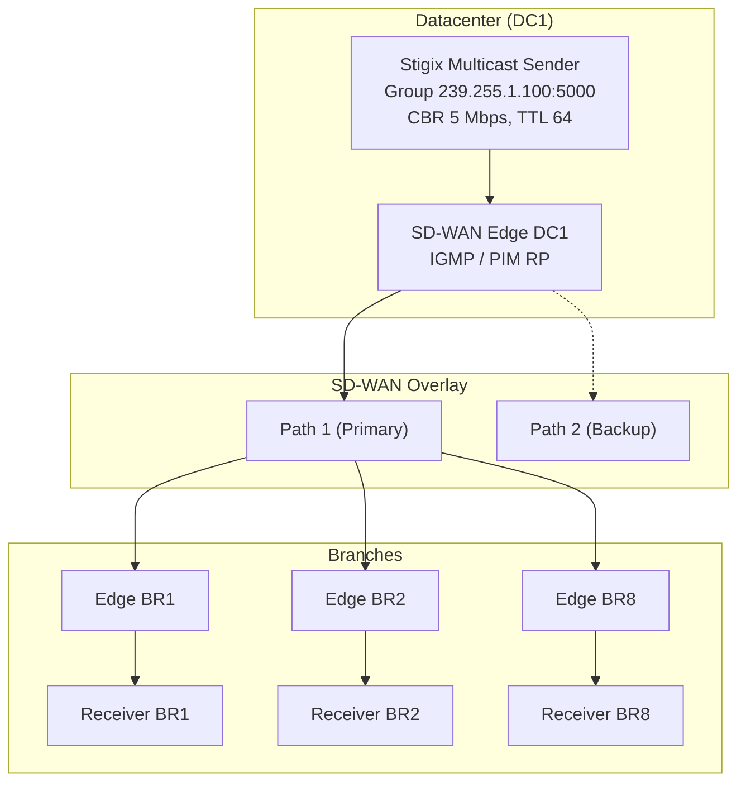
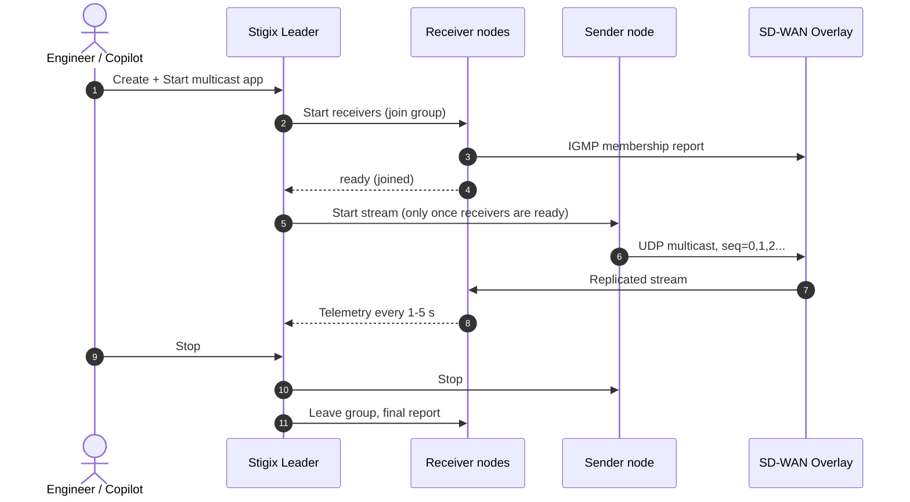

> **Last Updated:** 2026-10-13 | **Created:** 2026-10-13 (v3.0.3)

# PRD — SD-WAN Overlay Multicast Validation Engine

**Status:** Draft v3 (revised) | **Owner:** Stigix Core Team | **Target:** v3.1.x

**Reference platform:** Palo Alto Networks **Prisma SD-WAN** (first validated target). **Design principle:** the engine is *vendor-neutral* — it only speaks standard IGMP/UDP multicast from the edge of the LAN, so it works with any SD-WAN solution that transports multicast. Vendor-specific knowledge is limited to documentation (Appendix A) and optional pre-flight hints.

---

## 1. Executive Summary & Vision

### 1.1 The Challenge
Enterprise SD-WAN deployments increasingly transport IP multicast: financial market data, corporate video/IPTV/CCTV, and industrial/IoT telemetry or bulk imaging.

Validating multicast over an SD-WAN overlay is hard:
1. Multicast is UDP-only, with no handshake or ACK. Loss is silent for the application.
2. The overlay must either do **Head-End Replication (HER)** (multicast converted into N unicast tunnels) or run **PIM-SM / PIM-SSM** across the overlay. The two behave very differently on failover.
3. Engineers lack a lightweight tool to measure **join latency**, **loss/duplication per receiver**, and **convergence time on WAN failure**.

### 1.2 The Solution
Extend the existing **Custom Apps** subsystem (`web-dashboard/custom-tcp-apps/`) with a new **Multicast Stream** app type: a distributed 1-to-N UDP multicast sender plus receivers that join the group, track sequence numbers, and report telemetry to the dashboard.

### 1.3 Goals and Non-Goals

| Goals | Non-Goals (v1) |
|---|---|
| IPv4 ASM (`239/8`) and SSM (`232/8`) streams | IPv6 / MLD |
| Per-receiver loss, duplicates, jitter, throughput, join latency | Configuring the SD-WAN fabric (PIM, IGMP proxy, RP) — the network is assumed pre-configured |
| Convergence-time measurement during underlay chaos (VyOS) | Real video/audio codecs or decoding |
| Copilot/MCP/CLI parity | Multicast routing daemon inside Stigix (no PIM speaker) |
| Run inside existing container (host networking) | Bridge-mode Docker support |



---

## 2. Personas & Use Cases

| Persona | Goal | Value |
|---|---|---|
| **SD-WAN Architect** | Certify HER vs. native PIM behavior | Confirm every subscribed branch receives the stream with zero duplicates |
| **NOC Engineer** | Measure impact of a link cut | Exact lost-packet count and **stream interruption time** |
| **Trading / Financial Engineer** | Validate low-jitter feed replication | Sequence tracking, jitter and micro-burst loss |
| **Security Engineer** | Verify segmentation | Prove a non-member node (or other VRF) receives **nothing** (negative test) |

Core test scenarios:
- **S1 – Baseline:** all receivers joined, loss = 0, duplicates = 0.
- **S2 – Late join:** a receiver joins mid-stream; measure time-to-first-packet.
- **S3 – Failover:** inject `interface-down` on the primary underlay link; measure interruption per receiver.
- **S4 – Leak test:** receiver on an unauthorized segment must see 0 packets (expected-state `NO_TRAFFIC`).
- **S5 – Leave:** after stop, traffic must stop reaching the branch (prune check).

---

## 3. Functional Specifications

### 3.1 Sender
1. **Addressing:** ASM `239.0.0.0/8` (administratively scoped) and SSM `232.0.0.0/8`. Reject other ranges in validation, and reject reserved `224.0.0.0/24` (link-local).
2. **Parameters:** UDP port (default `5000`), egress interface (resolved to an IP; `IP_MULTICAST_IF`), TTL (default `64`), DSCP (`BE`, `CS5`, `EF`, custom), payload size (default `1316` bytes = 7 TS packets; range 64–1400 to avoid fragmentation).
3. **Rate modes:**
   - **CBR:** 64 kbps – 50 Mbps (v1 cap, see 4.3).
   - **Burst:** N packets every T ms (e.g., 50 pkts every 100 ms).
4. **`IP_MULTICAST_LOOP` = 0** so a co-located receiver does not see its own traffic and skew tests.
5. **Packet header** (network byte order, packed, 24 bytes), followed by padding:

   | Offset | Size | Field | Notes |
   |---|---|---|---|
   | 0 | 4 | `magic` | `0x53544758` ("STGX") — non-matching packets are counted as `foreign` and ignored |
   | 4 | 8 | `sequence_id` | per-stream, starts at 0 on each run |
   | 12 | 8 | `timestamp_ns` | sender wall clock; used for **jitter only**, never one-way delay |
   | 20 | 2 | `stream_id` | app identifier |
   | 22 | 2 | `run_id` | increments on sender restart so receivers can detect a reset instead of reporting huge loss |

### 3.2 Receiver
1. **Membership:**
   - ASM: `IP_ADD_MEMBERSHIP`.
   - SSM: `IP_ADD_SOURCE_MEMBERSHIP` with the sender's source IP (requires IGMPv3 in the network; the UI warns if the host is forced to IGMPv2).
   - Leave via `IP_DROP_MEMBERSHIP` on stop. Periodic report replies to IGMP queries are handled by the **Linux kernel**, not by the application.
2. **Metrics (per 1-second window and cumulative):**
   - Loss (gaps in `sequence_id`), reordering, **duplicates**, `foreign` packets.
   - Throughput (kbps) and pps.
   - **Jitter** per RFC 3550 using sender timestamps (clock offset cancels out in inter-arrival differences).
   - **Time-to-first-packet:** time from `IP_ADD_MEMBERSHIP` call to first valid packet. Documented as an approximation (the kernel sends the IGMP report asynchronously).
   - **Max interruption (gap) in ms:** longest inter-arrival gap — the primary failover/convergence metric.
3. **Expectation mode:** `EXPECT_TRAFFIC` (default) or `EXPECT_NONE` (leak test). The verdict is computed locally.
4. **Health verdict:**

   | State | Rule (configurable thresholds) |
   |---|---|
   | `HEALTHY` | loss ≤ 0.1%, 0 duplicates |
   | `DEGRADED` | loss 0.1–2% or duplicates > 0 |
   | `FAILED` | loss > 2% or no packet for > 3 s |
   | `NO_TRAFFIC` | expected for `EXPECT_NONE` (shown as pass) |

---

## 4. Technical Architecture

### 4.1 Where it fits in the codebase
The existing Custom Apps backend lives in `web-dashboard/custom-tcp-apps/` (`tcp-app-manager.ts`, `api-routes.ts`, `config-store.ts`, `history-store.ts`, `validation.ts`, `types.ts`). The frontend is `web-dashboard/src/CustomApps.tsx` and `web-dashboard/src/components/custom-tcp/CustomAppWizardModal.tsx`.

Proposed additions:
- `engines/multicast_engine.py` — daemon (single process per role, `--role sender|receiver`), emits JSON stats lines on stdout / local Unix socket. Follows the pattern of other Python engines in `engines/`.
- `web-dashboard/custom-tcp-apps/multicast-manager.ts` — spawns/stops the daemon and ingests stats.
- Extend `types.ts` with `kind: 'tcp' | 'multicast'` (default `'tcp'`, so existing configs remain valid), and extend `validation.ts`.
- Reuse the existing leader→peer config sync and peer API so receivers run on the other nodes.

### 4.2 Orchestration



Start order is **receivers first**, so the baseline is measured without join transients (unless the *late join* scenario is chosen).

### 4.3 Implementation notes and constraints
- **Networking:** requires `network_mode: host` (already used in `docker-compose.yml`). In bridge mode, multicast does not cross the container boundary; the UI/CLI refuse to start and explain why.
- **Host prerequisites to surface in a pre-flight check:**
  - `rp_filter` may drop multicast on asymmetric paths.
  - Interface must have the `MULTICAST` flag.
  - Local firewall must allow UDP to the group/port.
  - Detect and show the effective IGMP version (`/proc/net/igmp`).
- **Performance:** a Python sender is suitable up to ~50 Mbps with 1316-byte payloads (~4.7 kpps) using a paced loop. Above that, a Node/C sender is a v2 item. The CBR limit is therefore 50 Mbps in v1.
- **Time:** wall-clock timestamps are only used for jitter. One-way delay is explicitly **not** reported (no clock sync guarantee).
- **Safety limits:** max 10 concurrent multicast apps per node, max 50 Mbps aggregate, mandatory TTL ≤ 64 by default, and a confirmation when TTL > 16 (leak risk).
- **Persistence:** apps in `config/custom-tcp-apps.json` (same store); run history in the existing history store with per-receiver summary.

### 4.4 Data model (excerpt)
```json
{
  "id": "mc-001",
  "kind": "multicast",
  "name": "Market Data Feed",
  "group": "239.255.1.100",
  "port": 5000,
  "ssm_source": null,
  "sender_node": "DC1",
  "receivers": [
    {"node": "BR1", "expect": "traffic"},
    {"node": "BR2", "expect": "traffic"},
    {"node": "BR5", "expect": "none"}
  ],
  "rate": {"mode": "cbr", "kbps": 5000},
  "payload_bytes": 1316,
  "ttl": 64,
  "dscp": "CS5",
  "duration_s": 0
}
```

### 4.5 API (under existing `/api/custom-tcp`)

| Method | Path | Purpose |
|---|---|---|
| `POST` | `/api/custom-tcp/multicast` | Create multicast app |
| `POST` | `/api/custom-tcp/multicast/:id/start` · `/stop` | Orchestrated start/stop |
| `GET` | `/api/custom-tcp/multicast/:id/stats` | Per-receiver live stats |
| `POST` | `/api/custom-tcp/multicast/:id/preflight` | Host/interface checks on all nodes |

---

## 5. UI/UX Specification

### 5.1 Wizard extension
`CustomAppWizardModal.tsx` gets a type step: `[ TCP | ⚡ Multicast Stream ]`. For multicast:
- Group IP (validated, with ASM/SSM badge), port, sender node, receiver multi-select (each with *Expect traffic / Expect none*), rate mode + value, payload size, DSCP, TTL (advanced), duration.
- Pre-flight button; result list per node (✅/⚠️/❌ with remediation text).

### 5.2 Live monitoring drawer
- Source: bitrate, packets sent, uptime.
- Receivers table:

  | Receiver | IGMP | Rx Mbps | Loss % | Dups | Jitter ms | Max gap ms | Join ms | Verdict |
  |---|---|---|---|---|---|---|---|---|
  | BR1 | v3 | 4.98 | 0.00 | 0 | 1.1 | 20 | 42 | 🟢 |
  | BR5 | v3 | 0.00 | — | 0 | — | — | — | 🟢 (expected none) |

- Timeline chart of per-receiver throughput with failover events overlaid (links to VyOS chaos actions).

---

## 6. Copilot, MCP & CLI Integration

Per the `stigix-mcp-sync` convention, every tool is mirrored in the CLI and the MCP manifest.

| Tool | Parameters | Description |
|---|---|---|
| `create_multicast_app` | `name, group, port, sender_node, receivers[], bitrate_kbps, ttl, dscp` | Create a stream |
| `start_multicast_app` / `stop_multicast_app` | `app_id` | Orchestrated start/stop |
| `get_multicast_stats` | `app_id` | Per-receiver loss, jitter, gap, verdict |
| `run_multicast_failover_test` | `app_id, vyos_action` | Runs a stream, injects the chaos action, returns max interruption per receiver |

RBAC mapping (see `PRD_ENTERPRISE_RBAC.md`): new capabilities `multicast:read` and `multicast:execute` (included in the *Test Operator* preset, `read` only in *Demo / Read-Only*).

---

## 7. Success Metrics & Acceptance Criteria

- Sender holds configured CBR within ±3% at 5, 20 and 50 Mbps.
- Loss detection accuracy: injected 1% `tc netem` loss reported within ±0.2%.
- Duplicates correctly flagged when a HER setup double-delivers.
- Failover test returns max interruption within ±100 ms of an external packet capture.
- Leak test (`EXPECT_NONE`) reports a failure when any valid packet is received.
- Existing TCP custom apps and their JSON configs are unaffected (regression suite `test-custom-tcp-*` passes).

## 8. Risks & Open Questions

| Risk / Question | Mitigation |
|---|---|
| Fabric is not multicast-enabled → apparent "failure" | Pre-flight + clear `NO_TRAFFIC` diagnostics, document network prerequisites |
| Multicast leakage onto the Internet | Default TTL 64 restricted to 239/8, explicit warning for high TTL |
| Python pacing jitter at high rates | 50 Mbps cap in v1; native sender in v2 |
| Which vendors on the fabric? | **Decided:** Prisma SD-WAN first; engine stays vendor-neutral (standard IGMP/UDP). Per-vendor notes in Appendix A |
| Receivers on non-Stigix hosts? | **Decided:** out of scope — receivers are Stigix nodes only (v1) |
| Prisma multicast feature/version prerequisites (ION software, WAN multicast profile) may differ per release | Validate against the current Prisma SD-WAN documentation and lab before GA; keep the appendix versioned |
| Docker `Dockerfile` sync | Run the `stigix-docker-audit` checklist for the new `engines/` and `custom-tcp-apps/` files |

## 9. Phased Roadmap (effort-based)

| Phase | Scope | Est. effort |
|---|---|---|
| **1 – Engine** | `multicast_engine.py` (sender/receiver, header, metrics), CLI standalone test | 2–3 days |
| **2 – Platform** | `multicast-manager.ts`, validation, routes, orchestration order, history | 2–3 days |
| **3 – UI** | Wizard mode, pre-flight, drawer and chart | 2–3 days |
| **4 – Automation** | Copilot/MCP/CLI tools, failover test, docs, FAQ, RBAC capabilities | 2 days |

Total ≈ 8–11 days for full scope; an MVP (phases 1–2 plus a minimal UI) is achievable in ~4–5 days.

---

## Appendix A — Vendor Notes (v1: Prisma SD-WAN)

> [!NOTE]
> Vendor behavior below must be validated against the Prisma SD-WAN release in use before GA. Stigix never configures the fabric; this appendix documents what the operator must have in place.

### A.1 Generic requirements (any SD-WAN)
| Layer | Requirement |
|---|---|
| Receiver LAN | Edge router runs **IGMPv2 or v3** (v3 mandatory for SSM) on the LAN interface facing the Stigix node |
| Source LAN | Edge router accepts multicast from the sender subnet (PIM/RPF on the source-facing interface) |
| Overlay | Either native multicast routing (PIM) or head-end replication, as supported by the vendor |
| Rendezvous | A reachable RP (ASM), consistent on all participating routers |
| Policy | Multicast not blocked by the vendor's security/path policy; DSCP/QoS class mapped if tested |

### A.2 Prisma SD-WAN (reference target)
Prisma SD-WAN supports multicast with **IGMP (v2/v3) on the LAN** and **PIM-SM across the fabric**, with a configured Rendezvous Point.

Typical operator checklist:
1. Enable multicast on the Layer 3 LAN interfaces (receiver branches) and on the DC interface facing the source.
2. Create a **WAN multicast profile** and associate it with the participating sites.
3. Configure the multicast global parameters, then a **Static RP** (same RP address on every participating node), or dynamic RP learning if the design requires it.
4. Verify on the ION with the multicast diagnostics (`dump routing multicast status | pim | igmp | mroute`).

Stigix hints (optional, vendor-neutral output):
- If a receiver reports `FAILED` / no packets while the pre-flight is green, the diagnostic suggests checking: IGMP membership visible on the edge, PIM neighbor/RP reachability, and the `mroute` entry for the group.
- Failover scenario (S3) on Prisma: use the existing underlay chaos actions on the WAN circuit and observe **max gap** per branch; compare native PIM vs. any HER-style behavior observed (duplicates indicate double delivery).

### A.3 Future vendors
Any solution transporting multicast (e.g., other SD-WAN or router-based overlays such as VyOS) is expected to work unchanged. Adding a vendor requires only an appendix entry and, optionally, extra pre-flight hint text — **no engine change**.

---

## 📜 Revision History


| Date | Stigix Version | Author / Trigger | Summary of Changes |
|---|---|---|---|
| 2026-10-13 | `v3.0.3` | Stigix Core Team | Initial PRD creation for SD-WAN Overlay Multicast Validation Engine |
| 2026-10-13 | `v3.0.3` | Stigix Core Team | Revision: aligned with real code layout (`custom-tcp-apps/`), fixed SSM and IGMP handling, added `run_id`, leak/failover scenarios, pre-flight, data model, API, RBAC mapping, acceptance criteria, risks, realistic estimates |
| 2026-10-13 | `v3.0.3` | Stigix Core Team | Vendor-neutral design with Prisma SD-WAN as reference target (Appendix A); receivers limited to Stigix nodes
