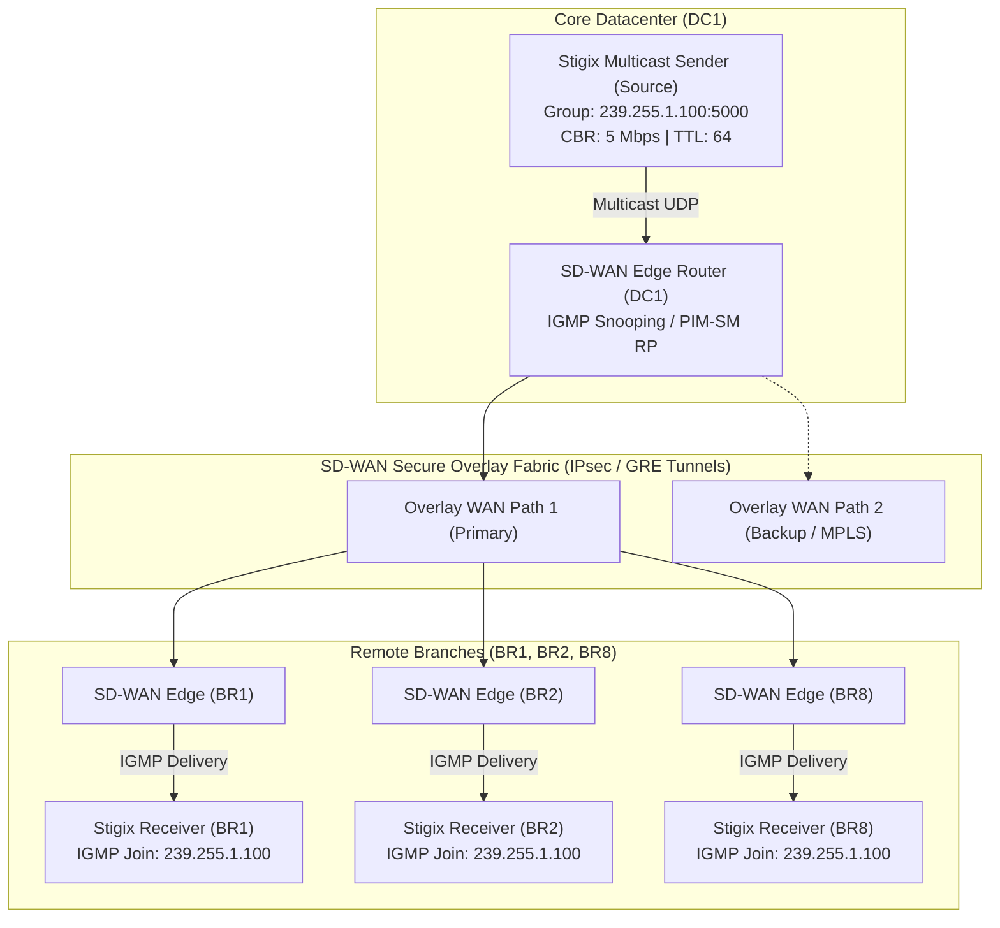
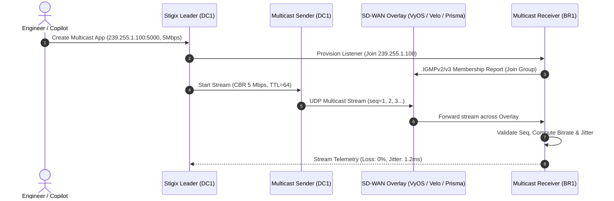
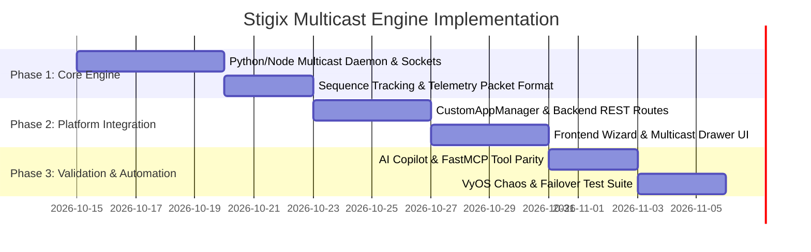

> **Last Updated:** 2026-10-13 | **Created:** 2026-10-13 (v3.0.3)

# PRD — SD-WAN Overlay Multicast Validation Engine

---

## 1. Executive Summary & Vision

### 1.1 The Challenge
Enterprise SD-WAN deployments increasingly transport mission-critical IP Multicast traffic:
- **Financial Market Data:** Ultra-low latency, zero-loss multicast feeds (L2/L3 order books, ticker plants).
- **Enterprise Video & IPTV:** Corporate broadcasts, CCTV surveillance streaming, video conferencing.
- **Industrial Automation & Telemetry:** SCADA, IoT telemetry distribution, and Ghost/PXE bulk imaging.

Validating multicast over SD-WAN is notoriously complex:
1. Multicast packets do not utilize TCP handshakes or ACKs, making packet loss catastrophic for consumers.
2. SD-WAN solutions must either implement **Head-End Replication (HER)** (converting multicast into multiple unicast overlay tunnels) or maintain dynamic **PIM-SM (Protocol Independent Multicast Sparse Mode)** trees over IPsec/GRE overlays.
3. Network engineers lack lightweight, automated validation tools to test **IGMP Join latency**, **underlay failover impact on overlay multicast streams**, and **packet drop rates** across branch offices.

### 1.2 The Solution
The **Stigix Multicast Validation Engine** integrates seamlessly into the Stigix platform, extending the **Custom Apps** framework to support distributed **UDP Multicast (1-to-N)** traffic generation, automated IGMPv2/v3 group subscription, and real-time telemetry analysis across the SD-WAN mesh fabric.



---

## 2. Personas & Core Use Cases

| Persona | Operational Goal | Stigix Value Proposition |
|---|---|---|
| **SD-WAN Network Architect** | Certify multicast forwarding mode (Head-End Replication vs. Native Overlay PIM-SM). | Verify that all subscribed branches receive the stream with zero packet duplication. |
| **NOC / Operations Engineer** | Measure packet loss and audio/video artifacts during underlay brownouts and link cuts. | Quantify exact packet drop count and convergence time when a WAN circuit fails. |
| **Financial / Trading Engineer** | Validate sub-millisecond market feed replication across DC and branch nodes. | Precise sequence tracking, jitter profiling, and micro-burst packet loss measurement. |
| **Security Engineer** | Ensure multicast streams remain strictly contained within their designated VRF/Segment. | Confirm no cross-talk or leakage into non-subscribed tenant segments or the public Internet. |

---

## 3. Functional Specifications

### 3.1 Multicast Sender Engine (Source)
The sender runs on any designated Stigix node (typically DC1 or a central hub):
1. **Multicast Group Addressing:**
   - Supports Administratively Scoped IPv4 Multicast: `239.0.0.0/8` (e.g., `239.255.1.100`).
   - Supports Global/Source-Specific Multicast (SSM): `232.0.0.0/8`.
2. **Transmission Parameters:**
   - **Destination Port:** Configurable UDP port (default: `5000`–`5008`).
   - **Source Interface Binding:** Binds strictly to the SD-WAN LAN overlay interface (e.g., `eth1`, `enp2s0`).
   - **Bitrate Modes:**
     - Constant Bitrate (CBR): Configurable from `64 kbps` up to `100 Mbps`.
     - Burst Mode: Generates periodic micro-bursts (e.g., 10 ms bursts at 50 Mbps every 1 second).
   - **IP TTL (Time-To-Live):** Configurable `TTL` (default: `64`), ensuring packets traverse multi-hop SD-WAN router overlays without being dropped at the first boundary.
   - **DSCP / TOS Tagging:** Custom QoS markings (e.g., `CS5`, `EF` for broadcast video/voice, or `BE`).
3. **Packet Header Format:**
   Every generated UDP payload includes a 24-byte structured telemetry header:
   ```c
   struct StigixMulticastHeader {
       uint32_t magic;         // 0x53544758 ("STGX")
       uint64_t sequence_id;   // Monotonically increasing sequence number
       uint64_t timestamp_ns;  // Sender epoch timestamp in nanoseconds
       uint16_t stream_id;     // Unique identifier for the multicast app
       uint16_t payload_len;   // Payload length
   };
   ```

### 3.2 Multicast Receiver Engine (Subscribers / Listeners)
Receivers run on one or more distributed Stigix spoke instances (e.g., BR1, BR2, BR8):
1. **Automated IGMP Group Membership:**
   - Issues an **IGMPv2/v3 Join** (`IP_ADD_MEMBERSHIP`) on startup.
   - Periodically responds to **IGMP Queries** from the local SD-WAN Edge router to maintain membership.
   - Issues an **IGMP Leave** (`IP_DROP_MEMBERSHIP`) when the test is stopped.
2. **Telemetry Calculation:**
   - **Packet Loss:** Tracks missing `sequence_id` instances in real time.
   - **Throughput:** Computes 1-second rolling bitrate (kbps / Mbps) and packet rate (pps).
   - **Jitter:** Computes RFC 3550 inter-arrival jitter variance across consecutive packets.
   - **Join Latency (Time-To-First-Packet):** Milliseconds elapsed between sending the IGMP Join report and receiving the first multicast data packet.
   - **Duplicate Detection:** Flags duplicate sequence numbers caused by improper SD-WAN replication.

---

## 4. Technical Architecture

### 4.1 Daemon Execution & Socket Implementation
The Multicast Engine is implemented as a lightweight daemon running inside the Stigix container:



#### Socket Configuration (Linux OS):
```python
# Receiver IGMP Join Socket Implementation
import socket, struct

sock = socket.socket(socket.AF_INET, socket.SOCK_DGRAM, socket.IPPROTO_UDP)
sock.setsockopt(socket.SOL_SOCKET, socket.SO_REUSEADDR, 1)
sock.bind(('', 5000))

# IGMP Join Group on local interface
mreq = struct.pack("4s4s", socket.inet_aton("239.255.1.100"), socket.inet_aton(interface_ip))
sock.setsockopt(socket.IPPROTO_IP, socket.IP_ADD_MEMBERSHIP, mreq)
```

```python
# Sender Multicast Socket Implementation
sock = socket.socket(socket.AF_INET, socket.SOCK_DGRAM, socket.IPPROTO_UDP)
# Set TTL to traverse SD-WAN routers
sock.setsockopt(socket.IPPROTO_IP, socket.IP_MULTICAST_TTL, 64)
# Bind multicast traffic to SD-WAN LAN interface
sock.setsockopt(socket.IPPROTO_IP, socket.IP_MULTICAST_IF, socket.inet_aton(interface_ip))
```

---

## 5. UI/UX Specifications in Stigix Dashboard

### 5.1 Custom Apps Wizard Extension
In **Generate ➔ Custom TCP/HTTP Apps** ([`CustomApps.tsx`](file:///Users/jsuzanne/Github/stigix/web-dashboard/src/CustomApps.tsx)), the creation wizard expands to include:
- **Protocol Selector:** `[ TCP Unicast | UDP Unicast | ⚡ Multicast Stream ]`
- **When Multicast is selected:**
  - **Multicast Group IP:** Default `239.255.1.100`.
  - **Port:** Default `5000`.
  - **Sender Node:** Select 1 source node (e.g., `DC1-Ubuntu`).
  - **Receiver Nodes (Multi-Select):** Select 1 or more listener nodes (`BR1`, `BR2`, `BR5`, `BR8`).
  - **Bitrate:** Slider / Input (`256 kbps` – `50 Mbps`).
  - **QoS Marking (DSCP):** Dropdown (`Best Effort`, `CS5 - Broadcast Video`, `EF - Telephony`).

### 5.2 Real-Time Monitoring Drawer
Clicking on an active Multicast App opens a dedicated drawer showing:
1. **Source Status:** Active bitrate, transmitted packet count, uptime.
2. **Subscribers Table:**
   | Receiver Node | IGMP State | Received Bitrate | Packet Loss (%) | Jitter (ms) | Join Latency | Status |
   |---|---|---|---|---|---|---|
   | **BR1-Ubuntu** | Joined (v3) | 4.98 Mbps | **0.00%** | 1.1 ms | 42 ms | 🟢 Healthy |
   | **BR2-Ubuntu** | Joined (v3) | 4.97 Mbps | **0.02%** | 1.4 ms | 38 ms | 🟢 Healthy |
   | **BR8-Ubuntu** | Joined (v3) | 4.99 Mbps | **0.00%** | 0.9 ms | 55 ms | 🟢 Healthy |

---

## 6. AI Copilot & MCP Tooling Integration

The engine will expose dedicated tools to the Stigix Copilot and FastMCP server:

| Tool Name | Parameters | Description |
|---|---|---|
| `create_multicast_app` | `name, group_ip, port, sender_node, receiver_nodes, bitrate_kbps` | Deploys a distributed multicast test stream across the SD-WAN mesh. |
| `get_multicast_stats` | `app_id` | Fetches real-time loss, bitrate, and jitter across all receivers. |
| `stop_multicast_app` | `app_id` | Sends IGMP Leave across all receivers and terminates the source stream. |

---

## 7. Phased Implementation Roadmap



1. **Phase 1 (Core Engine):**
   - Implement `engines/multicast_engine.py` (daemon handling sender and receiver loops).
   - Ensure IGMPv2/v3 join/leave and sequence telemetry operate cleanly in host networking mode.
2. **Phase 2 (Dashboard Integration):**
   - Integrate into `CustomAppManager` on backend (`server.ts`).
   - Add Multicast mode to `CustomAppWizardModal.tsx` and create real-time subscriber metrics view.
3. **Phase 3 (Chaos & Copilot Automation):**
   - Add FastMCP & Copilot tool definitions.
   - Run underlay chaos test (`vyos_execute_action`: `interface-down`) during active multicast streaming to validate SD-WAN overlay convergence time.

---

## 📜 Revision History

| Date | Stigix Version | Author / Trigger | Summary of Changes |
|---|---|---|---|
| 2026-10-13 | `v3.0.3` | Stigix Core Team | Initial PRD creation for SD-WAN Overlay Multicast Validation Engine |
