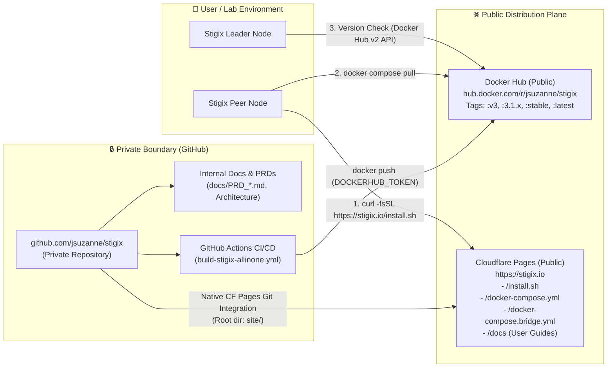

> **Last Updated:** 2026-10-26 | **Created:** 2026-10-26 (v3.1.31)

# PRD: Private GitHub Repository Transition & Public Distribution via `stigix.io`

## 1. Executive Summary & Objective

Stigix currently hosts its source code, installation bootstrap scripts (`install.sh`, `docker-compose.yml`), and user documentation in a public GitHub repository (`github.com/jsuzanne/stigix`), while publishing container images to Docker Hub (`hub.docker.com/r/jsuzanne/stigix`) and hosting its public web presence on Cloudflare Pages (`https://stigix.io`).

If corporate or intellectual-property policies require switching the GitHub repository from **Public** to **Private**, any unauthenticated call to `raw.githubusercontent.com/jsuzanne/stigix/...` or `api.github.com/repos/jsuzanne/stigix/...` will immediately fail with `HTTP 404 Not Found`.

### Primary Goals
1. **Zero-Disruption Repo Privatization**: Decouple all runtime, installation, and upgrade flows from `raw.githubusercontent.com` and `api.github.com` so `github.com/jsuzanne/stigix` can be switched to **Private** at any time without breaking existing nodes or new installations.
2. **Keep Public Container Distribution on Docker Hub (`jsuzanne/stigix`)**: Maintain public Docker images on Docker Hub without forcing users to migrate to `ghcr.io` or configure registry credentials.
3. **Establish `https://stigix.io` (Cloudflare Pages) as the Public Distribution & Documentation Hub**:
   - Serve the 3 mandatory bootstrap files (`install.sh`, `docker-compose.yml`, `docker-compose.bridge.yml`) directly from `https://stigix.io/`.
   - Provide a curated **Public Documentation Portal (`https://stigix.io/docs`)** exposing user and deployment guides while keeping internal PRDs and engineering specifications strictly private in GitHub.

---

## 2. Target Architecture



### Why `ghcr.io` Is Not Required
- GitHub Actions builds the multi-arch image and pushes it directly to **Docker Hub (`jsuzanne/stigix`)** using `DOCKERHUB_USERNAME` and `DOCKERHUB_TOKEN`.
- Docker Hub repository visibility (**Public**) is completely independent of GitHub repository visibility (**Private**).
- Keeping Docker Hub (`jsuzanne/stigix`) avoids breaking existing `docker-compose.yml` files and allows unauthenticated version checks via the public Docker Hub v2 API (`https://hub.docker.com/v2/repositories/jsuzanne/stigix/tags/`), whereas `ghcr.io` requires bearer token authentication even for public package tag listings.

---

## 3. Codebase Audit: Current Dependencies on Public GitHub

A full repository audit identified all locations that currently assume `github.com/jsuzanne/stigix` is publicly readable:

| # | File & Lines | Current Public GitHub Reference | Failure Mode if Repo is Private | Target Replacement |
|---|---|---|---|---|
| **1** | `install.sh` (L11–12, L501–508) | `REPO_URL="https://raw.githubusercontent.com/jsuzanne/stigix/${STIGIX_BRANCH:-main}"` to download `docker-compose.yml` and `docker-compose.bridge.yml` | `curl` downloads a `404: Not Found` string into `docker-compose.yml`; installation fails at `docker compose up -d`. | `REPO_URL="${STIGIX_REPO_URL:-https://stigix.io}"` |
| **2** | `web-dashboard/magic-join-manager.ts` (L305) | `curl -fsSL https://raw.githubusercontent.com/jsuzanne/stigix/v2/install.sh \| sudo bash -s -- ${token}` | Magic Join one-liner copied from UI or API fails with HTTP 404. | `curl -fsSL https://stigix.io/install.sh \| sudo bash -s -- ${token}` |
| **3** | `web-dashboard/src/Settings.tsx` (L1856) | `const installScriptUrl = 'https://raw.githubusercontent.com/jsuzanne/stigix/main/install.sh'` | Fleet onboarding modal displays a broken `raw.githubusercontent.com` one-liner. | `const installScriptUrl = 'https://stigix.io/install.sh'` |
| **4** | `web-dashboard/server.ts` (L14994) | `curl -sL https://api.github.com/repos/jsuzanne/stigix/tags` (used when `channel === 'stable'`) | Returns HTTP 404 on private repo; `stable` channel nodes cannot detect new releases via GitHub tags. | Resolve `stable` / `latest` version via Docker Hub v2 API digest matching (same mechanism added for `v3` in `v3.1.31`). |
| **5** | `web-dashboard/src/Iot.tsx` (L680) | `href="https://raw.githubusercontent.com/jsuzanne/stigix/main/sample%20config/iot-devices.json"` | Sample IoT template link returns HTTP 404. | Serve locally from backend (`/api/iot/sample-config`) or `https://stigix.io/samples/iot-devices.json`. |
| **6** | `site/index.html` (L1240, L1253, L1263), `site/script.js` (L191), `site/faq.html` (L161, L311, L2388) | Public website install snippets referencing `raw.githubusercontent.com/jsuzanne/stigix/main/install.sh` | Visitors copying the install command from `stigix.io` get HTTP 404. | Replace all snippets with `https://stigix.io/install.sh` and `https://stigix.io/docker-compose.yml`. |

---

## 4. Implementation Plan

### Phase 1: Host Mandatory Bootstrap Files on `stigix.io` (Cloudflare Pages)

Cloudflare Pages natively supports deploying from a **Private GitHub Repository** at no cost. Since Cloudflare Pages serves the `site/` directory at the root of `https://stigix.io`, only **3 bootstrap files** (plus 1 optional IoT sample file) need to be published in `site/`:

| Source File in Repo | Public Path in `site/` | Public URL on Cloudflare Pages |
|---|---|---|
| `install.sh` | `site/install.sh` | `https://stigix.io/install.sh` |
| `docker-compose.yml` | `site/docker-compose.yml` | `https://stigix.io/docker-compose.yml` |
| `docker-compose.bridge.yml` | `site/docker-compose.bridge.yml` | `https://stigix.io/docker-compose.bridge.yml` |
| `sample config/iot-devices.json` | `site/samples/iot-devices.json` | `https://stigix.io/samples/iot-devices.json` |

#### Result for End Users
- **Standalone / Leader Install**:
  ```bash
  curl -fsSL https://stigix.io/install.sh | sudo bash
  ```
- **Magic Join Peer Enrollment**:
  ```bash
  curl -fsSL https://stigix.io/install.sh | sudo bash -s -- STX-...
  ```

#### Self-Hosted Leader Fallback (Air-Gapped / Private Tunnel Bonus)
In addition to `https://stigix.io/install.sh`, expose lightweight unauthenticated read-only routes on the Stigix Leader (`GET /install.sh`, `GET /docker-compose.yml`, `GET /docker-compose.bridge.yml`) serving the bundled files from `/app/`.
- If `install.sh` is invoked with a Magic Join token or `--controller` URL and `https://stigix.io` is unreachable (restricted WAN), `install.sh` can automatically fall back to downloading `docker-compose.yml` directly from `$CONTROLLER_URL/docker-compose.yml`.

---

### Phase 2: Public Documentation Portal (`https://stigix.io/docs`) & Document Classification

Currently, `docs/` contains ~75 Markdown files mixing user-facing guides with internal engineering PRDs. When the GitHub repository becomes private, users will no longer be able to browse `github.com/jsuzanne/stigix/tree/main/docs`.

#### 2.1 Strict Classification: Public vs. Private Documents

| Category | Visibility | Included Files |
|---|---|---|
| **Getting Started & Deployment** | 🌐 **Public (`stigix.io/docs`)** | `QUICK_START.md`, `DEPLOYMENT_GUIDE.md`, `DEPLOYMENT_SCENARIOS_AND_CLOUD_EDGE.md`, `ENVIRONMENT_VARIABLES.md`, `CONFIGURATION.md`, `WINDOWS_INSTALL.md`, `AZURE_INSTALL.md` |
| **Fleet Mesh & Magic Join** | 🌐 **Public (`stigix.io/docs`)** | `MAGIC_JOIN_AND_MULTI_TENANCY.md`, `GLOBAL_PROVISIONING_AND_PEER_ONBOARDING.md`, `REMOTE_VIEW_USER_GUIDE.md`, `AUTODISCOVERY_GUIDE.md`, `HYBRID_REGISTRY.md` |
| **Traffic, DEM & Convergence** | 🌐 **Public (`stigix.io/docs`)** | `DIGITAL_EXPERIENCE_TESTING.md`, `TRAFFIC_GENERATOR.md`, `TRAFFIC_FLOW_GUIDE.md`, `CONVERGENCE_LAB.md`, `XFR_TESTING.md`, `VOICE_SIMULATION.md`, `CUSTOM_TCP_APPS_USER_GUIDE.md`, `CUSTOM_TCP_NETWORK_IMPAIRMENTS.md`, `MULTICAST_TESTING_GUIDE.md`, `PCAP_REPLAY_USER_GUIDE.md` |
| **Security & IoT Simulation** | 🌐 **Public (`stigix.io/docs`)** | `SECURITY_TESTING.md`, `SECURITY_QUICK_REFERENCE.md`, `SECURITY_TESTING_FAQ.md`, `IOT_SIMULATION.md`, `IOT_DEVICE_GENERATOR.md`, `IOT_LLM_GENERATION.md` |
| **SASE, VyOS & Automation** | 🌐 **Public (`stigix.io/docs`)** | `PRISMA-SDWAN_INTEGRATION.md`, `VYOS_CONTROL.md`, `VYOS_FIREWALL_INTEGRATION.md`, `MCP_SERVER.md`, `STIGIX_MCP_SCENARIOS_AND_CAPABILITIES.md`, `STIGIX_CLI.md`, `API_REFERENCE.md`, `API_STUDIO_GUIDE.md` |
| **Operations & Whitepapers** | 🌐 **Public (`stigix.io/docs`)** | `MAINTENANCE_AND_BACKUP_GUIDE.md`, `TROUBLESHOOTING.md`, `TECH_SUPPORT_DIAGNOSTICS.md`, `WHITEPAPER_SDWAN_MULTICAST_VALIDATION.pdf`, `PRIVATE_DEPLOYMENT_TOPOLOGIES.pdf` |
| **Internal PRDs & Engineering Specs** | 🔒 **Private (GitHub Repo Only)** | All `PRD_*.md` files, `BACKEND_ROUTES_DUMP.md`, `GETFLOW_ENGINE.md`, `RELEASE_WORKFLOW.md`, `PROMPT_WINDOW_FEASIBILITY.md`, `TERMINOLOGY_CONSOLIDATION.md`, `.agent/skills/*` |

#### 2.2 `site/docs.html` Architecture on `stigix.io`
1. **Unified Visual Design**: Matches `site/index.html`, `site/faq.html`, and `site/reports.html` (dark/glassmorphic theme, top navigation bar with **Home · Features · Docs · FAQ · Reports**).
2. **Categorized Sidebar & Instant Search**:
   - Left sidebar grouping the allowlisted user guides into the 6 functional categories above.
   - Instant client-side filter/search across document titles and headings.
3. **Client-Side Markdown + Mermaid Renderer**:
   - Loads curated `.md` files from `site/docs/<slug>.md` (with `marked.js`, `highlight.js` + one-click Copy buttons for code blocks, and `mermaid.js` for architecture diagrams).
4. **Automated Sync Script (`scripts/sync-public-site.sh`)**:
   - Copies `install.sh`, `docker-compose.yml`, and `docker-compose.bridge.yml` from the repository root into `site/`.
   - Copies only the allowlisted public user guides (and their referenced `docs/images/` / `docs/screenshots/`) into `site/docs/` and generates `site/docs/manifest.json`.
   - Explicitly blocks any `PRD_*.md` or internal specification file from ever entering `site/`.

---

### Phase 3: Remove Remaining GitHub API Calls & Optimize CI Quotas

1. **Docker Hub Native Version Resolution for `stable` / `latest` (`web-dashboard/server.ts`)**:
   - Replace the legacy `https://api.github.com/repos/jsuzanne/stigix/tags` call in `GET /api/admin/maintenance/version` (L14994) with Docker Hub v2 API digest matching against `:stable` / `:latest`, identical to the `v3` channel logic introduced in `v3.1.31`.
2. **Sanitize Public Links in `site/`**:
   - Remove or replace any "View Source on GitHub" links in `site/index.html` and `site/faq.html` with links to `https://stigix.io/docs` and `https://hub.docker.com/r/jsuzanne/stigix`.
3. **GitHub Actions Build Minutes on a Private Repository**:
   - *Context*: GitHub Actions provides unlimited free minutes for public repositories, but enforces a monthly quota on private repositories (2,000 min/month on GitHub Free; 3,000 min/month on GitHub Pro; Linux minutes billed at 1x).
   - *Mitigation*:
     - Use `paths-ignore` in `.github/workflows/build-stigix-allinone.yml` so documentation-only or `site/`-only commits (`docs/**`, `site/**`, `*.md`) do not trigger a 15-minute multi-arch Docker build.
     - Optionally register a lightweight self-hosted Linux runner on an existing lab machine or VPS (0 GitHub Actions quota consumption and 3x faster Docker layer caching).

---

## 5. Step-by-Step Cutover Checklist

When ready to execute this transition:

- [ ] **Step 1**: Create `scripts/sync-public-site.sh` to populate `site/install.sh`, `site/docker-compose.yml`, `site/docker-compose.bridge.yml`, and `site/docs/` (allowlisted user guides only).
- [ ] **Step 2**: Build `site/docs.html` and add the **Docs** navigation link to `site/index.html`, `site/faq.html`, and `site/reports.html`.
- [ ] **Step 3**: Update `install.sh`, `web-dashboard/magic-join-manager.ts`, `web-dashboard/src/Settings.tsx`, `web-dashboard/src/Iot.tsx`, and `site/*` to use `https://stigix.io/...` instead of `raw.githubusercontent.com/...`.
- [ ] **Step 4**: Update `stable` channel version resolution in `web-dashboard/server.ts` to use Docker Hub v2 API instead of `api.github.com`, and add `paths-ignore: ['docs/**', 'site/**', '*.md']` to `.github/workflows/build-stigix-allinone.yml`.
- [ ] **Step 5**: Push to `v3` / `main` and verify that `https://stigix.io/install.sh`, `https://stigix.io/docker-compose.yml`, and `https://stigix.io/docs` respond with `HTTP 200` on Cloudflare Pages.
- [ ] **Step 6**: In GitHub (`Settings -> General -> Danger Zone`), change repository visibility to **Private** and verify that Cloudflare Pages and Docker Hub pushes continue operating normally.

---

## 📜 Revision History

| Date | Stigix Version | Author / Trigger | Summary of Changes |
|---|---|---|---|
| 2026-10-26 | `v3.1.31` | Stigix Core Team | Initial PRD for Private GitHub Repository transition, Docker Hub public retention, and `stigix.io` distribution & documentation portal |
