> **Last Updated:** 2026-10-11 | **Created:** 2026-10-11 (v3.0.0-dev)

# PRD: Stigix Traffic Flow Nexus & SCM Command Center Architecture

## 1. Executive Summary & Vision

Modern SASE management platforms, epitomized by **Palo Alto Networks Strata Cloud Manager (SCM) Command Center**, leverage topological flow diagrams (Nexus / Sankey visualizations) to answer the fundamental operational question in real time:

> **"Who is communicating with what destination, through which SASE enforcement points, and with what quality of experience?"**

In Stigix, our distributed SD-WAN testbed actively produces synthetic multi-tenant enterprise workloads across five distinct engines:
1. **SaaS Application Traffic** (Office 365, Salesforce, ServiceNow, Zoom, Workday, etc.)
2. **Enterprise Private TCP/HTTP Applications** (Custom ERP, SAP, Database, SMB)
3. **Voice & VoIP Simulation** (SIP / RTP with bidirectional MOS scoring and jitter)
4. **Physical IoT Device Emulation** (Smart sensors, cameras, industrial controllers)
5. **Stateful PCAP Replays & Threat Validation** (Malware, EICAR, C2 emulation)

While Stigix currently aggregates these workloads into quantitative metric cards and table lists, it lacks a **unified macro-visual flow** that connects **Initiators ➔ Security & Transit Engines ➔ Destination Services**.

This specification defines the architectural study, UX model, and data aggregation pipeline for the **Stigix Traffic Flow Nexus** (inspired by SCM Command Center), alongside the migration of the **Bidirectional Full-Mesh Reachability Grid** into a dedicated view under the `Observe` domain.

---

## 2. High-Level Concept Diagram (Flow Nexus)

```mermaid
flowchart LR
    subgraph INITIATORS ["1. Initiators & Fleet Sources"]
        N1["Stigix Fleet Nodes<br/>(DC1, BR1, BR2, BR5, BR8)"]
        N2["SaaS Synthetic Clients<br/>(Background Load Workers)"]
        N3["Voice RTP Callers<br/>(G.711 / G.729 Streamers)"]
        N4["IoT Fleet Devices<br/>(Physical Sensors & Cameras)"]
    end

    subgraph TRANSIT ["2. Transit & Forwarding Core"]
        P1["Direct SD-WAN Overlay<br/>(Branch-to-Branch / Branch-to-DC IPsec & Prisma SD-WAN)"]
        P2["Cloud SASE & SSE<br/>(Prisma Access TSG / Zscaler ZIA & ZPA Inspection)"]
        P3["VyOS WAN Routers<br/>(Impairments, Multi-Path & BGP Failover)"]
        P4["Direct Internet Breakout (DIA)<br/>(Local Branch Gateway)"]
    end

    subgraph DESTINATIONS ["3. Destination Targets & Services"]
        D1["Remote Stigix Peers<br/>(DC1 Hub, BR1, BR5, Homelab Targets)"]
        D2["Enterprise Private Apps<br/>(Custom TCP, Branch ERP, SMB)"]
        D3["Public SaaS Workloads<br/>(M365, Salesforce, ServiceNow, AWS)"]
        D4["VoIP PBX & Echo Responders<br/>(MOS Scoring Endpoints)"]
        D5["Threat Validation Endpoints<br/>(EICAR, DNS Sinkholes)"]
    end

    INITIATORS ==>|Real-time Bitrate & Sessions| TRANSIT
    TRANSIT ==>|Inspected & Routed Flows| DESTINATIONS
```



---

## 3. The 3-Tier Topological Architecture

### Tier 1: Initiators & Fleet Sources (Left Column)
Represents the origins of all traffic generated inside the Stigix environment:
* **Fleet Meshed Nodes:**
  * DC1-Ubuntu (Data Center Hub)
  * BR1-Ubuntu, BR2-Ubuntu, BR5-Ubuntu, BR8-Ubuntu (Branch Offices)
  * Standalone / Homelab nodes
* **Workload Archetypes:**
  * **Enterprise Users & SaaS Traffic:** Total active simulated workers and aggregate requests/min (RPM).
  * **Voice Channels:** Active concurrent RTP calls.
  * **IoT Devices:** Emulated real-wire physical interfaces and MAC/IP bindings.
  * **Security Probes:** Policy validation probes (URL, threat signatures).

### Tier 2: Transit & Forwarding Core (Center Column)
Represents the enforcement, routing, and transit fabric through which synthetic packets flow:
* **Direct SD-WAN Overlay (Site-to-Site Fabric):**
  * Direct Branch-to-Branch (e.g. BR8 ➔ BR1) and Branch-to-DC overlay paths.
  * Native SD-WAN IPsec tunnels, BGP EVPN/OSPF paths, or Prisma SD-WAN fabric without going through cloud SSE.
* **Cloud SASE & SSE Inspection (Prisma Access / Zscaler):**
  * Palo Alto Cloud Security Processing Nodes (SPN / TSG) and SSE inspection engines (Zscaler ZIA/ZPA).
  * Cloud SWG, CASB, Zero Trust Network Access (ZTNA) inspection, and regional PoPs (`eu-central`, `eu-west`).
  * Security verdict aggregation (Allowed vs. Inspected vs. Blocked).
* **VyOS WAN Underlay & Impairments:**
  * Physical circuit emulation, dual-ISP paths, and applied QoS impairment rules (Latency, Loss, Jitter).
* **Direct Internet Breakout (DIA):**
  * Traffic bypassing the corporate overlay directly to local ISP gateways.

### Tier 3: Destination Targets & Services (Right Column)
Represents the target entities receiving and responding to traffic:
* **Remote Stigix Peer Instances (Inter-Branch / Hub Mesh):**
  * When BR8 communicates with BR1 or DC1, the **remote Stigix nodes are themselves destination targets** (responding to private probes, custom TCP sockets, bidirectional voice, and iperf3 bandwidth tests).
* **Enterprise Private Applications:**
  * Custom TCP workloads, Branch ERPs, Internal Web servers, SMB file shares hosted at DC or across branches.
* **Public SaaS Applications:**
  * Microsoft 365, Salesforce, ServiceNow, GitHub, Workday, Google Workspace.
* **VoIP Responders & Echo Endpoints:**
  * RTP reflectors and loopback audio targets for bidirectional MOS computation.
* **Security Validation Endpoints:**
  * WildFire test endpoints, DNS sinkholes, HTTP threat catalogs.

---

## 4. Visual Design & Interactive UX Model

Drawing inspiration from Palo Alto Strata Cloud Manager, the interface will feature:

```
┌────────────────────────────────────────────────────────────────────────────────────────┐
│  STIGIX COMMAND CENTER • TRAFFIC FLOW NEXUS                          [ 24h ] [ Live ● ]│
├───────────────────────┬───────────────────────────────┬────────────────────────────────┤
│  INITIATORS (SOURCES) │   TRANSIT & FORWARDING CORE   │      DESTINATION TARGETS       │
│                       │                               │                                │
│   ┌────────────────┐  │       ┌───────────────┐       │       ┌────────────────┐       │
│   │   BR8 (Branch) │──┼───────│ Direct SD-WAN │───────┼───────│ BR1 (Peer Node)│       │
│   │ 28 Streams     │  │  ╱─── │ Overlay Mesh  │ ───╲  │       │ 14ms • SLA OK  │       │
│   └────────────────┘  │ ╱     └───────────────┘     ╲ │       └────────────────┘       │
│          ...          │╱                             ╲│              ...               │
│   ┌────────────────┐ ╱│       ┌───────────────┐       │╲      ┌────────────────┐       │
│   │   DC1 (Hub)    │──┼───────│ Prisma Access │───────┼───────│ SaaS (M365...) │       │
│   │ 11 Apps • 40 IoT│  │       │ TSG: 192797   │       │       │ 450 req/min    │       │
│   └────────────────┘  │       └───────────────┘       │       └────────────────┘       │
│                       │       ┌───────────────┐       │       ┌────────────────┐       │
│                       │       │ VyOS (Impair) │       │       │ Private Apps   │       │
│                       │       │ Lat: +50ms    │       │       │ 28 Streams     │       │
│                       │       └───────────────┘       │       └────────────────┘       │
└───────────────────────┴───────────────────────────────┴────────────────────────────────┘
```

### Key Interactive Capabilities
1. **Dynamic Glowing Flow Ribbons:**
   * Stream thickness dynamically scales with throughput / active streams.
   * Subtle animated particles move along the paths to convey live motion.
   * Color-coded health status:
     * **Electric Cyan / Blue:** Healthy SaaS and private traffic conforming to SLAs.
     * **Emerald Green:** Normal voice streams with MOS score > 4.2.
     * **Amber:** Paths experiencing latency degradation or VyOS impairments.
     * **Crimson Red:** Blocked security threats, EICAR drops, or packet loss breaches.
2. **Bi-directional Focus Selection:**
   * **Click on a Source Node (e.g. BR8):** Dims all unrelated paths; illuminates exactly where BR8 is sending traffic (which VyOS router, which Prisma TSG, which Private Apps).
   * **Click on a Destination (e.g. Custom Apps):** Reveals all contributing branch offices and latency metrics.
   * **Click on a Transit Core (e.g. Prisma Access):** Displays inspected volume, active sessions, and security verdicts.
3. **Hover Telemetry Badges:**
   * Hovering over any ribbon reveals an instant micro-card: `Bandwidth Rate`, `P95 Latency`, `Packet Loss %`, and `Active Sessions`.

---

## 5. Telemetry Data Model & Integration

All data required to feed this visualization is **already computed and available** across existing Stigix backend subsystems:

| Nexus Node | Data Source in Stigix Backend |
|---|---|
| **Fleet Nodes** | `/api/fleet/overview`, `/api/system/health-matrix` (`mesh`, `host`) |
| **SaaS Traffic** | `/api/dashboard/metrics`, `/api/live-stats` |
| **Private Apps** | `/api/system/health-matrix` (`custom_apps.total_apps`, `active_streams`) |
| **Voice Simulation** | `/api/system/health-matrix` (`voice.activeCalls`, `mos_score`, `avg_loss_pct`) |
| **IoT Fleet** | `/api/system/health-matrix` (`iot.total_devices`, `running_devices`) |
| **Prisma SD-WAN** | `/api/system/health-matrix` (`prisma.status`, `tsg_id`, `region`) |
| **VyOS Routers** | `/api/system/health-matrix` (`vyos.active_routers`, `active_qos_rules`) |

---

## 6. Ergonomic Navigation Restructuring: `Observe > Mesh Matrix`

### The Problem
The **SD-WAN Bidirectional Reachability Grid ($N \times N$)** is currently embedded as a nested tab inside `Digital Experience (DEM)`. 
* It is visually constrained by the DEM layout.
* DEM's primary focus is synthetic user experience monitoring (SLAs, HTTP endpoints, SaaS performance curves).
* The reachability matrix is fundamentally an **infrastructure telemetry grid** correlating forward egress SLA ($A \to B$) with return ingress path quality ($B \to A$).

### The Solution
Promote the Reachability Grid to a dedicated, first-class citizen in the **`Observe`** domain:
* `Observe` ➔ **Packet Capture** (Deep BPF live capture)
* `Observe` ➔ **SD-WAN Mesh Grid** *(New dedicated screen)*
* `Observe` ➔ **Live Events Stream** (Real-time audit & syslog trail)

#### Benefits:
* **Full-screen 4K / Ultrawide Canvas:** Allows $7 \times 7$ and $10 \times 10$ matrices to render with zero horizontal scroll bar truncation.
* **Instant Filtering:** Filter by SLA status (`SLA OK`, `Degraded`, `Critical`, `Egress Only`) directly in the header toolbar.
* **Clear Semantic Division:** `Validate > DEM` tests applications; `Observe > Mesh Grid` tests the underlying SD-WAN mesh fabric.

---

## 7. Implementation Roadmap

### Phase 1: Navigation Realignment & Mesh Matrix Separation
1. Add `mesh_matrix` item under `Observe` in `navigationConfig.ts`.
2. Extract the `Bidirectional Reachability Grid` component from `Performance.tsx` into a dedicated component `ObserveMeshGrid.tsx`.
3. Provide seamless cross-navigation links between `DEM` and `Observe > Mesh Grid`.

### Phase 2: Flow Nexus Engine (Mockup & Prototype)
1. Build an SVG / Canvas rendering component (`FlowNexus.tsx`) using D3-Sankey or custom Bezier curves with Tailwind styling.
2. Connect mock and real data from `/api/system/health-matrix`.
3. Implement node selection highlighting and telemetry tooltips.

### Phase 3: Live Telemetry Streaming & Production Polish
1. Bind particle animation speed to live transfer rates (RPM / KBps).
2. Integrate into Home Overview with a clean toggle: `[ Dashboard Matrix ]` | `[ Flow Nexus ]`.

---

## 📜 Revision History

| Date | Stigix Version | Author / Trigger | Summary of Changes |
|---|---|---|---|
| 2026-10-11 | `v3.0.0-dev` | Stigix Core Team | Integrate Direct SD-WAN transit overlay, Prisma Access / Zscaler SSE, and Stigix peer target destinations |
| 2026-10-11 | `v3.0.0-dev` | Stigix Core Team | Initial PRD and architectural study for SCM Flow Nexus and Mesh Grid separation |
