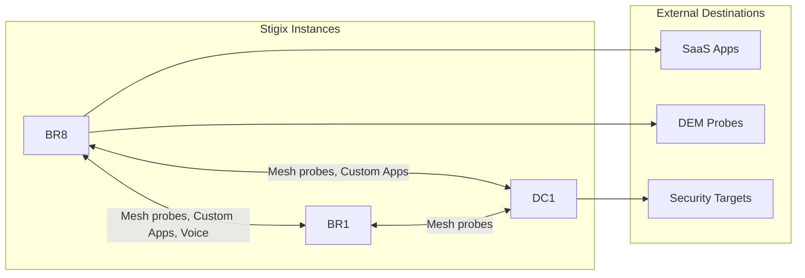

> **Last Updated:** 2026-10-11 | **Created:** 2026-10-11 (v3.0.0-dev)

# PRD: Stigix Explorer (formerly "Flow Nexus") & Observe Mesh Grid

| Field | Value |
|---|---|
| **Component** | Web Dashboard (`Observe`, optional `Home` entry), Backend (`server.ts`, registry heartbeat) |
| **Status** | Draft — Study only (no implementation started) |
| **Feature Flag** | `ENABLE_FLOW_NEXUS` (default `false`) |
| **Branch** | `v3` |

---

## 1. Vision

**Stigix Explorer** is a way to **browse a Stigix deployment**: see every Stigix instance, what each one is talking to, and navigate from instance to instance by following those interactions.

It answers two questions:
1. **Between instances:** which Stigix nodes interact with each other (mesh probes, Custom TCP/HTTP Apps client ➔ server, voice caller ➔ responder, bandwidth tests, failover tests), and how healthy each interaction is.
2. **Towards the outside:** what each instance sends to external destinations (SaaS apps, DEM probes, security targets, Internet).

### Design Principles
1. **Stigix-centric, not SCM-centric.** The Palo Alto SCM Command Center was the initial inspiration, but the goal is not to replicate its 3-tier security-path Sankey. The unit of navigation is the **Stigix instance**.
2. **Stigix data only.** Everything shown comes from what Stigix itself generates and measures. No background calls to external APIs (Prisma SD-WAN, Prisma Access, Zscaler).
3. **API-frugal by design.** No new fan-out from the leader to peers. Reuse the existing peer ➔ leader heartbeat channel (see §4).
4. **Transit path is out of the core model.** Prisma SD-WAN flow data only distinguishes *standard VPN overlay* vs *direct*, and is costly to query. Path information is available **on demand only**, through the existing `flow-trace` action, never in the background.

---

## 2. Conceptual Model



### Entities
| Entity | Description |
|---|---|
| **Instance** | A Stigix node (leader, peer, standalone). Primary navigation object. |
| **Internal interaction** | Traffic between two Stigix instances, attributed to an engine (mesh probe, Custom App, Voice, iperf, failover). |
| **External destination** | A non-Stigix target, grouped by kind: SaaS, DEM probe, Security target, Other. |
| **Interaction health** | `ok`, `degraded`, `critical`, `idle`, derived from the engine's own SLA metrics. |

### Attribution Rule
Interactions are **declared and measured by the initiating instance** (it knows its configured targets and its live stats). **Inbound** interactions for an instance are **computed by the leader** by inverting all outbound interactions. Responders never need to report anything extra.

---

## 3. UX Specification

### 3.1 Fleet View (default)

```
┌──────────────────────────────────────────────────────────────────────────────┐
│ STIGIX EXPLORER   [Engines: All ▾]  [Health: All ▾]  [Show external ☑]  ● Live │
├──────────────────────────────────────────────────────────────────────────────┤
│                                                                              │
│              ┌───────┐                         ┌───────┐                     │
│              │  DC1  │━━━━━━━━━━━━━━━━━━━━━━━━━│  BR1  │                     │
│              │  Hub  │╲                       ╱│Branch │                     │
│              └───────┘ ╲                     ╱ └───────┘                     │
│                         ╲   ┌───────┐       ╱                                │
│                          ━━━│  BR8  │━━━━━━━  (amber: SLA degraded)          │
│                             │Branch │                                        │
│                             └───┬───┘                                        │
│                     ┌───────────┼───────────┐                                │
│                 [ SaaS 12 ] [ Probes 94 ] [ Security 6 ]   ← external rings  │
└──────────────────────────────────────────────────────────────────────────────┘
```

* Instances are cards (site name, role, version, number of active engines).
* Instance ↔ instance links: **thickness = number of active interactions**, **color = worst health**.
* External destinations are shown as **grouped counters** attached to each instance (not one node per SaaS app), to stay readable.

### 3.2 Instance Focus View (browsing)

Clicking an instance makes it the center of the view:

```
┌──────────────────────────────────────────────────────────────────────────────┐
│ ‹ Fleet  ›  BR8                                                [Open node ↗] │
├────────────────────────┬────────────────────┬────────────────────────────────┤
│ INBOUND (who reaches it)│     BR8 (center)   │ OUTBOUND (what it reaches)     │
│                        │                    │                                │
│  BR1 ─ Mesh, Voice ────┼──▶  ● BR8  ──────▶ ┼── DC1   Mesh, Custom Apps (3)  │
│  DC1 ─ Mesh ───────────┼──▶                 ┼── BR1   Mesh, Voice            │
│                        │  11 Apps • 40 IoT  ┼── SaaS  12 apps • 450 rpm      │
│                        │  2 Calls • DEM 70  ┼── DEM   94 probes • score 70   │
│                        │                    ┼── Sec   6 targets              │
└────────────────────────┴────────────────────┴────────────────────────────────┘
```

* **Click another instance** (inbound or outbound) ➔ it becomes the center. A breadcrumb keeps the browsing history (`Fleet › BR8 › BR1 › DC1`).
* **Click an external group** (e.g. SaaS) ➔ it expands into a list of destinations with per-destination health.
* **Click an interaction** ➔ side panel with per-engine metrics and actions:
  * `Open in Mesh Grid` (deep-link to the cell A ➔ B)
  * `Open engine page` (Custom Apps, Voice, DEM…)
  * `Trace path` (**on demand**, see §4.3)

### 3.3 Visual Encoding
| Channel | Encodes |
|---|---|
| **Color** | Health only (cyan = ok, amber = degraded, red = critical, grey = idle) |
| **Thickness** | Number of active interactions / sessions |
| **Icons on link** | Engines involved (Mesh, Custom App, Voice, iperf, Failover) |

### 3.4 Empty & Degraded States
| Condition | Behavior |
|---|---|
| Standalone node | Focus View of the local instance only; external destinations still shown |
| Peer heartbeat stale | Instance card greyed, "Last seen X min ago"; its links dotted |
| No engine running | Explanatory empty state with links to Generate engines |

---

## 4. Data & API Strategy (API-frugal)

### 4.1 Per-instance Interaction Summary (local, in memory)
Each instance maintains a compact summary built **from its own engine state**, with no network calls:

```json
{
  "instance_id": "br8",
  "updated_at": "2026-10-11T20:00:00Z",
  "engines": { "custom_apps": 11, "iot_active": 40, "voice_calls": 2, "dem_score": 70 },
  "internal": [
    { "peer": "br1", "engine": "mesh",        "health": "ok",       "latency_ms": 14 },
    { "peer": "br1", "engine": "voice",       "health": "ok",       "mos": 4.4 },
    { "peer": "dc1", "engine": "custom_apps", "health": "degraded", "sessions": 3, "p95_ms": 669 }
  ],
  "external": {
    "saas":     { "count": 12, "rate_rpm": 450, "health": "ok" },
    "probes":   { "count": 94, "score": 70,     "health": "degraded" },
    "security": { "count": 6,  "health": "ok" }
  }
}
```

* Target size: **< 4 KB** per instance.
* Exposed locally on `GET /api/explorer/summary` (used by the Focus View of a standalone node).

### 4.2 Fleet Aggregation (no new fan-out)
* **Preferred approach (to confirm against the heartbeat payload):** peers attach the summary to the **existing heartbeat** they already send to the leader (`registry-manager.ts`). The leader stores the latest summary per instance in memory.
* The leader serves `GET /api/explorer/graph` from that in-memory store: **zero additional calls** to peers per page view.
* Inbound interactions are computed on the leader by inverting `internal[]` across all summaries.
* If the heartbeat payload cannot be extended, fallback: leader polls `/api/explorer/summary` with **one in-flight request per peer, 30 s minimum interval, 3 s timeout, partial results accepted**.

### 4.3 Path Information (on demand only)
* No background calls to Prisma SD-WAN, Prisma Access or Zscaler.
* `Trace path` in the side panel calls the **existing** `/api/fleet/matrix/flow-trace` for **one pair**, only after an explicit click.
* Guardrails: result cached **5 min per pair**; button disabled during cooldown; one trace in flight per user.
* Displayed as returned by Prisma SD-WAN (standard VPN overlay vs direct), without further classification.

### 4.4 Load Budget
| Action | API cost |
|---|---|
| Open Fleet View | 1 local call to the leader (in-memory) |
| Browse instance to instance | 0 additional calls (client-side from the same graph) |
| Auto-refresh | 1 local call every 15 s while the view is visible; paused when the tab is hidden |
| Trace path | 1 Prisma flow query per explicit click, cached 5 min |

---

## 5. Observe ➔ SD-WAN Mesh Grid

### Problem
The bidirectional reachability grid (N × N, forward A ➔ B and return B ➔ A) is nested in **Digital Experience (DEM)**. It is constrained by the DEM layout and is infrastructure telemetry rather than application experience.

### Solution
New entry **`Observe ➔ SD-WAN Mesh Grid`**, full-width, keeping the existing filters (SLA OK / Degraded / Critical / Egress Only, topology mode, latency threshold).

* `Validate ➔ DEM` = application experience; `Observe ➔ Mesh Grid` = SD-WAN fabric health.
* DEM keeps a link card to the new view.
* **Not behind a feature flag** (relocation, not a new capability).
* Stigix Explorer deep-links to Mesh Grid cells.

---

## 6. Feature Flag

| Location | Change |
|---|---|
| `.env` | `ENABLE_FLOW_NEXUS=true` |
| `docker-compose.yml` (`stigix.environment`) | `- ENABLE_FLOW_NEXUS=${ENABLE_FLOW_NEXUS:-false}` |
| Backend | `/api/explorer/*` and heartbeat summary disabled unless `process.env.ENABLE_FLOW_NEXUS === 'true'` |
| Frontend | Exposed via the UI config payload (same pattern as `enablePcapReplay`), consumed through `features` in navigation |

> The flag name is kept as `ENABLE_FLOW_NEXUS` for continuity; it may be renamed `ENABLE_STIGIX_EXPLORER` before release.

---

## 7. Success Criteria

1. From the Fleet View, an operator can reach any instance's Focus View in one click and any peer of that instance in a second click.
2. Opening and browsing the Explorer generates **no request to any external API**.
3. Leader `GET /api/explorer/graph` p95 < 100 ms (in-memory).
4. Heartbeat payload growth < 4 KB per peer.
5. A degraded interaction (e.g. Custom App p95 above SLA between BR8 and DC1) is visible in amber within one heartbeat interval.

---

## 8. Open Questions (pending — owner reflecting)

1. **Path classification:** Prisma SD-WAN flows only return *standard VPN overlay* vs *direct*; is that enough for the on-demand `Trace path`, or should path display be dropped entirely?
2. **Per-destination counters:** which engines already track per-target counters (mesh, Custom Apps, Voice) and which need new ones (IoT per destination, SaaS per app)?
3. **Heartbeat extension:** can the existing heartbeat carry a ~4 KB summary, or is the polling fallback required?
4. **External grouping:** are the groups SaaS / Probes / Security / Other the right ones?

---

## 9. Implementation Roadmap

| Phase | Deliverable | Depends on |
|---|---|---|
| **1** | `Observe ➔ SD-WAN Mesh Grid` (extract from DEM, nav entry, DEM link card) | — |
| **2** | Local `/api/explorer/summary` built from engine state + feature flag plumbing | Q2 |
| **3** | Fleet aggregation on the leader (heartbeat extension or guarded polling) + `/api/explorer/graph` | 2, Q3 |
| **4** | UI: Fleet View + Instance Focus View + breadcrumb browsing + side panel (with mock data first) | Contract from 2 |
| **5** | On-demand `Trace path` with cache and cooldown | 4, Q1 |

---

## 📜 Revision History

| Date | Stigix Version | Author / Trigger | Summary of Changes |
|---|---|---|---|
| 2026-10-11 | `v3.0.0-dev` | Stigix Core Team (owner feedback) | Reframed as Stigix Explorer: instance-centric browsing of internal and external interactions; removed transit-path column and background Prisma sampling; API-frugal aggregation via heartbeat; path trace on demand only; open questions kept pending |
| 2026-10-11 | `v3.0.0-dev` | Stigix Core Team (review) | Corrected data-availability claim; added Expected vs Verified path model, backend graph contract, VyOS as underlay attribute, site-only sources, single-dimension color encoding, scope/scale/empty states, success criteria, open questions, revised roadmap |
| 2026-10-11 | `v3.0.0-dev` | Stigix Core Team | Integrate Direct SD-WAN transit overlay, Prisma Access / Zscaler SSE, and Stigix peer target destinations |
| 2026-10-11 | `v3.0.0-dev` | Stigix Core Team | Initial PRD and architectural study for SCM Flow Nexus and Mesh Grid separation |
