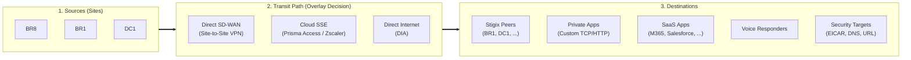

> **Last Updated:** 2026-10-11 | **Created:** 2026-10-11 (v3.0.0-dev)

# PRD: Stigix Traffic Flow Nexus & Observe Mesh Grid

| Field | Value |
|---|---|
| **Component** | Web Dashboard (`Home`, `Observe`), Backend (`server.ts`) |
| **Status** | Draft — Study only (no implementation started) |
| **Feature Flag** | `ENABLE_FLOW_NEXUS` (default `false`) |
| **Branch** | `v3` |

---

## 1. Executive Summary & Vision

Palo Alto Networks **Strata Cloud Manager (SCM) Command Center** uses a flow (Sankey / Nexus) visualization to answer one operational question:

> **"Who is talking to what, through which enforcement path, and with what quality?"**

Stigix generates synthetic workloads from five engines (SaaS, Custom TCP/HTTP Apps, Voice, IoT, PCAP/Security). Today these are shown as per-engine cards and tables. There is no single view that connects **Sources ➔ Transit Path ➔ Destinations**.

### The Stigix Differentiator: Expected vs. Verified Paths

SCM shows **what happened**. Stigix also knows **what it intended to send**, because it generated the traffic. This enables something SCM cannot do on its own:

> **Every ribbon carries an *expected* transit path (from Stigix intent/config) and, when available, a *verified* transit path (observed from the SD-WAN fabric). A mismatch is a policy validation finding.**

Example: *"BR8 ➔ M365 expected via Prisma Access, observed via DIA"* is a steering-policy violation surfaced visually. This turns the Flow Nexus from a decorative dashboard into a **validation instrument**, consistent with Stigix's positioning ("The Engine for SASE Validation").

### Scope of this PRD
1. **Observe ➔ SD-WAN Mesh Grid**: promote the bidirectional reachability grid out of DEM (low risk, independent).
2. **Flow Nexus**: data model, backend contract, and UX for the SCM-inspired flow view.

---

## 2. Conceptual Model



### Modeling Rules
1. **Left column = sites only.** Workload type (SaaS / Voice / IoT / Custom App / Security) is an **attribute of the ribbon**, not a separate source node. Mixing sites and workload types in the same column double-counts traffic (BR8 *is* the origin of its SaaS workers).
   * A toolbar toggle switches grouping: **Group by Site** (default) ↔ **Group by Engine**.
2. **Center column = overlay path decision only**: Direct SD-WAN, Cloud SSE, DIA. These are mutually exclusive per flow.
3. **VyOS is the underlay, not a transit lane.** It sits *beneath* all three paths. It is rendered as an **attribute on ribbons** (impairment badge, e.g. `⚠ +50ms / 2% loss on BR8-eth1`), never as a peer node of Prisma Access.
4. **Stigix peers are destinations.** When BR8 talks to BR1, BR1 appears in the right column (responding to probes, Custom TCP sockets, RTP echo, iperf3).
5. **Zscaler is declarative only.** No Zscaler integration exists in Stigix. It may be selected as the configured SSE vendor for *expected* paths, but it never produces *verified* telemetry.

---

## 3. Data Availability — Honest Assessment

A flow diagram needs **weighted links** (`source ➔ via ➔ destination = N sessions`), not per-node totals.

| Need | Exists today? | Source / Gap |
|---|---|---|
| Per-node engine totals (apps, streams, devices, calls) | ✅ Yes | `/api/system/health-matrix` (`custom_apps`, `iot`, `voice`, `vyos`, `prisma`) |
| Fleet membership & peers | ✅ Yes | `/api/fleet/overview` |
| Peer-to-peer reachability (A ➔ B latency/SLA) | ✅ Yes | Fleet matrix endpoints (`/api/fleet/matrix/*`) |
| **Per-link weights** (src ➔ dst, per engine) | ❌ No | Engines expose totals; per-destination breakdown must be aggregated |
| **Expected transit path** | ❌ No | Must be derived from Stigix config (target type + declared steering) |
| **Verified transit path** | ⚠️ Partial | `engines/getflow.py` (Prisma SD-WAN flows API) already powers `/api/fleet/matrix/flow-trace`. Returns `path_id` per flow; **mapping `path_id` ➔ {VPN, DIA, Service Link} must be built**. Slow, rate-limited, Prisma SD-WAN only. |
| VyOS impairments per interface | ✅ Yes | `vyos.routers_summary` / interface `qos` in health-matrix |

> [!IMPORTANT]
> A new backend aggregation endpoint is **required**. The previous revision's claim that "all data is already available" was incorrect.

---

## 4. Backend Contract (define before any UI work)

### Endpoint
`GET /api/flow-nexus/graph?scope=local|fleet&group=site|engine`

* Returns `404` / empty when `ENABLE_FLOW_NEXUS !== 'true'`.
* `scope=fleet` is **leader-only**; aggregates peers via existing fleet proxy.

### Response Shape
```json
{
  "generated_at": "2026-10-11T20:00:00Z",
  "scope": "fleet",
  "verification": {
    "source": "prisma_sdwan_getflow",
    "last_sampled_at": "2026-10-11T19:55:00Z",
    "status": "ok | stale | unavailable"
  },
  "nodes": [
    { "id": "site:BR8", "tier": "source", "label": "BR8" },
    { "id": "via:sse",  "tier": "transit", "label": "Prisma Access", "vendor": "prisma" },
    { "id": "dst:saas:m365", "tier": "destination", "label": "Microsoft 365", "kind": "saas" },
    { "id": "dst:peer:BR1",  "tier": "destination", "label": "BR1", "kind": "peer" }
  ],
  "links": [
    {
      "src": "site:BR8",
      "via": "via:sse",
      "dst": "dst:saas:m365",
      "engine": "saas",
      "sessions": 42,
      "rate": { "value": 120, "unit": "rpm" },
      "health": "ok | degraded | critical | blocked",
      "latency_p95_ms": 38,
      "loss_pct": 0,
      "path": {
        "expected": "sse",
        "verified": "dia",
        "match": "mismatch | match | unknown"
      },
      "underlay": { "impairment": { "latency_ms": 50, "loss_pct": 2, "iface": "eth1" } }
    }
  ]
}
```

### Expected Path Derivation (cheap, instant)
| Destination kind | Default expected path | Override |
|---|---|---|
| Stigix peer / Private App on DC | `sdwan` | Per-target setting |
| SaaS app | Configured SSE vendor (`sse`) or `dia` | Per-category steering declared in Settings |
| Security targets | `sse` | — |
| Voice responder | Follows target kind (peer ➔ `sdwan`, cloud ➔ `sse`/`dia`) | — |

### Verified Path Sampling (expensive, cached)
* Background job on the **leader**, every **5 minutes** (configurable), queries `getflow` per branch site.
* Results cached in memory; the graph endpoint **never** calls `getflow` synchronously.
* DC/Hub IONs carry no branch path policy: verification is performed on the branch side (same rule as `flow-trace`).
* When Prisma credentials are missing: `verification.status = "unavailable"`, all `match = "unknown"`.

---

## 5. UX Specification

### Layout
```
┌───────────────────────────────────────────────────────────────────────────────────┐
│ FLOW NEXUS   [Local | Fleet]  [Group: Site | Engine]  [Mismatches only]  ● Live  │
│ Verification: Prisma SD-WAN • sampled 3 min ago                                   │
├─────────────────────┬───────────────────────────┬─────────────────────────────────┤
│ SOURCES             │ TRANSIT PATH              │ DESTINATIONS                    │
│                     │                           │                                 │
│  BR8  ━━━━━━━━━━━━━━━━━ Direct SD-WAN ━━━━━━━━━━━━  BR1 (peer)                   │
│       ━━━━━━━━━━━━━━━━━ Prisma Access ━━━━━━━━━━━━  Microsoft 365                │
│       ┄┄┄┄┄┄┄┄┄┄┄┄┄┄┄┄┄ DIA  ⚠ mismatch ┄┄┄┄┄┄┄┄┄┄  Salesforce                   │
│  DC1  ━━━━━━━━━━━━━━━━━ Direct SD-WAN ━━━━━━━━━━━━  Private Apps (11)            │
│                         ⚠ VyOS +50ms on BR8-eth1                                  │
│                                                     & 38 more SaaS apps           │
└─────────────────────┴───────────────────────────┴─────────────────────────────────┘
```

### Visual Encoding (one dimension per channel)
| Channel | Encodes | Values |
|---|---|---|
| **Color** | Health only | Cyan = OK · Amber = degraded · Red = critical/loss · Grey-red hatched = blocked by security |
| **Line style** | Path verification | Solid = verified match · Dashed = mismatch · Dotted = unverified |
| **Thickness** | Volume | Sessions or rate (log-scaled) |
| **Icon on ribbon** | Engine | SaaS / Voice / IoT / Custom App / Security glyph |
| **Badge** | Underlay | VyOS impairment on the traversed interface |

> Engine type must **not** be encoded by color (previous revision conflated "green = voice" with "cyan = healthy").

### Interactions
* **Click source**: isolate its ribbons; side panel lists destinations, paths, mismatches.
* **Click transit**: inspected volume, sessions, security verdict counts.
* **Click destination**: contributing sites and P95 latency.
* **Hover ribbon**: rate, P95, loss, sessions, expected vs verified path.
* **"Mismatches only"** filter: shows only `match = mismatch` ribbons — the validation view.

### Scale Rules
* Destinations: show **top-N (default 8) per kind** by volume, collapse the rest into `& N more`, as SCM does.
* Sources: up to 12 sites rendered; beyond that, group by region/role.
* Minimum ribbon thickness so low-volume flows remain clickable.

### Empty & Degraded States
| Condition | Behavior |
|---|---|
| Standalone node | `scope=local` only; Fleet toggle hidden |
| No engine running | Explanatory empty state with links to Generate engines |
| No Prisma credentials | Graph renders with expected paths; banner "Verification unavailable" |
| Verification stale (> 3× interval) | Banner "Verification stale"; ribbons dotted |
| Peer unreachable (fleet scope) | Source node greyed with "No telemetry" |

---

## 6. Observe ➔ SD-WAN Mesh Grid

### Problem
The bidirectional reachability grid (N × N, forward A➔B and return B➔A) is nested in **Digital Experience (DEM)**. It is constrained by the DEM layout and is semantically infrastructure telemetry, not application experience.

### Solution
New entry **`Observe ➔ SD-WAN Mesh Grid`**, full-width, with existing filters (SLA OK / Degraded / Critical / Egress Only, topology mode, latency threshold).

* `Validate ➔ DEM` = application experience.
* `Observe ➔ Mesh Grid` = SD-WAN fabric health.
* DEM keeps a link card to the new view.
* **Not behind a feature flag** — this is a relocation, not a new capability.

### Link to Flow Nexus
Clicking a peer-to-peer ribbon in the Flow Nexus deep-links to the corresponding Mesh Grid cell (and to `flow-trace`).

---

## 7. Feature Flag

| Location | Change |
|---|---|
| `.env` | `ENABLE_FLOW_NEXUS=true` |
| `docker-compose.yml` (`stigix.environment`) | `- ENABLE_FLOW_NEXUS=${ENABLE_FLOW_NEXUS:-false}` |
| Backend | Endpoint and sampling job disabled unless `process.env.ENABLE_FLOW_NEXUS === 'true'` |
| Frontend | Exposed via the UI config payload (same pattern as `enablePcapReplay`), consumed through `features` in navigation |

---

## 8. Success Criteria

1. An operator can answer "which path does BR8 use to reach M365?" in under 5 seconds.
2. A deliberately misconfigured steering policy (e.g. SaaS forced to DIA) appears as a **mismatch** within one sampling interval.
3. Graph endpoint p95 response < 300 ms (cached, no synchronous `getflow`).
4. Fleet scope with 8 sites and 5 engines renders without overlapping labels at 1440 px width.

---

## 9. Open Questions

1. **`path_id` classification**: how to map Prisma SD-WAN `path_id` to `{VPN, DIA, Service Link}` reliably (WAN interface / service link lookup)?
2. **Per-destination weights**: which engines already track per-target counters (SaaS per app, Custom Apps per app) and which need new counters (IoT per destination)?
3. **Steering declaration**: is a per-category "expected path" setting acceptable UX, or should it be inferred from Prisma SD-WAN path policies via API?
4. **Sampling budget**: acceptable `getflow` call rate per site against Prisma API limits.

---

## 10. Implementation Roadmap

| Phase | Deliverable | Depends on |
|---|---|---|
| **1** | `Observe ➔ SD-WAN Mesh Grid` (extract from DEM, nav entry, DEM link card) | — |
| **1.5** | `/api/flow-nexus/graph` contract with **mock data** + feature flag plumbing | — |
| **2** | **Expected** layer: per-link aggregation from engines + expected-path derivation | 1.5, Q2, Q3 |
| **3** | UI prototype (`FlowNexus.tsx`) on the contract: encoding, interactions, scale rules, empty states | 1.5 |
| **4** | **Verified** layer: cached `getflow` sampling, `path_id` classification, mismatch filter | 2, Q1, Q4 |
| **5** | Home integration toggle `[ Overview ] / [ Flow Nexus ]`, fleet scope polish | 3, 4 |

---

## 📜 Revision History

| Date | Stigix Version | Author / Trigger | Summary of Changes |
|---|---|---|---|
| 2026-10-11 | `v3.0.0-dev` | Stigix Core Team (review) | Corrected data-availability claim; added Expected vs Verified path model, backend graph contract, VyOS as underlay attribute, site-only sources, single-dimension color encoding, scope/scale/empty states, success criteria, open questions, revised roadmap |
| 2026-10-11 | `v3.0.0-dev` | Stigix Core Team | Integrate Direct SD-WAN transit overlay, Prisma Access / Zscaler SSE, and Stigix peer target destinations |
| 2026-10-11 | `v3.0.0-dev` | Stigix Core Team | Initial PRD and architectural study for SCM Flow Nexus and Mesh Grid separation |
