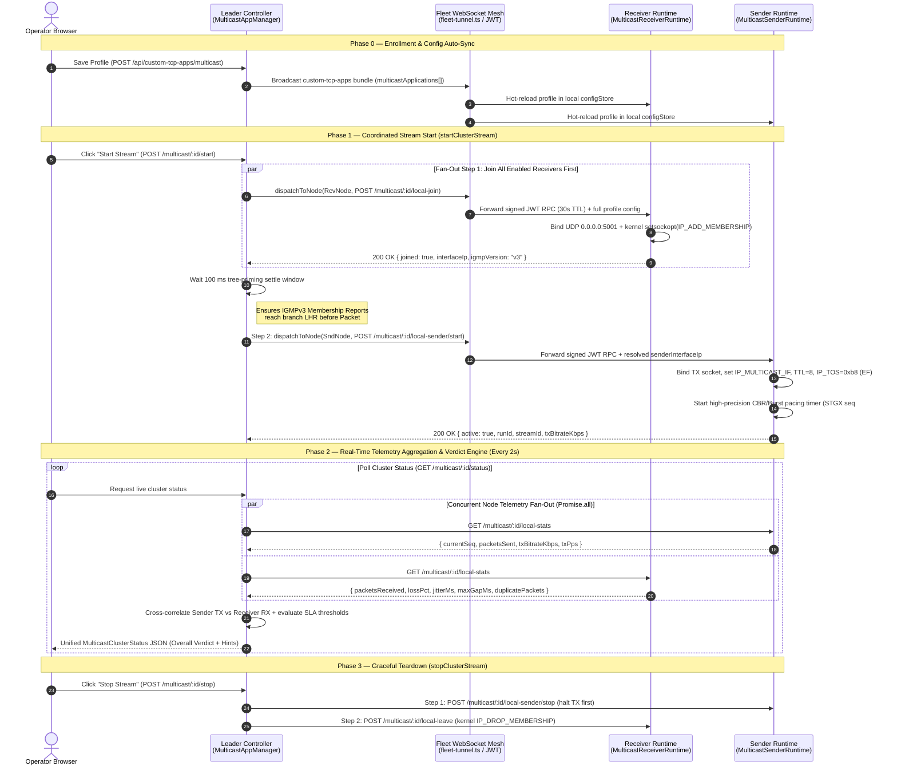

> **Last Updated:** 2026-10-14 | **Created:** 2026-10-14 (v3.0.21)

# Technical White Paper: Distributed SD-WAN Overlay Multicast Validation with Stigix

**Validating IGMPv2/v3, PIM-SM/SSM, Rendezvous Point (RP) Convergence, and Real-Time RFC 3550 Telemetry Across Prisma SD-WAN Fabrics**

---

## Executive Summary

Enterprise multicast applications—such as live IP video distribution, financial market data feeds, push-to-talk (PTT) radio systems, and industrial IoT telemetry—pose unique operational challenges over modern Software-Defined Wide Area Networks (SD-WAN). Unlike unicast flows, multicast relies on a multi-layered state machine spanning host kernel IGMP memberships, LAN Layer-3 transit routing (e.g., VyOS / core switches), First-Hop Router (FHR) PIM registration, Rendezvous Point (RP) arbitration, SD-WAN fabric tunnel replication, and Last-Hop Router (LHR) delivery.

A single missing link in this chain—such as an unconfigured intermediary PIM hop, a mismatched IGMP version, or a TTL threshold—results in silent packet blackholing that standard ping or TCP synthetic probes cannot detect.

This white paper details the architecture, control/data plane separation, network engineering configuration (Prisma SD-WAN ION & VyOS), and end-to-end telemetry methodology of the **Stigix SD-WAN Overlay Multicast Validation Engine**.

---

## 1. Architectural Foundations: Control Plane vs. Data Plane Separation

A core design principle of Stigix is the strict decoupling between the **Orchestration Control Plane** (Stigix Fleet Mesh) and the **Network Validation Data Plane** (Native Kernel UDP/IGMP).

```mermaid
flowchart TB
    subgraph ControlPlane["1. STIGIX CONTROL PLANE (Encrypted WebSocket Fleet Mesh)"]
        UI["Operator Web Browser\n(SSE Real-Time Stream)"]
        Leader["DC1-Ubuntu (LEADER)\nOrchestrator & Telemetry Aggregator\n192.168.203.100:8080"]
        PeerBR5["BR5-Ubuntu (PEER)\nBranch Agent\n192.168.217.5"]
        PeerBR8["BR8-Ubuntu (PEER)\nBranch Agent\n192.168.219.1"]
        UI <==>|"HTTPS / SSE"| Leader
        Leader <==>|"Inbound/Outbound WS\nControl & Telemetry"| PeerBR5
        Leader <==>|"Inbound/Outbound WS\nControl & Telemetry"| PeerBR8
    end

    subgraph DataPlane["2. PHYSICAL & SD-WAN MULTICAST DATA PLANE (Zero Tunnel Bypass)"]
        SenderNIC["DC1 Host Kernel (ens9)\n192.168.203.100\nRaw UDP 239.1.1.100:5001\nTTL=8, DSCP=EF, 24B STGX Header"]
        VyOS["Intermediary Transit Router (VyOS)\neth5 (192.168.203.10) -> eth1 (192.168.201.10)\nPIM-SM + BGP AS 201"]
        DC1_ION["Prisma SD-WAN DC1-R1 ION\nPort 1: 192.168.201.3\nStatic RP (224.0.0.0/4) & FHR"]
        Fabric["Prisma SD-WAN Secure Fabric\n(BR5-INET Overlay Tunnel)\nPIM Register / Multicast Replication"]
        BR5_ION["Prisma SD-WAN BR5 ION\nSub-Interface 217 on Port 3\n192.168.217.254 (IGMPv3 Querier & LHR)"]
        ReceiverNIC["BR5 Host Kernel (enp2s0)\n192.168.217.5\nIGMP Join + 4096-Bit Sequence Tracker"]

        SenderNIC -->|"L2 MAC 01:00:5e:01:01:64"| VyOS
        VyOS -->|"PIM-SM (S,G) Forwarding"| DC1_ION
        DC1_ION ===>|"SD-WAN Overlay"| Fabric
        Fabric ===>|"Replicated Stream"| BR5_ION
        BR5_ION <-->|"IGMPv3 Report / Multicast UDP"| ReceiverNIC
    end
```



### 1.1 Deep-Dive: How the Control Plane Works (Leader Controller, Sender & Receiver)

Stigix strictly decouples **Control Plane Orchestration** from **Data Plane Packet Injection**. Every Stigix instance runs the exact same [`MulticastAppManager`](../web-dashboard/custom-tcp-apps/multicast-manager.ts) and [`multicast-runtime.ts`](../web-dashboard/custom-tcp-apps/multicast-runtime.ts) engine, allowing any node in the fleet to act as **Leader Controller**, **Multicast Sender**, or **Multicast Receiver** (or simultaneously Leader + Sender, as in the `DC1` $\rightarrow$ `BR5` topology).



#### The Three Architectural Roles

1. **The Leader Controller (`MulticastAppManager` + `nodeForwarder`)**:
   - **Single Pane of Glass**: Hosted on the Stigix Leader (`DC1-Ubuntu`), it stores the authoritative multicast profiles and exposes the cluster-wide orchestration API (`/api/custom-tcp-apps/multicast/:id/start`, `/stop`, `/status`, `/preflight`).
   - **Smart Local vs. Remote Dispatch (`dispatchToNode`)**: Before sending any command, the Leader checks `isLocalNode(nodeId)`:
     - If the target node is the Leader itself (e.g., `DC1-Ubuntu` acting as Sender), it invokes `startLocalSender()` or `joinLocalReceiver()` **in-process** with zero network overhead.
     - If the target node is a remote branch (e.g., `BR5-Ubuntu` or `BR8-Ubuntu`), it invokes `nodeForwarder()`, which mints a short-lived **30-second ephemeral JWT** (`username: 'stigix-multicast-orchestrator'`, `x-gateway-source: 'stigix-leader'`) and tunnels the HTTP request inside the persistent **Fleet WebSocket Tunnel** (`fleetTunnelManager.forwardRequest()`), with automatic fallback to direct HTTP if needed.
   - **Self-Contained RPC Payloads**: Every `local-join` and `local-sender/start` command carries the **entire normalized profile configuration** (`config: app`) inside the JSON body. Even if a branch node was temporarily offline during profile creation, it immediately caches the profile at runtime (`runtimeConfigCache`) and executes the test without configuration drift.
   - **Ordered Start & Stop Sequencing**:
     - On **Start (`startClusterStream`)**: The Leader **always joins all Receivers first** (`Promise.allSettled` across all enabled receivers), pauses for a **100 ms settle window** so the branch Linux kernels emit their IGMPv3 Membership Reports onto the LAN, and **only then** starts the Sender. This prevents initial packet drops while the receiver socket initializes.
     - On **Stop (`stopClusterStream`)**: The Leader reverses the order—**stopping the Sender first** so no new packets are injected into the fabric, and **then** instructing all Receivers to send an IGMP Leave (`IP_DROP_MEMBERSHIP`). This prevents false-positive tail-loss counters during teardown.
   - **Centralized Correlation & Diagnostic Engine (`getClusterStats`)**: Every 2 seconds, the Leader queries `/local-stats` concurrently from the Sender and all Receivers. By comparing `sender.active` and `sender.packetsSent` against each receiver's `packetsReceived`, `lossPct`, `maxGapMs`, and `expect` policy (`traffic` vs. `none`), the Leader computes per-receiver and cluster-wide health verdicts (`HEALTHY`, `DEGRADED`, `FAILED`, `NO_TRAFFIC`, `UNEXPECTED_TRAFFIC`) and generates contextual SD-WAN troubleshooting hints.

2. **The Sender Runtime (`MulticastSenderRuntime`)**:
   - **Kernel Socket & QoS Marking**: Opens an IPv4 UDP datagram socket (`dgram.createSocket('udp4')`), binds to the resolved physical LAN interface IP (`setMulticastInterface('192.168.203.100')`), sets the multicast hop limit (`setMulticastTTL(8)`), and programs the IP Type-of-Service byte in the Linux kernel (`IP_TOS = 0xb8` for `DSCP EF`) so the Prisma SD-WAN ION classifies the synthetic stream into the real-time voice/video queue.
   - **Co-Located Loopback Intelligence**: Automatically enables `setMulticastLoopback(true)` only if a receiver is co-located on the same host; otherwise keeps loopback disabled to avoid unnecessary local kernel replication.
   - **Deterministic Packet Pacing & Run Isolation**: Generates a unique `runId` (32-bit timestamp) and `streamId` (CRC/hash of the profile ID) every time a stream starts. In **CBR mode**, a drift-compensated timer computes the exact inter-packet interval from `kbps` and `payloadBytes` (e.g., `50 kbps` with `1200 B` packets = `5.2 pps` / `192 ms` interval) and stamps each packet with a monotonically increasing 64-bit `seq` and `process.hrtime.bigint()` nanosecond timestamp.

3. **The Receiver Runtime (`MulticastReceiverRuntime`)**:
   - **Native Kernel IGMPv2/v3 Signaling**: Binds a shared UDP socket (`reuseAddr: true`) to `0.0.0.0:<port>` and invokes kernel socket options on the branch LAN interface (`192.168.217.5`):
     - **ASM Mode (`*,G`)**: Calls `socket.addMembership(group, interfaceIp)` (`IP_ADD_MEMBERSHIP`), prompting the Linux kernel to emit an IGMPv3 `ALLOW_NEW_SOURCES` / `CHANGE_TO_EXCLUDE_MODE` Membership Report to `224.0.0.22`.
     - **SSM Mode (`S,G`)**: Calls `socket.addSourceSpecificMembership(ssmSource, group, interfaceIp)` (`IP_ADD_SOURCE_MEMBERSHIP`), emitting a source-specific IGMPv3 `INCLUDE (S)` report.
   - **Autonomous Edge Telemetry**: Inspects every incoming UDP datagram at wire speed. It validates the `"STGX"` magic bytes and `streamId` (incrementing `foreignPackets` if unrelated traffic hits the port), detects new sender runs via `runId` (auto-resetting counters if the sender restarts), updates the **4096-packet sliding bitmask**, computes **RFC 3550 inter-arrival jitter**, tracks `joinLatencyMs` (time from `local-join` to first multicast packet arrival), and maintains a 60-second rolling telemetry ring buffer (`history[]`) ready for the Leader to poll.

---


## 2. Binary Wire Protocol & Telemetry Mathematics

Every UDP multicast packet transmitted by Stigix carries a deterministic **24-byte `STGX` binary header** at the start of the UDP payload:

```text
 0                   1                   2                   3
 0 1 2 3 4 5 6 7 8 9 0 1 2 3 4 5 6 7 8 9 0 1 2 3 4 5 6 7 8 9 0 1
+-+-+-+-+-+-+-+-+-+-+-+-+-+-+-+-+-+-+-+-+-+-+-+-+-+-+-+-+-+-+-+-+
|                        Magic ("STGX")                         |  Bytes 0..3
+-+-+-+-+-+-+-+-+-+-+-+-+-+-+-+-+-+-+-+-+-+-+-+-+-+-+-+-+-+-+-+-+
|  Version (1)  |     Flags     |          Reserved             |  Bytes 4..7
+-+-+-+-+-+-+-+-+-+-+-+-+-+-+-+-+-+-+-+-+-+-+-+-+-+-+-+-+-+-+-+-+
|                                                               |
+                  Sequence Number (uint64 BE)                  +  Bytes 8..15
|                                                               |
+-+-+-+-+-+-+-+-+-+-+-+-+-+-+-+-+-+-+-+-+-+-+-+-+-+-+-+-+-+-+-+-+
|                                                               |
+                TX Timestamp in ns (uint64 BE)                 +  Bytes 16..23
|                                                               |
+-+-+-+-+-+-+-+-+-+-+-+-+-+-+-+-+-+-+-+-+-+-+-+-+-+-+-+-+-+-+-+-+
|               Deterministic Padding up to Payload Size        |  Bytes 24..N
+-+-+-+-+-+-+-+-+-+-+-+-+-+-+-+-+-+-+-+-+-+-+-+-+-+-+-+-+-+-+-+-+
```

### 2.1 4096-Packet Sliding Bitmask Window (Loss, Duplicates, Reordering)
Rather than relying on naive packet counters that fail during out-of-order delivery or late joins:
- **Late-Join Baseline (`firstSeq`)**: When a receiver joins mid-stream (e.g., at sequence `7087`), it anchors its expected packet counter at `firstSeq = 7087`, preventing false-positive loss reports for packets sent prior to the IGMP Join.
- **Bitmask Tracking**: A 4096-slot circular bitmask tracks every sequence number:
  - If a sequence number is already marked `1` in the bitmask, Stigix increments the **Duplicate (`Dup`)** counter (often caused by dual-tunnel SD-WAN replication anomalies or L2 loops).
  - If a packet arrives with `seq < maxSeq`, Stigix increments the **Out-of-Order (`Reord`)** counter and marks the bitmask slot, dynamically healing the loss count.

### 2.2 RFC 3550 Inter-Arrival Jitter
Stigix calculates real-time network jitter using the standard RTP/RTCP **RFC 3550** exponentially weighted moving average formula, which is immune to clock skew between the Sender and Receiver hosts:

$$D(i, j) = (R_j - R_i) - (S_j - S_i)$$

$$J_j = J_{j-1} + \frac{|D(i, j)| - J_{j-1}}{16}$$

Where $S_i, S_j$ are the sender nanosecond timestamps from the `STGX` header and $R_i, R_j$ are the receiver monotonic arrival timestamps.

---

## 3. Spoke-to-Spoke Topology: How a `BR8` (Source) $\rightarrow$ `BR5` (Receiver) Test Works

Because Stigix separates orchestration from data generation, any Peer node in the fleet can act as the **Multicast Source (Sender)** while any subset of Peers acts as **Receivers**—without routing multicast traffic through the Stigix Leader (`DC1`).

```mermaid
sequenceDiagram
    autonumber
    participantDC1 as Stigix Leader (DC1-Ubuntu)
    participantBR8 as Sender Peer (BR8-Ubuntu)
    participantION8 as Prisma ION BR8 (FHR)
    participantRP as Prisma ION DC1-R1 (RP 192.168.201.3)
    participantION5 as Prisma ION BR5 (LHR)
    participantBR5 as Receiver Peer (BR5-Ubuntu)

    Note over participantDC1,participantBR5: Phase 1 — Stigix Mesh Orchestration (WebSocket Control Plane)
    participantDC1->>participantBR5: WS RPC: Join Multicast Group 239.1.1.100:5001
    participantDC1->>participantBR8: WS RPC: Start UDP Stream to 239.1.1.100:5001 (TTL=8, EF)

    Note over participantBR8,participantBR5: Phase 2 — Shared Tree (*,G) & PIM Registration via RP
    participantBR5->>participantION5: Kernel IGMPv3 Membership Report (*, 239.1.1.100)
    participantION5->>participantRP: SD-WAN Overlay PIM (*,G) Join
    participantBR8->>participantION8: Raw UDP Multicast (S=192.168.219.1, G=239.1.1.100)
    participantION8->>participantRP: Unicast PIM Register (Encapsulated Multicast Data)
    participantRP->>participantION5: Forward down (*,G) Shared Tree
    participantION5->>participantBR5: Deliver Multicast UDP to enp2s0

    Note over participantION8,participantION5: Phase 3 — SPT Switchover (Direct Branch-to-Branch Tunnel)
    participantION5->>participantION8: PIM (S,G) Join directly over BR5<->BR8 Dynamic Tunnel
    participantION8->>participantION5: Direct Branch-to-Branch Multicast Stream (Bypasses DC1 RP)
    participantBR5-->>participantDC1: WS Telemetry: RX Bitrate, Loss %, RFC 3550 Jitter
    participantBR8-->>participantDC1: WS Telemetry: TX Bitrate, Sent Packets
```

1. **Orchestration Role of `DC1`**: When the operator selects `Sender: BR8-Ubuntu` and `Receiver: BR5-Ubuntu` on the `DC1` dashboard, `DC1` sends start instructions to `BR8` and `BR5` via WebSocket and aggregates their live telemetry reports.
2. **Initial RPT Forwarding (`*,G`)**: `BR5` ION sends a PIM `(*,G)` Join to the Static RP (`192.168.201.3` on `DC1-R1`). Meanwhile, `BR8` ION receives the multicast stream on its LAN and sends unicast **PIM Register** packets to `DC1-R1`.
3. **SPT Switchover (Direct Spoke-to-Spoke)**: Because **SPT Switchover** is enabled on the Prisma SD-WAN fabric, as soon as `BR5` ION receives the first packet and learns the source IP of `BR8` (`192.168.219.1`), it initiates a source-specific `(S,G)` tree directly toward `BR8` ION, optimizing latency by bypassing the hub once the tree converges.

---

## 4. End-to-End Reference Lab Configuration (`DC1` $\rightarrow$ `BR5`)

Below is the complete, production-validated configuration across all four layers of the lab: **Stigix**, **Prisma SD-WAN Branch ION (`BR5`)**, **Prisma SD-WAN Hub ION (`DC1-R1`)**, and the **Intermediary Transit Router (`VyOS`)**.

### 4.1 Layer 1 — Stigix Multicast Profile Configuration

In the Stigix Web Dashboard (**Custom Apps $\rightarrow$ Multicast Overlay**), the profile is configured with the following parameters:

<p align="center">
  
</p>

| Parameter | Configured Value | Engineering Rationale |
| :--- | :--- | :--- |
| **Profile ID / Name** | `mc-sdwan-feed` / `SD-WAN Multicast Feed` | Identifies the synthetic multicast test profile across all cluster nodes. |
| **Addressing Mode** | `ASM (*,G — 239.0.0.0/8)` | Tests Any-Source Multicast using the Prisma SD-WAN Rendezvous Point (`192.168.201.3`). |
| **Multicast Group & Port** | `239.1.1.100 : 5001` | Administratively scoped organization-local multicast group. |
| **Sender Node (Source DR)** | `DC1-Ubuntu (192.168.203.100)` | Transmits on physical interface `ens9`. |
| **Rate Mode & Bitrate** | `CBR 50 kbps` (`1200 B` payload, `5 pps`) | Constant predictable pacing (`200 ms` inter-packet gap) ideal for sequence tracking. |
| **TTL & DSCP** | `TTL = 8`, `DSCP = EF` | `TTL 8` survives multiple L3 hops (`DC1 -> VyOS -> DC1-R1 -> BR5-ION -> BR5`); `EF` maps to real-time voice/video QoS. |
| **Receiver Node** | `BR5-Ubuntu (192.168.217.5)` | Configured with policy `EXPECT_TRAFFIC`. |

---

### 4.2 Layer 2 — Prisma SD-WAN Branch ION Configuration (`BR5`)

On the branch router (`BR5`), three multicast components must be active:

#### A. LAN Sub-Interface IGMPv3 Activation
Under **Interfaces $\rightarrow$ Port 3 $\rightarrow$ Sub-Interface (217) (`192.168.217.254/24`) $\rightarrow$ Advanced Settings**, enable **Multicast (`Yes`)** and set **IGMP version** to **`IGMPv3`**:

<p align="center">
  
</p>

> [!TIP]
> Linux kernels (`Ubuntu 22.04/24.04`) default to sending **IGMPv3 Membership Reports** (`proto 2`, type `0x22` to `224.0.0.22`) when `IP_ADD_MEMBERSHIP` is invoked. Setting the Prisma SD-WAN LAN interface to **IGMPv3** ensures immediate membership processing without requiring kernel `force_igmp_version` overrides on Linux hosts.

#### B. Static Rendezvous Point (RP) Definition
Under **Routing $\rightarrow$ Multicast $\rightarrow$ RP**, define the global Rendezvous Point pointing to `DC1-R1`'s LAN IP (`192.168.201.3`) for `224.0.0.0/4`:

<p align="center">
  
</p>

#### C. Verifying Branch Control Plane State (`BR5`)
Once Stigix starts the stream, `BR5` ION confirms local IGMP reception and upstream WAN PIM signaling:

1. **IGMP Membership Table** (`Sub-Interface (217) on Port 3` shows `GROUP: 239.1.1.100`, `SOURCE: ANY`, `FORWARD?: Yes`):
   <p align="center">
     
   </p>

2. **WAN Multicast Statistics toward `DC1`** (`Join Prune TX PKTS: 22` sent over the SD-WAN fabric to `DC1`):
   <p align="center">
     
   </p>

3. **WAN Multicast Route Table on `BR5`** (`FLAGS: S C`, `INCOMING: Site name: DC1`, `OUTGOING: Sub-Interface (217) on Port 3`):
   <p align="center">
     
   </p>

---

### 4.3 Layer 3 — Prisma SD-WAN Hub ION Configuration (`DC1-R1`)

At the Data Center hub (`DC1-R1`), the ION acts as both the **Static Rendezvous Point (`192.168.201.3`)** and the **Hub Multicast Replicator**:

1. **Global Multicast Configuration**: Enable **SPT Switchover** and bind the **WAN Multicast peer group profile** (`DC1 Multicast Traffic`):
   <p align="center">
     
   </p>

2. **WAN PIM Join Reception from `BR5`**: Under **WAN Statistics (`BR5-INET`)**, `DC1-R1` confirms receiving `Join Prune RX PKTS: 29` from `BR5`:
   <p align="center">
     
   </p>

3. **WAN Multicast Route Table on `DC1-R1`**: Installs the active replication state (`GROUP: 239.1.1.100`, `INCOMING: Port 1`, `OUTGOING: Site name: BR5, Secure fabric: BR5-INET`):
   <p align="center">
     
   </p>

---

### 4.4 Layer 4 — The Critical Intermediary Transit Router (`VyOS`)

In many enterprise Data Centers, application servers (`DC1-Ubuntu` on `192.168.203.100/24`) do not sit on the same Layer-2 broadcast domain as the SD-WAN ION LAN interface (`DC1-R1 Port 1` on `192.168.201.3/24`). An intermediary core router (`vyoslandc1`) routes traffic between them:

- `eth5` (`192.168.203.10/24`): Default gateway for `DC1-Ubuntu` (`192.168.203.100`).
- `eth1` (`192.168.201.10/24`): Transit LAN connected to `DC1-R1` (`192.168.201.3`).

#### Symptom When PIM Is Missing on the Intermediary Router
When `vyoslandc1` only runs BGP unicast without PIM-SM enabled on `eth5` and `eth1`, `VyOS` silently drops all multicast packets arriving on `eth5`. Stigix immediately flags this condition with an automated **Overlay Blackhole Diagnostic**:

<p align="center">
  
</p>

#### Enabling PIM-SM on VyOS (`vyoslandc1`)
To bridge the multicast tree between the `DC1-Ubuntu` Sender subnet (`eth5`) and the Prisma SD-WAN RP (`eth1`), apply the following configuration on VyOS:

```bash
configure
set protocols pim interface eth5
set protocols pim interface eth1
set protocols pim rp address 192.168.201.3 group '224.0.0.0/4'
commit
save
exit
```

#### Verifying Multicast State on VyOS
Immediately after committing, VyOS establishes a PIM adjacency with `DC1-R1` (`192.168.201.3`) on `eth1` and installs the `(192.168.203.100, 239.1.1.100)` `(S,G)` entry with flags `SFT` (Sparse, Register, SPT-bit set):

```text
vyos@vyoslandc1:~$ show ip pim neighbor 
 Interface  Neighbor       Uptime    Holdtime  DR Pri  
 eth1       192.168.201.3  00:00:42  00:01:33  1       

vyos@vyoslandc1:~$ show ip pim interface 
 Interface  State  Address         PIM Nbrs  PIM DR  FHR  IfChannels  
 eth1       up     192.168.201.10  1         local   0    1           
 eth5       up     192.168.203.10  0         local   0    0           
 pimreg     up     0.0.0.0         0         local   0    0           

vyos@vyoslandc1:~$ show ip multicast route
IP Multicast Routing Table
Flags: S - Sparse, C - Connected, P - Pruned
       R - SGRpt Pruned, F - Register flag, T - SPT-bit set
 Source           Group        Flags  Proto  Input  Output  TTL  Uptime    
 192.168.203.100  239.1.1.100  SFT    PIM    eth5   eth1    1    00:01:13  
```

---

## 5. Live Telemetry Results & SLA Diagnostics in Stigix

Once the full multicast path is operational, Stigix provides continuous millisecond-level visibility into the health of the SD-WAN replication tree:

### 5.1 Healthy Replication State (`OVERALL: HEALTHY`)
In steady state, `BR5-Ubuntu` receives `584 / 584` packets (`0.00%` loss, `0` duplicates, `0` reordered) at the exact target rate (`48.0 kbps`, `5 pps`) with `23.93 ms` RFC 3550 jitter:

<p align="center">
  
</p>

### 5.2 Real-Time SLA Violation Detection (`OVERALL: DEGRADED`)
When transient WAN impairments or tunnel switchovers occur across the SD-WAN fabric, Stigix's 4096-bit sequence tracker catches single-packet anomalies that traditional SNMP counters miss. In the example below, over a `2,694`-packet run, Stigix detected `3 lost packets (0.11% loss)` and `3 duplicate packets (Dup: 3)`, automatically transitioning the verdict to **`DEGRADED`** with a specific SLA diagnostic alert:

<p align="center">
  
</p>

### 5.3 Synchronized Branch Peer View (`BR5-Ubuntu`)
Because the Multicast profile and live state are synchronized across the Stigix Fleet Mesh, operators viewing the local dashboard on `BR5` (`https://sdwanbr5.carenaje.fr`) see the exact same live state and diagnostics:

<p align="center">
  
</p>

---

## 📜 Revision History

| Date | Stigix Version | Author / Trigger | Summary of Changes |
|---|---|---|---|
| 2026-10-14 | `v3.0.21` | Stigix Core Team | Initial publication of the SD-WAN Overlay Multicast Validation Technical White Paper with Prisma SD-WAN ION, VyOS PIM-SM, and Stigix telemetry architecture |
