# Stigix Technical White Paper — SD-WAN Multicast Validation & Troubleshooting Guide

> **Last Updated:** 2026-10-14 | **Created:** 2026-10-14 | **Initial Stigix Version:** 3.0.21 | **Document Version:** 1.0 (`2026-10-14`)

---

## Introduction

Validating IP Multicast across an SD-WAN fabric is traditionally complex because it requires coordinating a traffic generator on one site, a multicast listener on one or more remote branches, and checking multiple routing tables (IGMP, PIM, and Rendezvous Point states) across the network.

**Stigix** simplifies this entire process into a single button click from a central web dashboard. This White Paper explains in simple, network-oriented terms:
1. **How Stigix coordinates a multicast test** between the **Leader Controller**, the **Sender**, and the **Receivers**.
2. **What happens step-by-step on the network** when you start a stream (both Data Center-to-Branch and Branch-to-Branch).
3. **How to configure Prisma SD-WAN (`ION`) and transit routers (`VyOS`)** using a validated reference lab (`DC1` → `BR5`).
4. **How to read the results and troubleshoot** multicast drops in seconds.

---

## 1. How Stigix Works: Leader Controller, Sender, and Receiver

To test multicast across multiple sites without logging into multiple machines via SSH, Stigix separates **Test Management (Control Plane)** from **Multicast Traffic (Data Plane)**.

Every Stigix probe in your network can play one or more of three simple roles:

| Role | What It Does | Example in Our Lab |
| :--- | :--- | :--- |
| **1. Leader Controller** | The central web dashboard where you configure the test, click **Start / Stop**, and view live results from all sites. | `DC1-Ubuntu` (`192.168.203.100`) |
| **2. Sender (Source)** | The Stigix probe that injects the real UDP Multicast stream onto its local LAN interface toward the local router. | `DC1-Ubuntu` (or `BR8-Ubuntu`) |
| **3. Receiver (Listener)** | The Stigix probe on a remote site that subscribes to the multicast group (via **IGMP**) on its local LAN and measures received packets. | `BR5-Ubuntu` (`192.168.217.5`) |

> [!IMPORTANT]
> **Multicast traffic never passes through the Stigix management tunnel.**
> The management connection between the Leader and the remote branches is only used to send "Start/Stop" orders and collect statistics. The multicast packets themselves are injected directly onto the physical LAN and must traverse your real routers and SD-WAN tunnels.

<p align="center">
  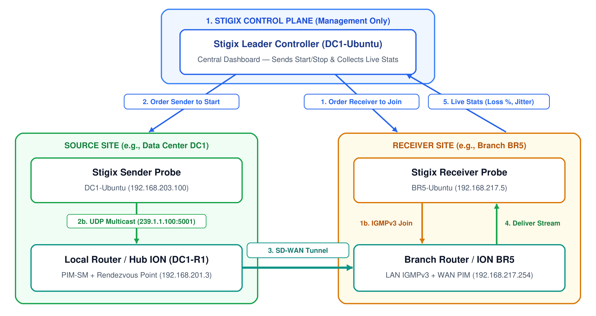
</p>

### What Happens When You Click "Start Stream"?

When you click **Start Stream** on the Leader dashboard, Stigix executes a 4-step sequence automatically:

1. **Step 1 — The Receivers Subscribe First (IGMP Join)**:
   - The Leader Controller tells all selected **Receiver** probes (e.g., `BR5-Ubuntu`) to join the multicast group (`239.1.1.100:5001`).
   - Each Receiver immediately sends a standard **IGMPv3 Membership Report** onto its local LAN to tell its local branch router: *"I want to receive multicast group `239.1.1.100`"*.
   - The branch router (`BR5` ION) signals the SD-WAN Rendezvous Point (RP) via **PIM Join** to build the multicast tree.

2. **Step 2 — The Sender Starts Injecting Traffic (UDP Multicast)**:
   - A fraction of a second later (once the receivers are ready), the Leader Controller tells the **Sender** probe (e.g., `DC1-Ubuntu`) to start transmitting the UDP multicast stream at the chosen bitrate (for example, `50 kbps` with `DSCP EF` and `TTL 8`).
   - Each packet is numbered sequentially (`#1`, `#2`, `#3`...) and timestamped so receivers can detect any missing, duplicated, or delayed packet.

3. **Step 3 — Live Measurement & Dashboard Updates**:
   - Every 2 seconds, the Leader Controller asks the **Sender** (*"How many packets did you send?"*) and each **Receiver** (*"How many packets did you receive, what is your loss %, and what is your jitter?"*).
   - If a Receiver joins while the stream is already running (**Late Join**), it starts counting from the first packet it sees, so it never reports false packet loss for packets sent before it joined.

4. **Step 4 — Clean Teardown ("Stop Stream")**:
   - When you click **Stop Stream**, the Leader Controller **stops the Sender first** so no new packets enter the network, and **then** tells the Receivers to send an **IGMP Leave** to tear down the multicast tree cleanly without false loss alerts.

<p align="center">
  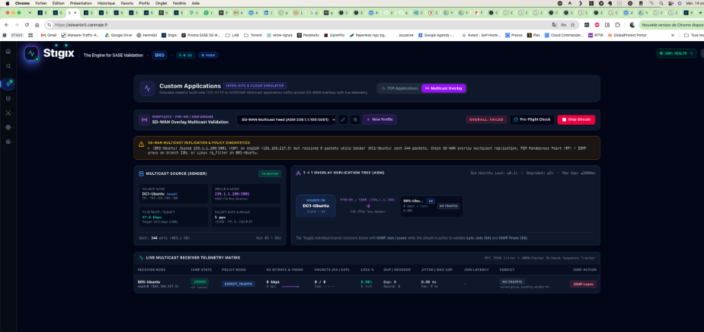
</p>

---

## 2. Hub-to-Branch vs. Branch-to-Branch: How the Traffic Flows

Because the **Leader Controller** role is independent from the **Sender** role, you can run tests from any site to any other site from the exact same `DC1` dashboard.

### Case A: Data Center to Branch (`DC1` Source → `BR5` Receiver)
- **Stigix Roles**: `DC1-Ubuntu` is both the **Leader Controller** and the **Sender**. `BR5-Ubuntu` is the **Receiver**.
- **Network Path**:
  1. `BR5-Ubuntu` sends an **IGMPv3 Join** to its local `BR5` ION (`192.168.217.254`).
  2. `BR5` ION sends a **PIM Join** over the SD-WAN tunnel to the Hub `DC1-R1` ION (which acts as the Rendezvous Point at `192.168.201.3`).
  3. `DC1-Ubuntu` sends the UDP multicast stream on its LAN (`192.168.203.100`), which reaches `DC1-R1` ION and is replicated across the SD-WAN tunnel to `BR5`.

### Case B: Branch to Branch (`BR8` Source → `BR5` Receiver)
What happens if you stay on the `DC1` dashboard, but select **`BR8-Ubuntu` as the Sender** and **`BR5-Ubuntu` as the Receiver**?

<p align="center">
  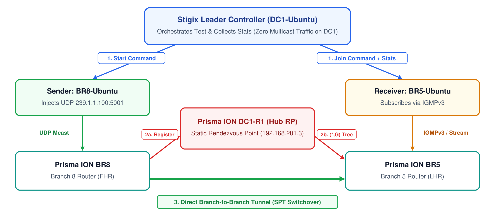
</p>

1. **`DC1` Only Gives the Orders**: `DC1-Ubuntu` tells `BR5-Ubuntu` to listen and `BR8-Ubuntu` to transmit. `DC1-Ubuntu` does not generate or receive any multicast traffic itself.
2. **Initial Meeting at the Hub RP (`*,G`)**:
   - `BR5` ION asks the Rendezvous Point (`DC1-R1`) for group `239.1.1.100`.
   - `BR8` ION receives the multicast stream from `BR8-Ubuntu` on its LAN and registers the stream with the Rendezvous Point (`DC1-R1`). The very first packets flow through `DC1-R1` to reach `BR5`.
3. **Automatic Switch to Direct Branch-to-Branch Tunnel (`SPT Switchover`)**:
   - Because **SPT Switchover** is enabled on Prisma SD-WAN, as soon as `BR5` ION receives the first packet, it sees that the real source is `BR8`.
   - `BR5` ION immediately builds a direct multicast path `(S,G)` over the dynamic branch-to-branch VPN tunnel between `BR8` and `BR5`, **bypassing the Data Center (`DC1`)** to reduce latency and save Hub bandwidth.

---

## 3. Step-by-Step Configuration Guide (`DC1` → `BR5`)

Below is the complete configuration used in our lab to validate multicast between `DC1` (`192.168.203.100`) and `BR5` (`192.168.217.5`).

<p align="center">
  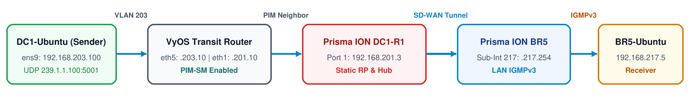
</p>

### 3.1 Step 1 — Configure the Multicast Test Profile in Stigix

In the Stigix Web Dashboard (**Custom Apps → Multicast Overlay**), create your test profile:

<p align="center">
  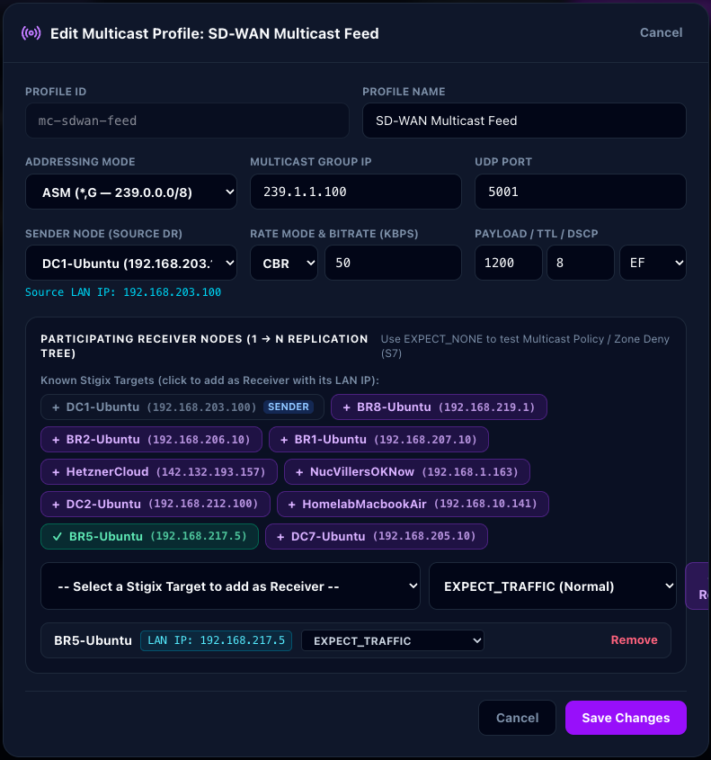
</p>

- **Mode**: `ASM (*,G — 239.0.0.0/8)` (uses the SD-WAN Rendezvous Point).
- **Group & Port**: `239.1.1.100` on UDP port `5001`.
- **Sender Node**: `DC1-Ubuntu (192.168.203.100)`.
- **Rate**: `CBR` at `50 kbps` (`1200 bytes` per packet, ~5 packets/second).
- **TTL & DSCP**: `TTL = 8` (must be greater than the number of routers on the path) and `DSCP = EF` (Real-Time Voice/Video priority).
- **Receiver Node**: `BR5-Ubuntu (192.168.217.5)` with expectation set to **`EXPECT_TRAFFIC`**.

---

### 3.2 Step 2 — Configure the Prisma SD-WAN Branch ION (`BR5`)

On the branch router (`BR5`), two settings are required so it listens to the local Receiver and requests the stream from the Hub:

#### A. Enable Multicast & IGMPv3 on the Branch LAN Interface
Go to **Interfaces → Port 3 → Sub-Interface (217) (`192.168.217.254/24`) → Advanced Settings**, set **Multicast** to **`Yes`**, and select **`IGMPv3`**:

<p align="center">
  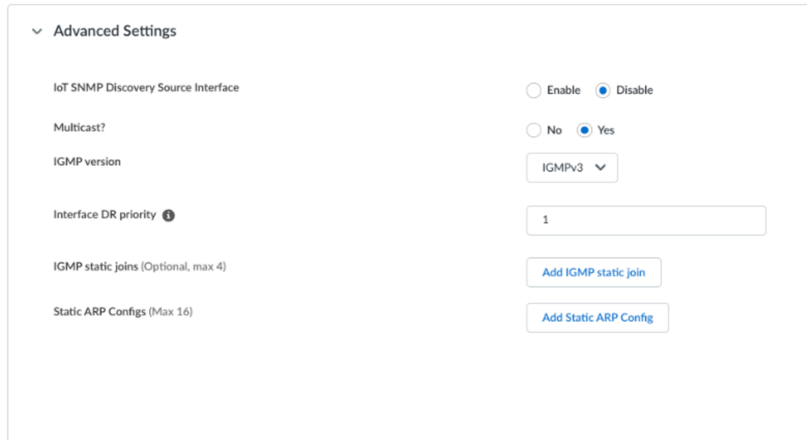
</p>

> [!TIP]
> **Why IGMPv3?** Modern Linux servers (Ubuntu 22.04 / 24.04) use **IGMPv3** by default when subscribing to a multicast group. Selecting `IGMPv3` on the Prisma SD-WAN LAN interface ensures the router immediately recognizes the subscription.

#### B. Point the Branch to the Rendezvous Point (RP)
Go to **Routing → Multicast → RP** and configure the Static RP address (`192.168.201.3`, which is `DC1-R1`'s LAN IP) for the multicast range `224.0.0.0/4`:

<p align="center">
  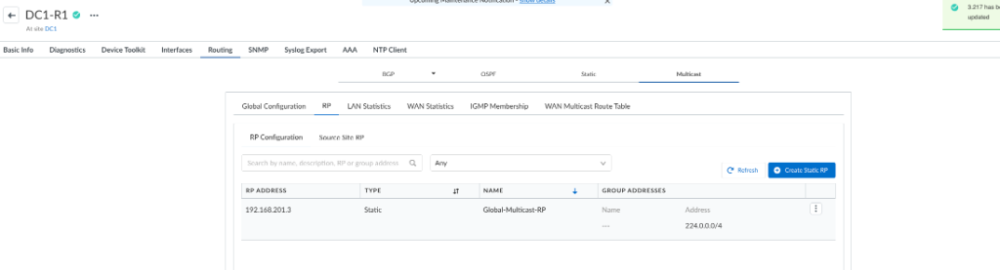
</p>

---

### 3.3 Step 3 — Configure the Prisma SD-WAN Hub ION (`DC1-R1`)

On the Data Center Hub router (`DC1-R1`), enable **Global Multicast**, **SPT Switchover**, and the **WAN Multicast Peer Group Profile**, and define the same Static RP (`192.168.201.3` for `224.0.0.0/4`):

<p align="center">
  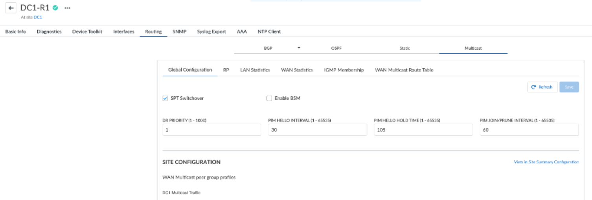
</p>

Also ensure that `DC1-R1`'s LAN interface (`Port 1`, `192.168.201.3/24`) has **Multicast (`Yes`)** and **PIM** enabled so it can receive multicast streams from the Data Center LAN.

---

### 3.4 Step 4 — Don't Forget Transit Routers in the Data Center (`VyOS` Example)

In many Data Centers, the server generating the multicast stream (`DC1-Ubuntu` in `192.168.203.0/24`) is not on the exact same subnet as the SD-WAN Hub (`DC1-R1` in `192.168.201.0/24`), with a core switch or router (`vyoslandc1`) sitting in between.

> [!WARNING]
> **Unicast routing (BGP/OSPF) does not forward multicast packets!**
> Even if `DC1-Ubuntu` can ping `DC1-R1`, the transit router (`vyoslandc1`) will silently drop multicast packets unless **PIM-SM** is enabled on both its incoming (`eth5`) and outgoing (`eth1`) interfaces.

Configuration required on the `vyoslandc1` router:
```bash
configure
set protocols pim interface eth5
set protocols pim interface eth1
set protocols pim rp address 192.168.201.3 group '224.0.0.0/4'
commit
save
```

Once applied, `vyoslandc1` establishes a PIM neighbor session with `DC1-R1` (`192.168.201.3`) and forwards the stream `(192.168.203.100, 239.1.1.100)` from `eth5` to `eth1`:
```text
vyos@vyoslandc1:~$ show ip pim neighbor
 Interface  Neighbor       Uptime    Holdtime  DR Pri
 eth1       192.168.201.3  00:00:42  00:01:33  1

vyos@vyoslandc1:~$ show ip multicast route
 Source           Group        Flags  Proto  Input  Output  TTL  Uptime
 192.168.203.100  239.1.1.100  SFT    PIM    eth5   eth1    1    00:01:13
```

---

## 4. Validating & Troubleshooting Multicast in Prisma SD-WAN and Stigix

### 4.1 Checking Prisma SD-WAN Tables (From Branch to Hub)

When a stream is running, you can verify the 3 stages of the multicast tree directly in the Prisma SD-WAN UI:

1. **On `BR5` — Did the branch router hear the local server's IGMP Join?**
   Check **Routing → Multicast → IGMP**. You should see `GROUP: 239.1.1.100` on `Sub-Interface (217) on Port 3` with `FORWARD?: Yes`:
   <p align="center">
     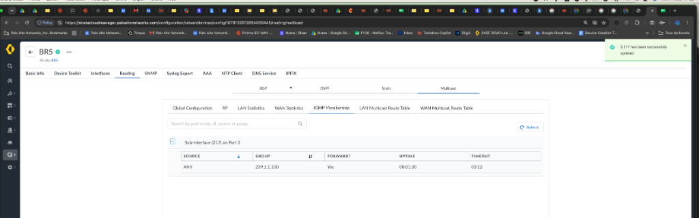
   </p>

2. **On `BR5` & `DC1-R1` — Did the branch request the stream over the SD-WAN WAN tunnel?**
   Check **Routing → Multicast → WAN Statistics**. You should see `Join Prune TX PKTS` incrementing on `BR5` and `Join Prune RX PKTS` incrementing on `DC1-R1`:
   <p align="center">
     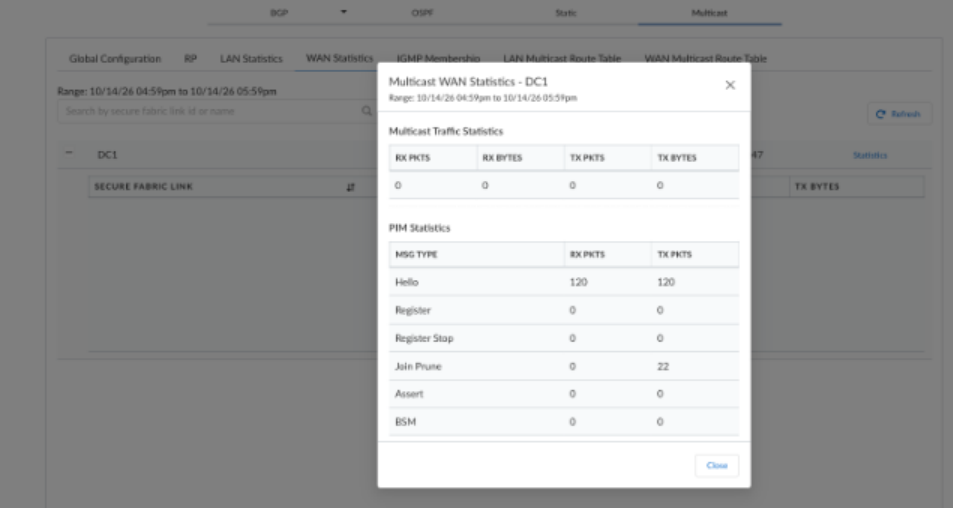
   </p>
   <p align="center">
     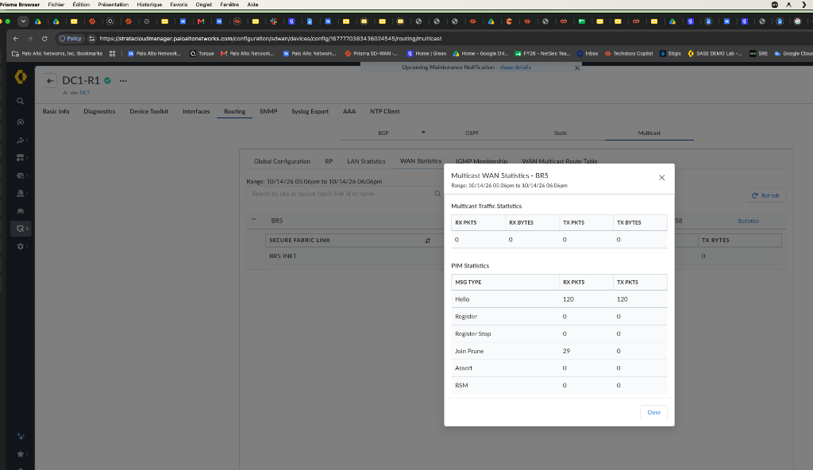
   </p>

3. **On `DC1-R1` & `BR5` — Is the WAN Multicast Route installed end-to-end?**
   Check **Routing → Multicast → WAN Multicast Route**.
   - On **`DC1-R1`**, `INCOMING` is `Port 1` (DC LAN) and `OUTGOING` is `Site name: BR5, Secure fabric: BR5-INET`:
     <p align="center">
       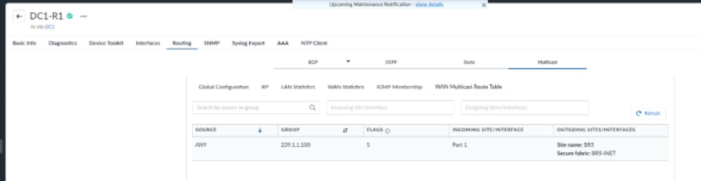
     </p>
   - On **`BR5`**, `INCOMING` is `Site name: DC1` and `OUTGOING` is `Sub-Interface (217) on Port 3`:
     <p align="center">
       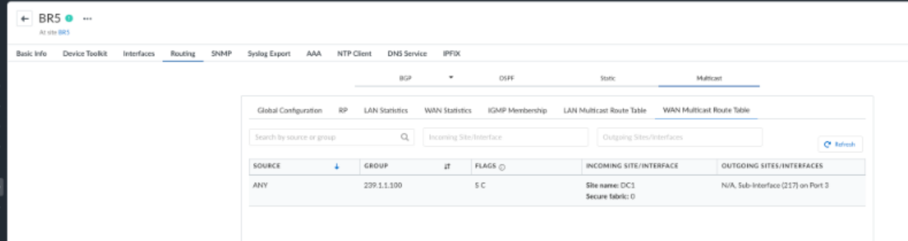
     </p>

---

### 4.2 Reading the Stigix Dashboard Verdicts

Stigix translates raw packet counters into three visual states so you immediately know the health of your multicast overlay:

#### 1. `OVERALL: HEALTHY` — End-to-End Replication Validated
All packets sent by `DC1-Ubuntu` (`584 SENT`) arrive at `BR5-Ubuntu` (`584/584 PKTS`, `0.00%` loss, `50 kbps` bitrate, `23.93 ms` jitter):

<p align="center">
  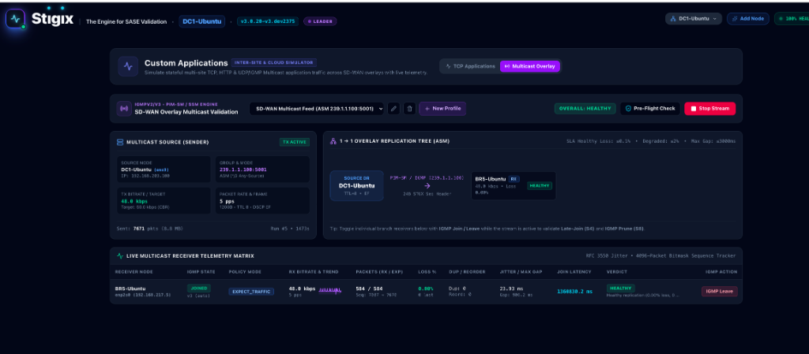
</p>

#### 2. `OVERALL: DEGRADED` — Packet Loss or Mid-Stream Interruption Detected
The stream reaches the branch, but packet loss exceeds the SLA threshold (e.g., `24.16%` loss or a `5571 ms` interruption gap during a routing change):

<p align="center">
  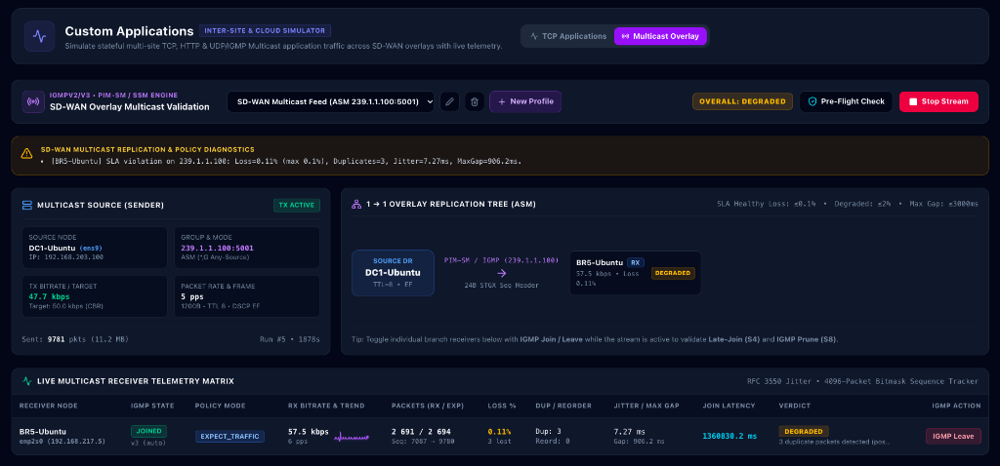
</p>

#### 3. `OVERALL: NO_TRAFFIC` / `FAILED` — Multicast Tree Blocked
The Sender is transmitting (`28 SENT`), and the Receiver is subscribed (`JOINED (v3)`), but **`0` packets arrive** at the branch (`0/0 PKTS`). Stigix automatically displays a **Diagnostics & SD-WAN Hints** banner listing the exact causes to check (RP reachability, PIM-SM on transit routers, IGMP version mismatch, or TTL):

<p align="center">
  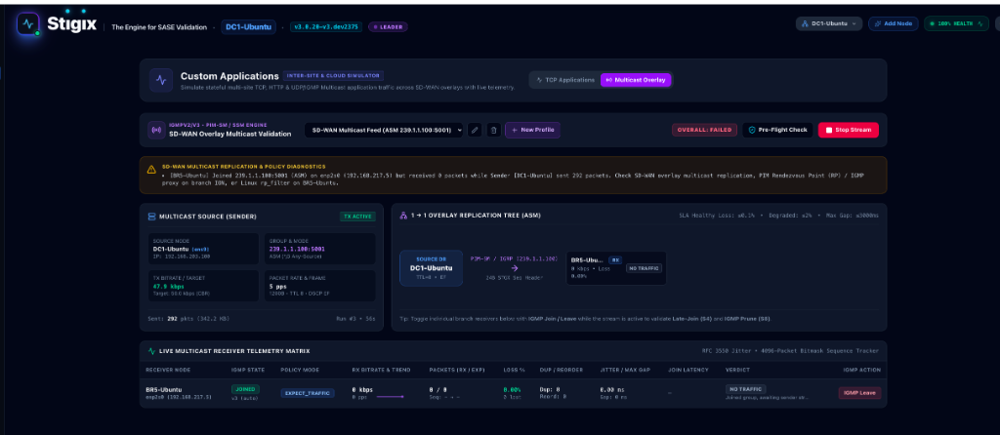
</p>

---

## Revision History

| Date | Version | Author | Description |
| :--- | :--- | :--- | :--- |
| 2026-10-14 | 1.0 | Stigix Engineering | Simplified, network-engineer-friendly White Paper covering Control Plane vs. Data Plane operation, Hub-to-Branch & Branch-to-Branch flows, Prisma SD-WAN + VyOS setup, and visual troubleshooting. |
